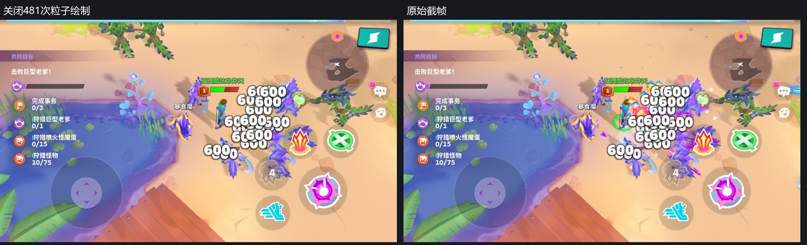
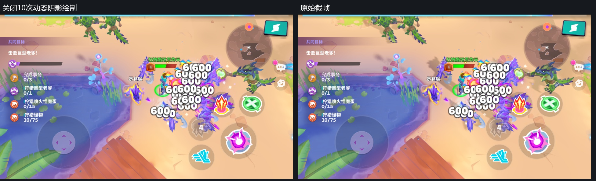

# moco · 截帧分析详细附录

分析日期：2026-10-20。返回[正文](moco-截帧分析.md)。原始RDC位于报告文件夹的上一级，不包含在分享压缩包中。

## 目录

1. [范围与计算口径](#范围与计算口径)
2. [目标和采样数](#目标和采样数)
3. [代表Shader证据](#代表shader证据)
   1. [GPU蒙皮](#gpu蒙皮)
   2. [颜色和环境参数](#颜色和环境参数)
   3. [粒子、文字与轮廓](#粒子文字与轮廓)
4. [同帧开关验证](#同帧开关验证)
5. [Shader绘制清单](#shader绘制清单)
6. [全部纹理清单](#全部纹理清单)

## 范围与计算口径

| 简称 | 文件 | 绘制次数 |
| --- | --- | --- |
| 入口 | moco_入口.rdc | 915 |
| 绿色战斗 | moco_战斗场景绿色.rdc | 581 |
| 暗色战斗 | moco_战斗场景暗色.rdc | 552 |
| 技能1 | moco_战斗场景亮绿+技能.rdc | 558 |
| 技能2 | moco_战斗场景亮绿+技能2.rdc | 801 |
| 技能3 | moco_战斗场景亮绿+技能3.rdc | 636 |

六份均为Vulkan，包含完整场景与UI，全部0次Compute Dispatch。入口、绿色和暗色位于不同位置，技能1／2／3也不是静态A/B。代表材质特化参数`rogue_lowend`均为0，但不能仅凭该参数替代游戏菜单来命名画质档位。

按目标用途、顶点输入、Shader算法和代表截图分类。骨骼分类包括所有带骨骼权重的网格，不等于玩家人数；粒子不包含UI数字，轮廓遮罩和合成单列。面数含实例、条带退化三角形与阴影等重复通道。GPU实际执行的顶点／片元数量可能不同。

## 目标和采样数

| 截帧 | 动态阴影 | 主颜色／解析颜色ID | 主深度ID | 显示颜色ID |
| --- | --- | --- | --- | --- |
| 入口 | 72711 · 1032×1312 D16 | 60536 / 60546 | 60541 | 6003 |
| 绿色战斗 | 211250 · 1240×728 D16 | 208306 / 208316 | 208311 | 5972 |
| 暗色战斗 | 252600 · 1144×680 D16 | 208306 / 208316 | 208311 | 5941 |
| 技能1 | 1550909 · 1088×488 D16 | 1540123 / 1540133 | 1540128 | 1484708 |
| 技能2 | 1587295 · 1088×496 D16 | 1540123 / 1540133 | 1540128 | 1484646 |
| 技能3 | 1554705 · 1088×496 D16 | 1540123 / 1540133 | 1540128 | 1484677 |

所有主颜色及深度都是960×540、4×；解析颜色960×540、1×；显示颜色1080×1920、1×。技能2原生RenderPass附件索引为颜色[0]、解析[1]、深度2，资源依次1540123、1540133、1540128。两张颜色资源是MSAA解析关系，并非G-buffer。

技能2主场景E127–E1862；E1884使用VS1495053／PS1495054单次采样显示拷贝，后续才是UI。不能用最后的显示图尺寸反推实际场景分辨率。

## 代表Shader证据

### GPU蒙皮

入口VS63079、技能2对应骨骼程序声明`boneTexture`、`a_boneindex`、`a_boneweights`、`a_skinningOffsets`。代表顶点布局为索引4×UInt8、打包权重1×UInt32，实例提供模型矩阵和骨骼表偏移。

地址：`索引 = 实例起始偏移 + 本地骨骼编号`，`x = 3 × (索引 % 256)`、`y = 索引 / 256`。读取(x,y)、(x+1,y)、(x+2,y)三组float4。第一影响先读；打包权重非0时再读另外三影响。没有前后动画帧的第二套矩阵查找。

绿色210008：768×2 RGBA32F，E17为CopyDst，之后供阴影和主场景顶点程序读取。暗色248873和技能2的1546508同样在E17上传。这支持本帧姿态表的用途，不能说明CPU状态机实现，更不能把表高当作动画帧数。

### 颜色和环境参数

入口PS15993、PS63085及技能帧同类代表程序启用`rogue_color_correction`、`rogue_colortransform`。颜色运算包含乘1.1、限幅到0～1.7、五次多项式压缩、围绕RGB平均值调整色差，最后约`pow(color, 0.4675)`。数值来自反汇编显示精度；这是嵌入物体材质的变换，不是另开HDR目标的整屏通道。

技能2环境图：`rpTex1`1539713为100×900 RGBA8，`rpTex2`1539716为100×200 RGBA16F；绿色207480为135×1152，207483为135×256。它们是按世界网格纵向排列的多组参数；不能当作普通颜色素材或骨骼图统计。128×32的`indirectLightingLookupTex`用于间接光照。

代表材质绑定静态／动态阴影、`lightMaskTex0…3`，并有动态灯位置、颜色、参数输入。绑定或特化启用不意味着所有物体的参数非零。动态图在本帧生成；静态阴影图的生成过程没有出现在这六帧中。

### 粒子、文字与轮廓

| 用途 | 技能2代表程序 | 算法摘要 |
| --- | --- | --- |
| 单纹理粒子 | VS1494846 / PS1494847 | 图集1次采样＋顶点乘色、Alpha和附加色 |
| 渐变粒子 | VS1496707 / PS1496708 | 基础采样＋渐变图采样；渐变行由顶点输入选择 |
| 轮廓合成 | E1136 / PS1508271 | R8遮罩中心＋周围8方向，局部颜色／Alpha合成 |
| SDF文字 | PS1487427 | 距离场通道、曲线参数、fwidth屏幕导数 |

纹理统计用“本帧绑定”口径，可能包含默认占位或被特化开关跳过的输入。预乘Alpha为One / OneMinusSrcAlpha，加法为One / One，调制为DstColor / OneMinusSrcAlpha；混合状态不会增加Shader纹理采样点。

## 同帧开关验证

原始RDC只读。独立副本将指定绘制实例数设0；原样转换副本与原始输出逐字节一致，排除了转换造成的画面变化。比较最终1080×1920输出的RGB三通道，像素变化数不是性能数据。

| 验证 | 关闭绘制数 | 改变RGB像素数 | 与原始逐字节相同 |
| --- | --- | --- | --- |
| 原样副本 | 0 | 0 | 是 |
| 关闭粒子 | 481 | 281,918 | 否 |
| 关闭动态阴影 | 10 | 161,223 | 否 |
| 关闭轮廓合成 | 1 | 10,647 | 否 |

| 粒子开关全景 | 动态阴影开关全景 |
| --- | --- |
|  |  |

完整事件列表和输出哈希见[同帧验证数据](同帧验证.json)。这是渲染回放诊断，不是游戏内画质设置或帧率A/B测试。

## Shader绘制清单

以VS／PS模块组合分组，同一组合可以更换纹理、材质参数及混合状态。EID只在对应RDC有效。同类效果不逐个重复解释。

### 入口

| VS / PS | 绘制次 | 首末EID | 用途 |
| --- | --- | --- | --- |
| 61859 / 61860 | 223 | 1786～2537 | 粒子与平面特效 |
| 16001 / 16002 | 92 | 404～1535 | 场景模型 |
| 63116 / 63117 | 79 | 64～372 | 动态阴影 |
| 6130 / 8803 | 58 | 2592～3007 | UI与文字 |
| 16034 / 16036 | 52 | 451～2053 | 场景模型 |
| 61842 / 61845 | 49 | 1783～2548 | 粒子与平面特效 |
| 63079 / 63085 | 43 | 638～850 | 骨骼模型 |
| 16023 / 16024 | 41 | 522～1772 | 场景模型 |
| 6130 / 6131 | 41 | 2578～3022 | UI与文字 |
| 8197 / 8198 | 33 | 2580～3019 | UI与文字 |
| 16008 / 16010 | 32 | 1195～1318 | 场景模型 |
| 15991 / 15993 | 28 | 398～1065 | 场景模型 |
| 6096 / 6108 | 26 | 2585～3001 | UI与文字 |
| 16028 / 16029 | 16 | 413～1325 | 场景模型 |
| 63094 / 63096 | 12 | 873～945 | 骨骼模型 |
| 63110 / 63111 | 12 | 1956～2005 | 骨骼模型 |
| 65873 / 65875 | 9 | 548～926 | 骨骼模型 |
| 16041 / 16043 | 9 | 1187～1251 | 场景模型 |
| 14926 / 14927 | 9 | 2588～3016 | UI与文字 |
| 16015 / 16016 | 8 | 439～1336 | 场景模型 |
| 60574 / 60528 | 6 | 39～59 | 动态阴影 |
| 60595 / 16036 | 6 | 539～2011 | 骨骼模型 |
| 63089 / 63093 | 5 | 591～962 | 骨骼模型 |
| 61621 / 16024 | 4 | 857～2026 | 骨骼模型 |
| 14922 / 14923 | 4 | 2796～2974 | UI与文字 |
| 66061 / 66063 | 2 | 607～951 | 骨骼模型 |
| 63101 / 63102 | 2 | 863～867 | 骨骼模型 |
| 88209 / 88210 | 2 | 968～971 | 骨骼模型 |
| 69188 / 69190 | 2 | 2032～2037 | 骨骼模型 |
| 14929 / 14930 | 2 | 2964～2966 | UI与文字 |
| 16091 / 16093 | 1 | 528～528 | 场景模型 |
| 60592 / 16002 | 1 | 535～535 | 骨骼模型 |
| 65885 / 65888 | 1 | 584～584 | 骨骼模型 |
| 63087 / 63088 | 1 | 632～632 | 骨骼模型 |
| 67383 / 67384 | 1 | 932～932 | 骨骼模型 |
| 88212 / 88213 | 1 | 976～976 | 骨骼模型 |
| 60589 / 60590 | 1 | 1778～1778 | 场景模型 |
| 60558 / 60559 | 1 | 2570～2570 | 场景放大与转向 |

### 绿色战斗

| VS / PS | 绘制次 | 首末EID | 用途 |
| --- | --- | --- | --- |
| 16023 / 16024 | 111 | 124～1217 | 场景模型 |
| 16041 / 16043 | 100 | 340～614 | 场景模型 |
| 61859 / 61860 | 63 | 1357～1542 | 粒子与平面特效 |
| 208196 / 208199 | 35 | 1120～1206 | 场景模型 |
| 16008 / 16010 | 33 | 397～688 | 场景模型 |
| 208203 / 208205 | 31 | 1224～1302 | 场景模型 |
| 16015 / 16016 | 29 | 111～758 | 场景模型 |
| 6130 / 8803 | 28 | 1573～1815 | UI与文字 |
| 8197 / 8198 | 28 | 1614～1863 | UI与文字 |
| 6130 / 6131 | 22 | 1578～1866 | UI与文字 |
| 16108 / 16110 | 17 | 153～1114 | 场景模型 |
| 63116 / 63117 | 11 | 46～85 | 动态阴影 |
| 16072 / 16074 | 11 | 1310～1340 | 场景模型 |
| 6096 / 6108 | 11 | 1585～1823 | UI与文字 |
| 14922 / 14923 | 8 | 1637～1826 | UI与文字 |
| 63060 / 63061 | 7 | 256～287 | 骨骼模型 |
| 14926 / 14927 | 7 | 1709～1860 | UI与文字 |
| 208344 / 208345 | 5 | 226～241 | 场景模型 |
| 61842 / 61845 | 4 | 1503～1537 | 粒子与平面特效 |
| 60574 / 60528 | 2 | 39～41 | 动态阴影 |
| 72262 / 72264 | 2 | 299～302 | 骨骼模型 |
| 16001 / 16002 | 2 | 765～1352 | 场景模型 |
| 209522 / 209524 | 2 | 1491～1494 | 骨骼模型 |
| 14929 / 14930 | 2 | 1850～1852 | UI与文字 |
| 60595 / 16036 | 1 | 207～207 | 骨骼模型 |
| 61621 / 16024 | 1 | 211～211 | 骨骼模型 |
| 65756 / 65757 | 1 | 250～250 | 骨骼模型 |
| 63068 / 63070 | 1 | 293～293 | 骨骼模型 |
| 16131 / 16133 | 1 | 311～311 | 场景模型 |
| 208189 / 208190 | 1 | 1344～1344 | 场景模型 |
| 63076 / 63077 | 1 | 1485～1485 | 骨骼模型 |
| 60558 / 60559 | 1 | 1564～1564 | 场景放大与转向 |
| 207528 / 207529 | 1 | 1608～1608 | UI与文字 |
| 8197 / 60571 | 1 | 1672～1672 | UI与文字 |

### 暗色战斗

| VS / PS | 绘制次 | 首末EID | 用途 |
| --- | --- | --- | --- |
| 16023 / 16024 | 107 | 208～1027 | 场景模型 |
| 61859 / 61860 | 63 | 1100～1298 | 粒子与平面特效 |
| 6130 / 8803 | 54 | 1359～1868 | UI与文字 |
| 8197 / 8198 | 46 | 1339～1871 | UI与文字 |
| 6130 / 6131 | 46 | 1349～1874 | UI与文字 |
| 16015 / 16016 | 38 | 159～608 | 场景模型 |
| 208212 / 208213 | 27 | 947～1016 | 场景模型 |
| 208196 / 208199 | 21 | 379～941 | 场景模型 |
| 6096 / 6108 | 18 | 1345～1829 | UI与文字 |
| 208203 / 208205 | 15 | 385～1083 | 场景模型 |
| 16041 / 16043 | 15 | 509～540 | 场景模型 |
| 14922 / 14923 | 15 | 1373～1832 | UI与文字 |
| 63116 / 63117 | 14 | 39～101 | 动态阴影 |
| 16108 / 16110 | 12 | 337～882 | 场景模型 |
| 208223 / 208224 | 11 | 1020～1052 | 场景模型 |
| 14926 / 14927 | 7 | 1715～1862 | UI与文字 |
| 60527 / 60528 | 5 | 56～64 | 动态阴影 |
| 63079 / 63085 | 5 | 406～435 | 骨骼模型 |
| 65873 / 65875 | 5 | 439～459 | 骨骼模型 |
| 16131 / 16133 | 4 | 149～486 | 场景模型 |
| 61842 / 61845 | 4 | 1243～1273 | 粒子与平面特效 |
| 8197 / 60571 | 4 | 1642～1680 | UI与文字 |
| 65756 / 65757 | 2 | 396～399 | 骨骼模型 |
| 209503 / 209516 | 2 | 1231～1234 | 骨骼模型 |
| 14929 / 14930 | 2 | 1852～1854 | UI与文字 |
| 217932 / 217933 | 1 | 123～123 | 轮廓遮罩 |
| 63060 / 63061 | 1 | 423～423 | 骨骼模型 |
| 63094 / 63096 | 1 | 465～465 | 骨骼模型 |
| 208797 / 208798 | 1 | 472～472 | 骨骼模型 |
| 16072 / 16074 | 1 | 1091～1091 | 场景模型 |
| 208189 / 208190 | 1 | 1095～1095 | 场景模型 |
| 217928 / 217929 | 1 | 1217～1217 | 轮廓合成 |
| 63110 / 63111 | 1 | 1225～1225 | 骨骼模型 |
| 60558 / 60559 | 1 | 1331～1331 | 场景放大与转向 |
| 207528 / 207529 | 1 | 1610～1610 | UI与文字 |

### 技能1

| VS / PS | 绘制次 | 首末EID | 用途 |
| --- | --- | --- | --- |
| 1494042 / 1494043 | 128 | 212～870 | 场景模型 |
| 1494846 / 1494847 | 125 | 967～1344 | 粒子与平面特效 |
| 1484845 / 1487427 | 44 | 1379～1777 | UI与文字 |
| 1486874 / 1486875 | 43 | 1395～1832 | UI与文字 |
| 1484845 / 1484846 | 39 | 1375～1835 | UI与文字 |
| 1494070 / 1494071 | 31 | 254～928 | 场景模型 |
| 1495042 / 1495044 | 30 | 45～162 | 动态阴影 |
| 1484829 / 1484831 | 20 | 1390～1786 | UI与文字 |
| 1496707 / 1496708 | 14 | 1006～1246 | 粒子与平面特效 |
| 1493221 / 1493222 | 13 | 1393～1789 | UI与文字 |
| 1495029 / 1495030 | 11 | 340～391 | 骨骼模型 |
| 1494013 / 1494018 | 10 | 247～886 | 场景模型 |
| 1495032 / 1495033 | 8 | 403～443 | 骨骼模型 |
| 1493227 / 1493228 | 7 | 1645～1823 | UI与文字 |
| 1494056 / 1494057 | 5 | 935～943 | 场景模型 |
| 1494115 / 1494116 | 3 | 305～950 | 场景模型 |
| 1495026 / 1495027 | 3 | 397～454 | 骨骼模型 |
| 1495039 / 1495040 | 3 | 1098～1106 | 骨骼模型 |
| 1508274 / 1508275 | 2 | 184～186 | 轮廓遮罩 |
| 1494105 / 1494106 | 2 | 285～289 | 场景模型 |
| 1494060 / 1494062 | 2 | 295～299 | 场景模型 |
| 1494108 / 1494109 | 2 | 316～320 | 场景模型 |
| 1497788 / 1497790 | 2 | 424～460 | 骨骼模型 |
| 1493230 / 1493231 | 2 | 1813～1815 | UI与文字 |
| 1494111 / 1494112 | 1 | 325～325 | 场景模型 |
| 1494118 / 1494119 | 1 | 331～331 | 场景模型 |
| 1524024 / 1524025 | 1 | 466～466 | 骨骼模型 |
| 1494024 / 1494025 | 1 | 958～958 | 场景模型 |
| 1494045 / 1494046 | 1 | 962～962 | 场景模型 |
| 1508270 / 1508271 | 1 | 1090～1090 | 轮廓合成 |
| 1495053 / 1495054 | 1 | 1367～1367 | 场景放大与转向 |
| 1493217 / 1493218 | 1 | 1500～1500 | UI与文字 |
| 1486874 / 1495064 | 1 | 1566～1566 | UI与文字 |

### 技能2

| VS / PS | 绘制次 | 首末EID | 用途 |
| --- | --- | --- | --- |
| 1494846 / 1494847 | 423 | 652～1862 | 粒子与平面特效 |
| 1494042 / 1494043 | 110 | 127～585 | 场景模型 |
| 1496707 / 1496708 | 58 | 726～1825 | 粒子与平面特效 |
| 1484845 / 1487427 | 56 | 1896～2322 | UI与文字 |
| 1486874 / 1486875 | 36 | 1914～2325 | UI与文字 |
| 1484845 / 1484846 | 31 | 1892～2328 | UI与文字 |
| 1484829 / 1484831 | 14 | 1907～2271 | UI与文字 |
| 1493221 / 1493222 | 12 | 1912～2274 | UI与文字 |
| 1495042 / 1495044 | 9 | 39～70 | 动态阴影 |
| 1493227 / 1493228 | 8 | 2124～2316 | UI与文字 |
| 1494070 / 1494071 | 7 | 600～613 | 场景模型 |
| 1494056 / 1494057 | 5 | 620～628 | 场景模型 |
| 1495029 / 1495030 | 4 | 191～207 | 骨骼模型 |
| 1495032 / 1495033 | 4 | 219～233 | 骨骼模型 |
| 1493230 / 1493231 | 3 | 2298～2308 | UI与文字 |
| 1508274 / 1508275 | 2 | 97～101 | 轮廓遮罩 |
| 1494115 / 1494116 | 2 | 160～635 | 场景模型 |
| 1494118 / 1494119 | 2 | 166～170 | 场景模型 |
| 1494013 / 1494018 | 2 | 591～593 | 场景模型 |
| 1494236 / 1494237 | 1 | 75～75 | 动态阴影 |
| 1494060 / 1494062 | 1 | 154～154 | 场景模型 |
| 1495016 / 1495017 | 1 | 179～179 | 骨骼模型 |
| 1495013 / 1495014 | 1 | 184～184 | 骨骼模型 |
| 1495026 / 1495027 | 1 | 213～213 | 骨骼模型 |
| 1552172 / 1552174 | 1 | 239～239 | 场景模型 |
| 1494024 / 1494025 | 1 | 643～643 | 场景模型 |
| 1494045 / 1494046 | 1 | 647～647 | 场景模型 |
| 1508270 / 1508271 | 1 | 1136～1136 | 轮廓合成 |
| 1495039 / 1495040 | 1 | 1144～1144 | 骨骼模型 |
| 1495053 / 1495054 | 1 | 1884～1884 | 场景放大与转向 |
| 1493217 / 1493218 | 1 | 1970～1970 | UI与文字 |
| 1486874 / 1495064 | 1 | 2011～2011 | UI与文字 |

### 技能3

| VS / PS | 绘制次 | 首末EID | 用途 |
| --- | --- | --- | --- |
| 1494846 / 1494847 | 140 | 876～1517 | 粒子与平面特效 |
| 1494042 / 1494043 | 127 | 155～779 | 场景模型 |
| 1496707 / 1496708 | 72 | 940～1509 | 粒子与平面特效 |
| 1484845 / 1487427 | 62 | 1551～2079 | UI与文字 |
| 1484845 / 1484846 | 46 | 1547～2070 | UI与文字 |
| 1486874 / 1486875 | 41 | 1573～2067 | UI与文字 |
| 1494070 / 1494071 | 31 | 195～837 | 场景模型 |
| 1495042 / 1495044 | 17 | 34～97 | 动态阴影 |
| 1484829 / 1484831 | 17 | 1568～2073 | UI与文字 |
| 1493221 / 1493222 | 15 | 1571～2024 | UI与文字 |
| 1494013 / 1494018 | 10 | 188～795 | 场景模型 |
| 1493227 / 1493228 | 9 | 1824～2058 | UI与文字 |
| 1495032 / 1495033 | 8 | 323～357 | 骨骼模型 |
| 1495029 / 1495030 | 6 | 285～311 | 骨骼模型 |
| 1494056 / 1494057 | 5 | 844～852 | 场景模型 |
| 1494115 / 1494116 | 3 | 246～859 | 场景模型 |
| 1493230 / 1493231 | 3 | 1819～2050 | UI与文字 |
| 1494105 / 1494106 | 2 | 226～230 | 场景模型 |
| 1494060 / 1494062 | 2 | 236～240 | 场景模型 |
| 1494108 / 1494109 | 2 | 257～261 | 场景模型 |
| 1494118 / 1494119 | 2 | 272～276 | 场景模型 |
| 1495026 / 1495027 | 2 | 317～363 | 骨骼模型 |
| 1495039 / 1495040 | 2 | 1270～1274 | 骨骼模型 |
| 1486874 / 1495064 | 2 | 1739～1759 | UI与文字 |
| 1494236 / 1494237 | 1 | 102～102 | 动态阴影 |
| 1508274 / 1508275 | 1 | 129～129 | 轮廓遮罩 |
| 1494111 / 1494112 | 1 | 266～266 | 场景模型 |
| 1524024 / 1524025 | 1 | 369～369 | 骨骼模型 |
| 1552172 / 1552174 | 1 | 375～375 | 场景模型 |
| 1494024 / 1494025 | 1 | 867～867 | 场景模型 |
| 1494045 / 1494046 | 1 | 871～871 | 场景模型 |
| 1508270 / 1508271 | 1 | 1262～1262 | 轮廓合成 |
| 1495053 / 1495054 | 1 | 1539～1539 | 场景放大与转向 |
| 1493217 / 1493218 | 1 | 1697～1697 | UI与文字 |

## 全部纹理清单

[全部纹理清单.csv](全部纹理清单.csv)列出六份捕获的每张纹理：捕获名、ID、宽高、Mip层数、格式、采样数、逻辑字节、原始RenderDoc描述字节、绑定用途和Shader绑定名。CSV为UTF-8带BOM，可用Excel打开。

[统计数据](统计数据.json)保留绘制分类、目标分段、纹理角色及容量结果。逻辑容量按逐Mip像素数×格式字节×数组层×样本数计算，不使用RDC文件大小，也不把驱动对齐容量等同手机进程内存。

压缩格式结论只覆盖这些捕获中的GPU资源；未识别整屏通道的结论也只限这六帧，不扩展到游戏所有场景、档位和设备。
