# moco · 六份截帧分析

分析日期：2026-10-20。范围：入口、绿色战斗、暗色战斗，以及三份亮绿场景技能截帧；接口为 Vulkan。六份均完整包含游戏场景与 UI。

**核心做法：半分辨率 3D 场景＋4× MSAA＋全分辨率 UI；运行时骨骼矩阵纹理驱动蒙皮；静态／动态阴影、环境光照数据纹理和粒子图集共同构成画面。** 技能2主要多在粒子绘制，入口则包含较多角色与阴影。

这些文件是不同场景／战斗时刻，**不能当作高低画质档位对照**。正文保留代表模型和关键功能，完整 Shader 分组、纹理清单及验证口径见[详细附录](moco-截帧分析-详细附录.md)。

## 目录

1. [总览与六帧对比](#总览与六帧对比)
   1. [绘制数量与构成](#绘制数量与构成)
   2. [场景和技能画面](#场景和技能画面)
2. [渲染流程与基础配置](#渲染流程与基础配置)
   1. [分辨率、MSAA与UI](#分辨率msaa与ui)
   2. [阴影与局部轮廓](#阴影与局部轮廓)
   3. [颜色处理与整屏后处理](#颜色处理与整屏后处理)
3. [普通模型与材质规范](#普通模型与材质规范)
4. [骨骼动画方案](#骨骼动画方案)
   1. [矩阵纹理如何使用](#矩阵纹理如何使用)
   2. [容量和实例合批](#容量和实例合批)
5. [粒子与特效](#粒子与特效)
   1. [功能和绘制数量](#功能和绘制数量)
   2. [两个代表例子](#两个代表例子)
6. [贴图规格、Mip与容量](#贴图规格mip与容量)
   1. [分类规范](#分类规范)
   2. [纹理容量口径](#纹理容量口径)

## 总览与六帧对比

### 绘制数量与构成

| 指标 | 入口 | 绿色战斗 | 暗色战斗 | 技能1 | 技能2 | 技能3 |
| --- | --- | --- | --- | --- | --- | --- |
| 整帧绘制次数 | 915 | 581 | 552 | 558 | 801 | 636 |
| 主场景绘制次数 | 656 | 459 | 338 | 355 | 626 | 420 |
| 提交三角形（含实例及重复通道） | 639,681 | 239,173 | 285,329 | 296,607 | 237,257 | 258,887 |
| 绑定纹理数／其中有Mip | 165 / 134 | 47 / 23 | 67 / 41 | 91 / 56 | 63 / 27 | 81 / 46 |

三角形按 Triangle List 的索引数÷3、Triangle Strip 的顶点／索引数−2计算，乘实例数；包含条带退化三角形、不可见提交、阴影和轮廓重复绘制，并非唯一模型面数。绘制次数也不等于对象数或 GPU 耗时。

| 绘制分类（次） | 入口 | 绿色战斗 | 暗色战斗 | 技能1 | 技能2 | 技能3 |
| --- | --- | --- | --- | --- | --- | --- |
| 场景模型 | 280 | 376 | 252 | 187 | 132 | 188 |
| 骨骼模型 | 104 | 16 | 18 | 28 | 12 | 19 |
| 动态阴影 | 85 | 13 | 19 | 30 | 10 | 18 |
| 粒子与平面特效 | 272 | 67 | 67 | 139 | 481 | 212 |
| 轮廓遮罩 | 0 | 0 | 1 | 2 | 2 | 1 |
| 轮廓合成 | 0 | 0 | 1 | 1 | 1 | 1 |
| UI与文字 | 173 | 108 | 193 | 170 | 162 | 196 |
| 场景放大与转向 | 1 | 1 | 1 | 1 | 1 | 1 |

**技能2共801次绘制，其中481次是粒子，占整帧约60.0%、主场景约76.8%。** 入口有104次骨骼模型、85次动态阴影，二者合计约53.2万次三角形提交。两类负担不同，不能直接用总 Draw 数给实际帧率排名。

### 场景和技能画面

| 入口 | 绿色战斗 | 暗色战斗 |
| --- | --- | --- |
| 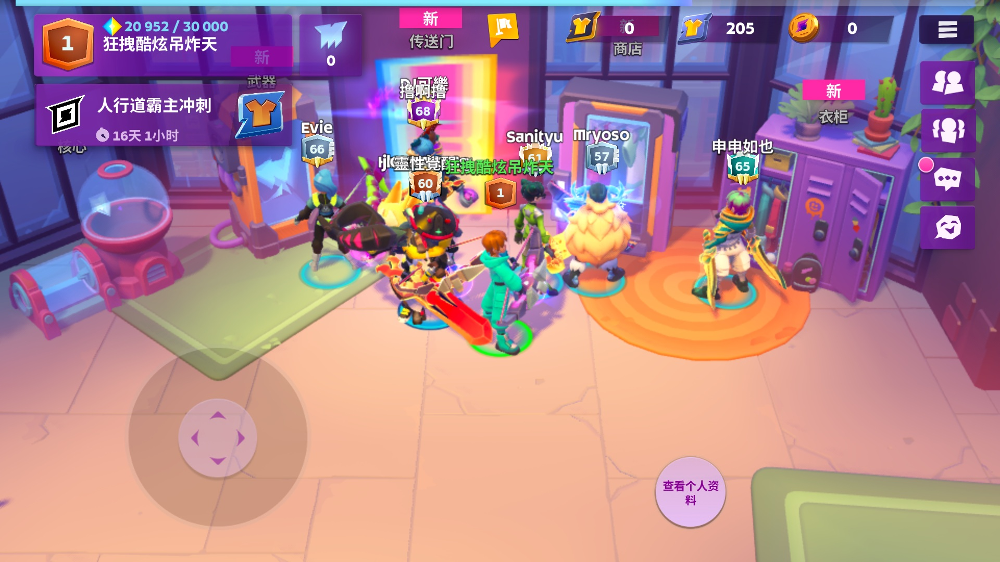 | 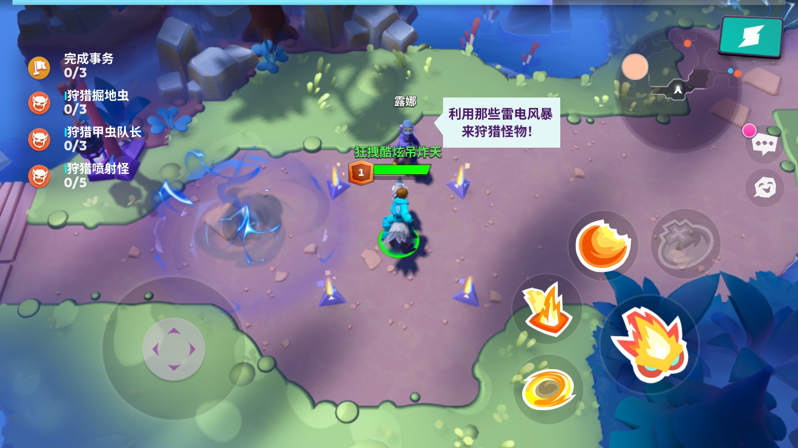 | 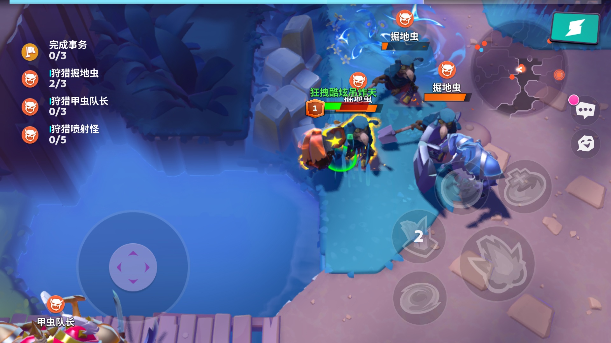 |

| 亮绿＋技能1 | 亮绿＋技能2 | 亮绿＋技能3 |
| --- | --- | --- |
| 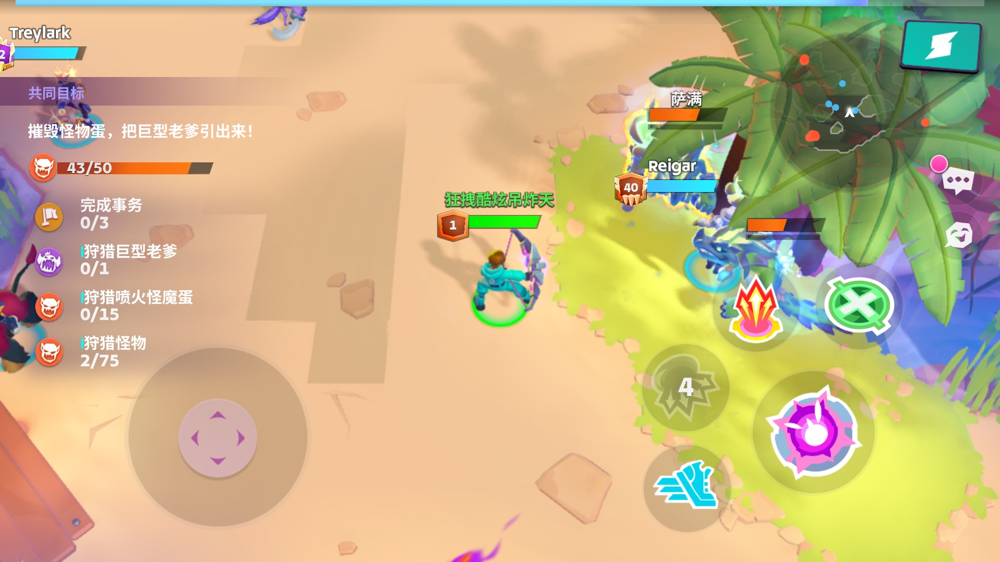 | 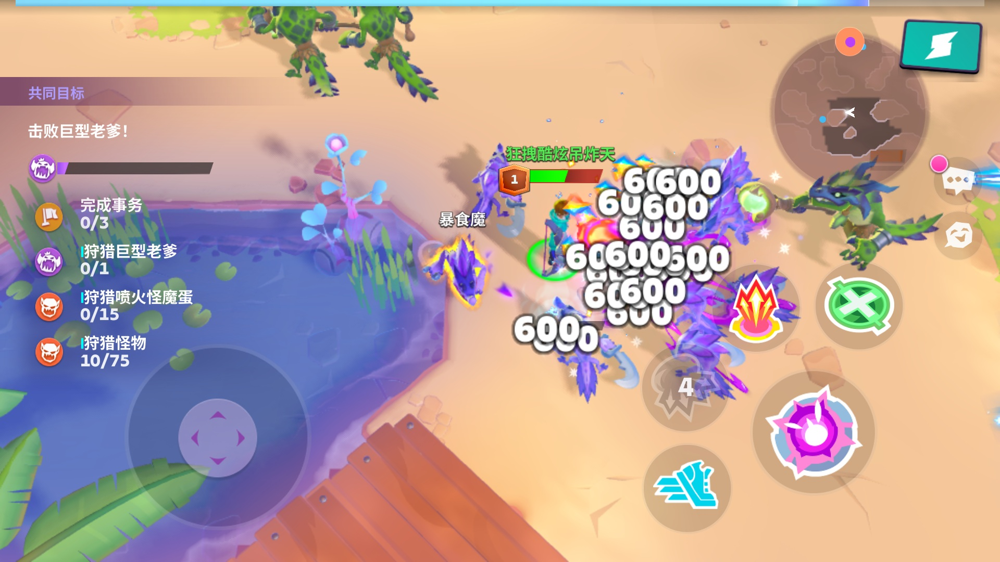 | 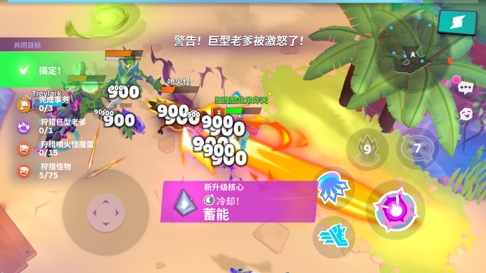 |

三份技能帧的粒子数为139、481、212，但镜头位置、怪物分布、动作和技能阶段也在变化。这是三个时刻的实际工作量，不是开启某个技能后的严格增量测试。

## 渲染流程与基础配置

### 分辨率、MSAA与UI

**六帧都是：场景960×540 → 4× MSAA解析到960×540单采样颜色图 → 放大并转向 → 横屏1920×1080 UI。场景宽高为显示画面的0.5，像素数为25%；UI没有跟着降为半分辨率。** 捕获的显示附件存为1080×1920，按横屏方向阅读就是1920×1080。

这是渲染目标尺寸，不能据此说游戏修改了系统 DPI。4× MSAA增加覆盖／深度采样，不等于把场景材质计算强制做四遍；代表流水线的 sample shading 为关闭。

| 阶段 | 输出／功能 | 六帧情况 |
| --- | --- | --- |
| 动态阴影 | D16单采样深度图 | 本帧重绘，尺寸随场景变化 |
| 轮廓遮罩 | 小尺寸R8图 | 暗色、技能1／2／3存在；入口和绿色帧没有此通道 |
| 3D场景 | BGRA8颜色＋D24S8深度，均4× MSAA | 模型、材质特效和粒子在此绘制 |
| MSAA解析 | 同尺寸单采样BGRA8 | RenderPass解析附件，不是第二张G-buffer |
| 显示与UI | RGBA8单采样目标 | 先放大场景，再绘图标、文字和伤害数字 |

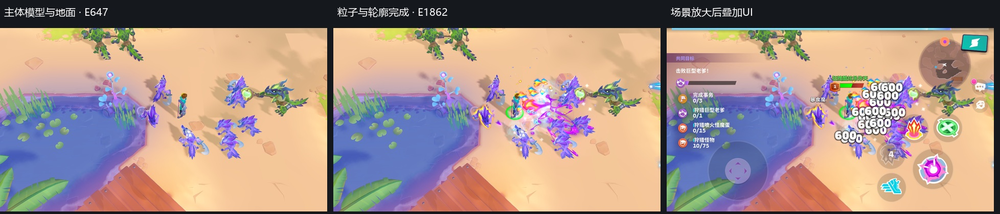

### 阴影与局部轮廓

**静态阴影与动态阴影都有。** 代表材质同时读取 `staticShadowmap` 与 `shadowmap`；动态图先绘制角色等投影物，再供场景采样。静态图是离线制作、进入地图时生成还是跨帧缓存，单帧无法区分。

技能2：动态阴影10次绘制，D16图1088×496；静态阴影图2048×1392。独立副本只关闭这10次动态阴影后，最终161,223个RGB像素变化，人物／怪物投影明显减少。

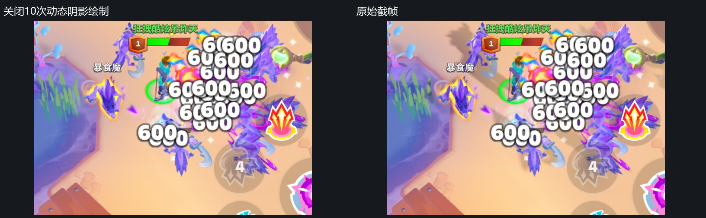

**黄色怪物轮廓采用遮罩扩展方案。** 技能2先用2次绘制把选中网格画入352×192的R8遮罩，再用1次局部合成取中心及周围8个方向的样本，生成彩色外轮廓。遮罩值还受模型高度影响。它是局部图像处理，不是法线外扩描边或整屏Bloom。

| 轮廓遮罩（灰度显示） | 同帧关闭／开启轮廓 |
| --- | --- |
| 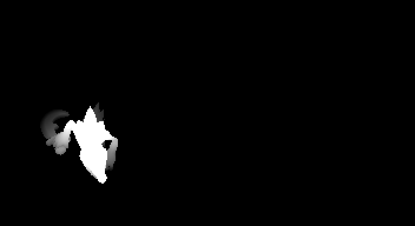 | 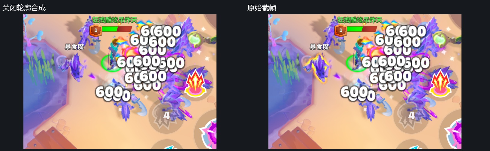 |

关闭合成E1136后，最终10,647个RGB像素变化。这里是诊断副本的绘制开关，不代表游戏提供独立设置。

### 颜色处理与整屏后处理

| 项目 | 本次结论 | 依据 |
| --- | --- | --- |
| MSAA | **明确使用4×** | 颜色／深度资源及流水线均为4采样 |
| UI文字边缘 | SDF距离场软化 | 字体Shader有距离场曲线和 `fwidth` 屏幕导数 |
| 局部轮廓 | **明确存在** | R8遮罩＋邻域采样合成＋同帧开关 |
| 材质内色调和颜色处理 | **明确存在** | 代表材质有亮度缩放、非线性压缩、饱和度调整及Gamma类幂运算 |
| 雾／环境色 | 材质内处理 | 根据位置和环境参数着色；部分具体物体的系数可为0 |
| Bloom、SSAO、景深、运动模糊 | 未识别到独立整屏链 | 六帧没有对应提取／模糊／合成链 |
| FXAA、SMAA、TAA | 未识别到专用通道 | 最后的场景放大Shader仅单次采样；没有历史重投影链 |
| 全屏LUT调色 | 未识别到 | 128×32彩色查找图用于间接光照，不应误认成最终画面LUT |

准确表述是：**未发现常见整屏后处理链，但存在4× MSAA、局部轮廓处理和材质内颜色处理。** 主场景是8位颜色目标，不能因材质内部出现大于1的值，就把整条管线称为HDR后处理。

## 普通模型与材质规范

面数均为**单次网格／部件、单实例**，不把阴影和重复实例加进去。

| 代表资源 | 面数 | 基础说明 |
| --- | --- | --- |
| 青色人物身体 · 绿色E272 | 6,240 | 不含头部、背部等其他部件；GPU蒙皮 |
| 紫色怪物主体 · 技能2 E179 | 3,984 | 当前一次绘制3实例，另有附属部件 |
| 粉色植物 · 技能2 E154 | 2,768 | 普通3D网格 |
| 岩石块 · 绿色E153 | 968 | 普通3D网格 |
| 草丛组 · 绿色E311 | 702 | 当前2实例 |
| 地面／覆盖片代表 · 技能2 E647 | 2／实例 | 当前34实例，重复方片拼接覆盖 |

| 人物身体 | 怪物主体 | 植物 | 岩石 |
| --- | --- | --- | --- |
| 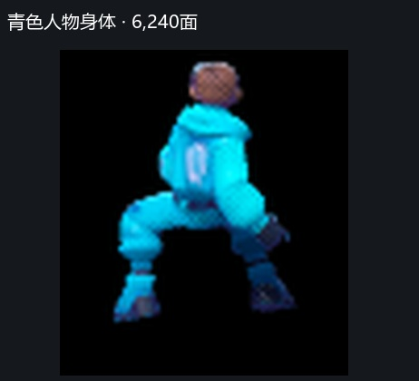 | 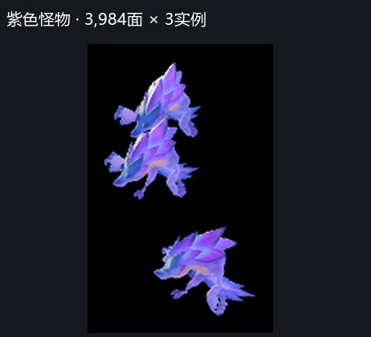 | 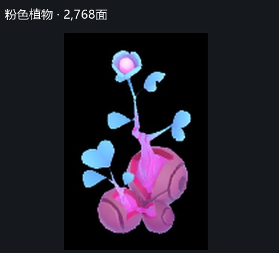 | 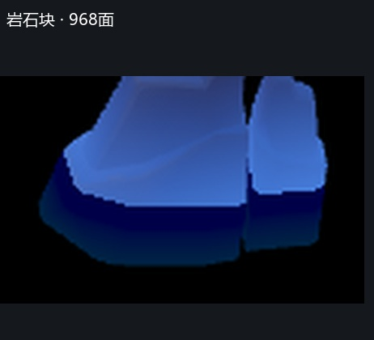 |

截图来自对应绘制后的真实画面，黑底是此阶段尚未画地面；小模型为局部放大。人物身体截图中已存在此前绘制的头部，6,240面仅对应本次身体网格。

场景常见512²调色板／材质图；角色代表使用512²颜色图，以及金属度、粗糙度、高光强度等打包图。代表Shader用网格法线参与直接光、间接光、阴影与轮廓光计算。各材质按开关使用功能，不能把全部声明都算成每个物体的固定成本。

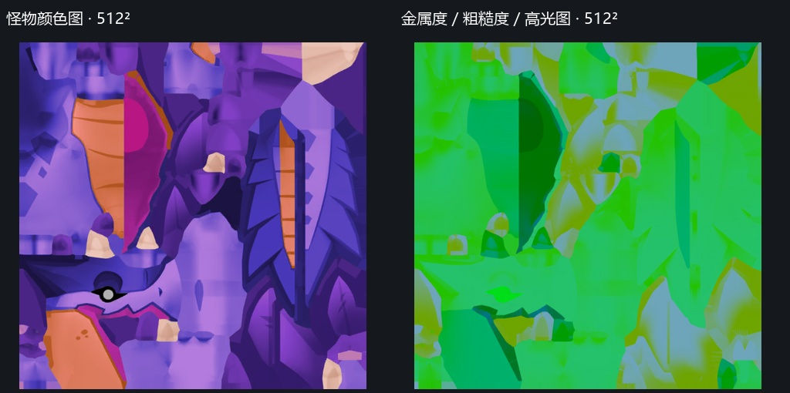

水面使用专用材质：噪声纹理随时间和位置扰动法线，地面距离图调节近岸法线强度，再计算高光、阴影和环境色，采用预乘Alpha叠加。技能2 E647是34个两面水面片实例；代表程序没有读取场景颜色或独立反射图，未见屏幕空间反射／折射通道。

## 骨骼动画方案

### 矩阵纹理如何使用

**这里是GPU蒙皮＋运行时骨骼矩阵表，未发现VAT顶点动画读取。它与“把全部动作帧预烘焙进骨骼图”也不能直接画等号。**

1. 顶点存4个8位无符号骨骼索引，加1个32位打包权重，共8字节；不是4个浮点权重的16字节布局。
2. 每实例提供骨骼表起始偏移。Shader把偏移加本地骨骼编号，再定位数据纹理。
3. 每个矩阵占3个RGBA32F纹素，即12个浮点数、48字节。图固定宽768，每行容纳256个矩阵槽。
4. 第一根骨骼先读3次。打包权重不为0时再读其余3根，最多共12次整数纹素读取；解包权重后混合矩阵，变换位置和法线。
5. 代表帧骨骼图在E17上传，随后才进入阴影与主场景。顶点程序没有按“动作编号＋前后动画帧”对两套姿态插值。

这说明本帧提交的是已经准备好的姿态表，GPU负责逐顶点蒙皮。**不能从图高推算动作数／帧数，也不能说整个Animator或状态机搬到了GPU。** CPU如何计算和混合姿态不在图形截帧的可见范围内。

### 容量和实例合批

| 截帧 | 骨骼图ID | 尺寸 | 矩阵槽容量 | 逻辑容量 |
| --- | --- | --- | --- | --- |
| 入口 | 72514 | 768×16 | 4,096 | 192 KiB |
| 绿色战斗 | 210008 | 768×2 | 512 | 24 KiB |
| 暗色战斗 | 248873 | 768×4 | 1,024 | 48 KiB |
| 技能1 | 1548020 | 768×4 | 1,024 | 48 KiB |
| 技能2 | 1546508 | 768×4 | 1,024 | 48 KiB |
| 技能3 | 1546508 | 768×4 | 1,024 | 48 KiB |

槽容量表示整张表能存多少矩阵，**不是单模型有效骨骼数**。这些图均RGBA32F、单层Mip，使用LOD0整数坐标读取。

已看到实例合批：技能2 E179把同一份3,984面网格绘制3实例，E219绘制5实例，实例数据带独立模型矩阵及骨骼表偏移。阴影通道也需要蒙皮，因此蒙皮计算会在多个通道重复发生。

## 粒子与特效

### 功能和绘制数量

| 主要粒子家族（次） | 入口 | 绿色 | 暗色 | 技能1 | 技能2 | 技能3 |
| --- | --- | --- | --- | --- | --- | --- |
| 单纹理＋顶点调色 | 223 | 63 | 63 | 125 | 423 | 140 |
| 纹理＋渐变映射 | 49 | 4 | 4 | 14 | 58 | 72 |
| 合计 | 272 | 67 | 67 | 139 | 481 | 212 |

| 功能 | 单纹理调色 | 渐变映射 | 局部轮廓（单列） |
| --- | --- | --- | --- |
| 输入 | 图集＋两组顶点颜色 | 图集＋渐变图＋渐变行编号＋顶点颜色 | R8网格遮罩＋轮廓颜色 |
| 像素采样 | 1个采样点 | 2个采样点 | 中心1次，分支内再采周围8次 |
| 着色 | 纹理乘色／透明度，再加附加色 | 取图案亮度，按渐变条重新上色 | 遮罩边缘扩展并着色 |
| 混合 | 加法、预乘Alpha等 | 加法、预乘Alpha等 | 局部透明叠加 |
| 噪声扰动／溶解 | 此主要家族未见对应多贴图逻辑 | 同左 | 不适用 |
| 软粒子深度渐隐 | 未读取场景深度 | 未读取场景深度 | 不适用 |

简单Shader配合图集内容、顶点数据和多层叠加，就能形成很多效果。不能由一帧确认动画帧切换或粒子模拟在CPU还是GPU；六帧均没有Compute Dispatch。

技能2的481次粒子中，176次加法混合、303次预乘Alpha混合、2次目标颜色调制。混合模式不是额外的Shader功能家族。

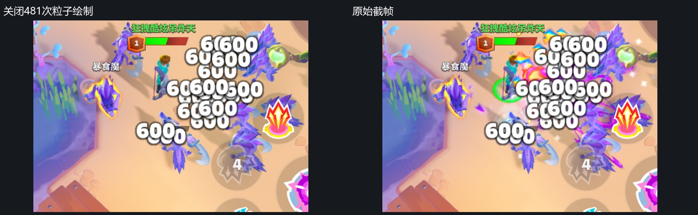

独立副本关闭481次粒子后，最终281,918个RGB像素变化。**伤害数字、UI按钮和黄色轮廓仍在**，它们不属于这481次粒子。部分粒子提交被遮挡、透明度很低或在画面外，不一定都产生可见贡献。

### 两个代表例子

**例一：红橙色光团，技能2 E1008。** 使用渐变家族：从基础图案取得亮度，再查渐变条生成颜色。下图仅增加这一次绘制。

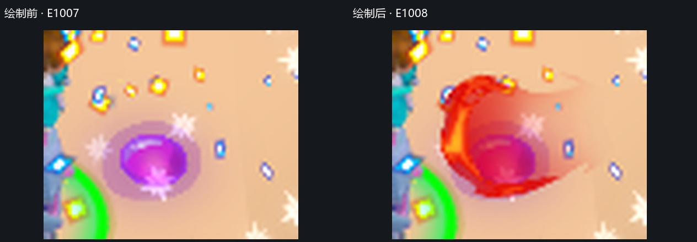

**例二：紫色碎片／拖尾层，技能2 E1189。** 使用单纹理家族，由图集形状、顶点乘色及附加色构成；不需要完整Bloom链也能产生明亮外观。

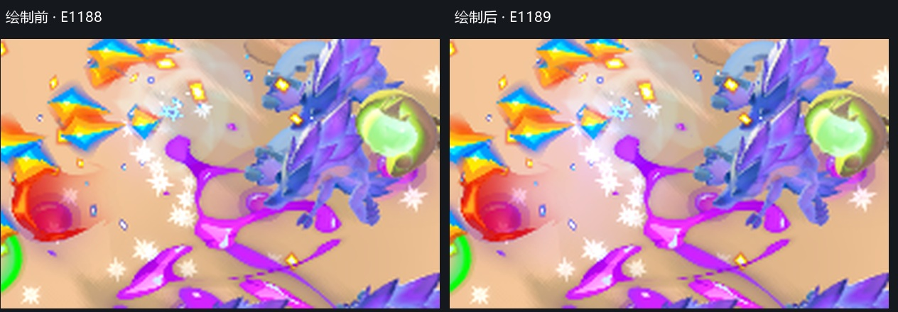

两图是960×540场景的局部放大，用于看清单次绘制贡献。

## 贴图规格、Mip与容量

### 分类规范

**普通模型材质多数有Mip，粒子图集、UI图集、骨骼和环境数据图均以单层为主；本次绑定的粒子图集没有Mip。** 下表把共享数据图从普通材质图中单列。

| 绑定纹理数／其中有Mip | 入口 | 绿色战斗 | 暗色战斗 | 技能1 | 技能2 | 技能3 |
| --- | --- | --- | --- | --- | --- | --- |
| 模型材质 | 133 / 132 | 23 / 21 | 41 / 39 | 56 / 53 | 26 / 24 | 46 / 43 |
| 光照遮罩 | 3 / 2 | 3 / 2 | 3 / 2 | 4 / 3 | 4 / 3 | 4 / 3 |
| 粒子图集 | 16 / 0 | 7 / 0 | 8 / 0 | 16 / 0 | 18 / 0 | 16 / 0 |
| 粒子渐变图 | 1 / 0 | 1 / 0 | 1 / 0 | 1 / 0 | 1 / 0 | 1 / 0 |
| UI与文字图集 | 5 / 0 | 6 / 0 | 6 / 0 | 6 / 0 | 6 / 0 | 6 / 0 |
| 骨骼矩阵 | 1 / 0 | 1 / 0 | 1 / 0 | 1 / 0 | 1 / 0 | 1 / 0 |
| 环境与光照数据 | 3 / 0 | 3 / 0 | 3 / 0 | 3 / 0 | 3 / 0 | 3 / 0 |
| 阴影深度 | 2 / 0 | 2 / 0 | 2 / 0 | 2 / 0 | 2 / 0 | 2 / 0 |
| 轮廓遮罩 | — | — | 1 / 0 | 1 / 0 | 1 / 0 | 1 / 0 |

此表按资源去重并分配主用途，同一纹理可能跨阶段共享。绑定表可能有默认占位图或被材质开关跳过的输入，因此“绑定”不等于每个像素实际读取。有Mip也不代表本帧采到了某个指定层级。

| 类别 | 代表规格 | Mip／说明 |
| --- | --- | --- |
| 模型调色板／材质 | 常见512²，另有256²、1024²等 | 512²代表有9或10层，部分链停止于2×2 |
| 粒子图集 | 多张4096²，也有非整方图集 | 无Mip；线性过滤不能替代Mip |
| UI图集 | 多张4096²，还有约3904×4080 | 无Mip；字体使用SDF改善边缘 |
| 光照遮罩 | 代表256² RGBA8 | 9层Mip，可投射云影／树影类图案 |
| 间接光查找图 | 128×32 RGBA8 | 无Mip；属于光照输入，不是全屏LUT |
| 环境参数图 | 技能帧100×900 RGBA8＋100×200 RGBA16F | 无Mip；按世界位置查询的数据 |
| 骨骼矩阵图 | 768×2～16 RGBA32F | 无Mip；整数寻址 |
| 阴影／轮廓目标 | D16／R8 | 无Mip，尺寸见前文 |

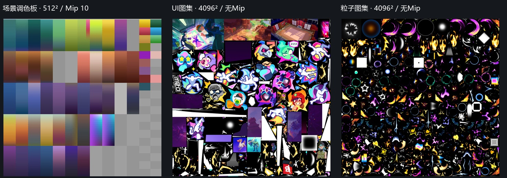

**捕获中未见ASTC、ETC、BC或PVRTC块压缩资源。** 颜色素材主要为RGBA8_UNORM；另有BGRA8目标、RGBA16F／RGBA32F数据图、R8遮罩、D16／D24S8深度。这是该捕获路径的GPU资源，不能直接推断安装包源图、其他设备或接口的压缩设置。

### 纹理容量口径

按宽高、格式、Mip、数组和采样数计算的**逻辑纹理数据容量**如下，不含驱动对齐、压缩元数据、网格、程序、CPU副本或引擎缓存，不等于进程内存／峰值显存。

| 逻辑容量（MiB） | 入口 | 绿色战斗 | 暗色战斗 | 技能1 | 技能2 | 技能3 |
| --- | --- | --- | --- | --- | --- | --- |
| 本帧绑定纹理去重 | 855.90 | 524.76 | 536.32 | 615.98 | 646.21 | 584.85 |
| 捕获列出的全部纹理 | 855.90 | 524.76 | 536.32 | 615.98 | 646.21 | 584.85 |

单张4096² RGBA8、无Mip图集就是64 MiB。技能2按主用途分配的粒子图集约350.59 MiB、UI／字体约221.38 MiB，而骨骼矩阵图只有48 KiB。**此样本的容量重点在大图集，骨骼表很小。** 本次未访问的图集区域也包含在整张图容量中。

960×540、4× MSAA颜色目标的逻辑样本数据约7.91 MiB，D24S8深度同样约7.91 MiB，解析颜色图约1.98 MiB。RenderDoc的`byteSize`可能含实现差异／对齐，没有直接拿来当手机物理占用；原始值保存在[全部纹理清单](全部纹理清单.csv)。

绘制数量、面数和资源容量可作为排查线索；真实GPU耗时、带宽、发热与帧率仍需在目标设备测量。
