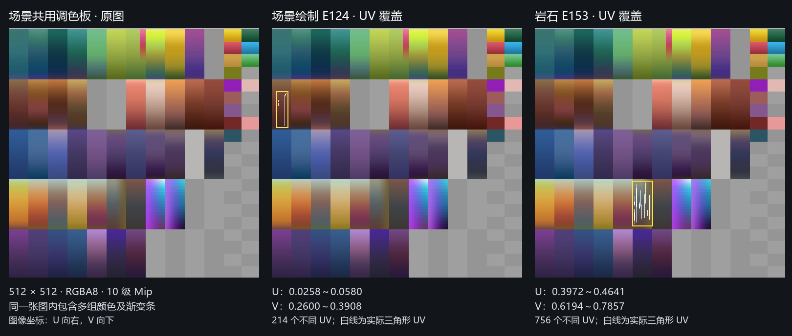
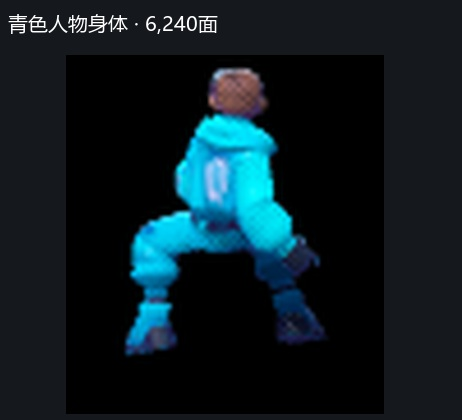
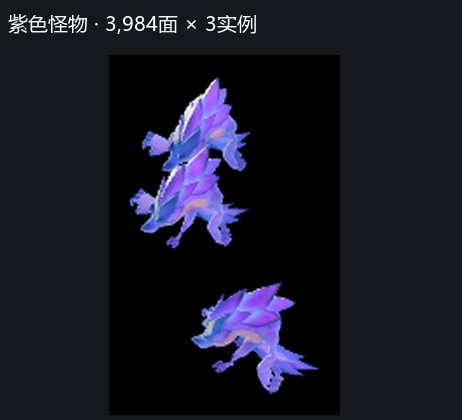
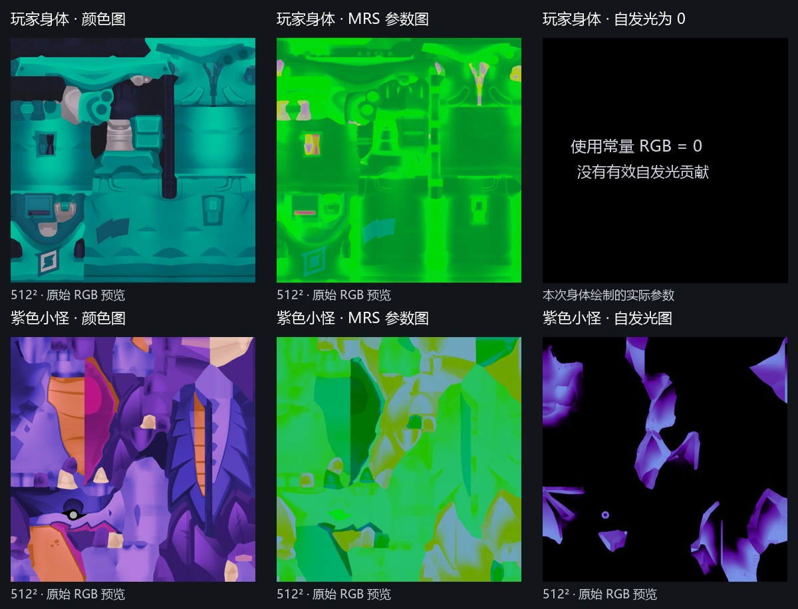
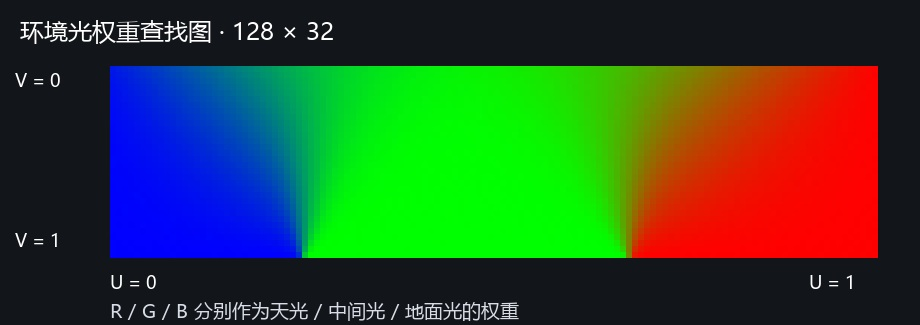

# moco · 场景调色板与角色光照分析

分析日期：2026-10-20。基于绿色战斗、亮绿＋技能2截帧，逐绘制核对顶点数据、Shader、实际特化开关和常量。本文是[六份截帧分析](moco-截帧分析.md)的材质补充；结论针对下列代表模型。

**场景调色板负责提供底色：模型 UV 在共用色条里选取颜色或渐变；场景顶点色 RGB 则分别存金属度、粗糙度、高光强度。玩家身体和紫色小怪使用同类风格化光照：包裹漫反射＋Blinn–Phong 高光＋环境光查表，再叠加阴影、自发光、边缘光和颜色处理。**

## 目录

1. [场景调色板怎么用](#场景调色板怎么用)
   1. [从模型UV取底色](#从模型uv取底色)
   2. [顶点色存材质参数](#顶点色存材质参数)
   3. [三类颜色纹理的区别](#三类颜色纹理的区别)
2. [角色和小怪的渲染流程](#角色和小怪的渲染流程)
   1. [从蒙皮到主场景输出](#从蒙皮到主场景输出)
   2. [玩家与小怪的实际差异](#玩家与小怪的实际差异)
3. [光照模型逐项拆解](#光照模型逐项拆解)
   1. [主光与高光](#主光与高光)
   2. [环境光与地图分区光色](#环境光与地图分区光色)
   3. [金属度与菲涅耳混合](#金属度与菲涅耳混合)
   4. [自发光与角色边缘光](#自发光与角色边缘光)
   5. [实例染色与最终颜色处理](#实例染色与最终颜色处理)
4. [实际启用范围与证据](#实际启用范围与证据)

## 场景调色板怎么用

### 从模型UV取底色

绿色战斗中的场景绘制 E124、岩石 E153，共用一张 **512×512 的 RGBA8 调色板**。它由多组色块和渐变条组成，绑定在底色槽 `diffuseTex`，有10级 Mip，采样器开启双线性和 Mip 层间线性过滤。

实际取色顺序：

```text
模型的 UV0
  → 加上 UV 滚动偏移（本次两例均为 0，因此就是原 UV）
  → 在共用调色板里采样 RGB
  → RGB 逐通道平方，近似转入线性空间
  → 与法线、主光、环境光和材质参数一起计算最终颜色
```

**因此它是模型底色图，不是根据受光强度查色的 Toon Ramp，也不是给最终画面做调色的整屏 LUT。** 同一块调色板颜色仍会因光照方向、阴影、粗糙度和环境色而显示不同明暗。



白线来自捕获中的索引与 UV，黄框标出覆盖范围；按纹理行序显示，V 向下。这里展示的是实际 UV 叠加，不是材质开关前后对比。

| 实测项 | 场景绘制 E124 | 岩石 E153 |
| --- | --- | --- |
| 使用的底色纹理 | 同一张调色板 | 同一张调色板 |
| 不同 UV 坐标数 | 214 | 756 |
| U 范围 | 0.0258～0.0580 | 0.3972～0.4641 |
| V 范围 | 0.2600～0.3908 | 0.6194～0.7857 |
| 三个顶点 UV 完全相同的三角形 | 26 / 894 | 32 / 968 |

只有少数三角形收缩为一个 UV 点，**大部分三角形的 UV 会在色条内变化**，可以直接取到渐变。不能把这套做法理解成“每个面只存一个颜色编号”。

制作上可以让不同模型的 UV 共用同一批色条，用 UV 所在区域决定配色，用 UV 在条带中的展开决定渐变。这样能复用底色资源、统一场景色系；共用贴图有利于减少材质资源切换，但**不会自动把所有模型变成一次绘制**。渐变条使用 Mip 和过滤时，仍需留边避免采到相邻色条；捕获能证明采样配置，不能还原其美术制作工具。

### 顶点色存材质参数

这两个场景绘制都开启了“底色来自纹理”，关闭了“底色来自顶点色”。顶点色的用途是：

| 顶点通道 | 实际含义 | 场景 E124 | 岩石 E153 |
| --- | --- | --- | --- |
| R | 金属度 `metalness` | 约0.749 | 0 |
| G | 粗糙度 `roughness` | 0.800 | 约0.700 |
| B | 高光强度 `specularity` | 约0.700 | 0.200 |
| A | 此处不参与上述三项材质参数 | 0 | 0 |

颜色格式为每通道8位 UNORM，表内0.700对应实际量化值0.6980或0.7020。**这个顶点色 RGB 不能按可见颜色理解：G 高说明粗糙度高，并非模型应该变绿。** 岩石在这套参数下是非金属、较粗糙、低高光；形体明暗还会受法线与光照影响。

这种分配让普通场景网格用“共用底色调色板＋顶点材质参数”完成着色，不需要每个物件额外持有一张 MRS 图。下文的玩家和小怪则用专门的 MRS 贴图表达更细的部位差异。

### 三类颜色纹理的区别

| 纹理类别 | 索引方式 | 存的内容 | 决定什么 |
| --- | --- | --- | --- |
| 场景调色板 `diffuseTex` | **模型 UV** | 可见底色、颜色渐变 | 物体表面原本是什么颜色 |
| 环境光查找图 `indirectLightingLookupTex` | **法线／反射方向、粗糙度** | 天／中／地三种光色的混合权重 | 不同朝向和材质如何接收环境光 |
| 地图环境参数图 `rpTex1 / rpTex2` | **世界位置**换算的地图 UV | 分区光色、雾／水下等环境参数 | 物体在地图不同位置采用什么环境设置 |

后两类会间接改变颜色，但它们不承担模型的底色贴图功能。

## 角色和小怪的渲染流程

### 从蒙皮到主场景输出

| 顺序 | 阶段 | 实际工作 |
| --- | --- | --- |
| 1 | 骨骼数据准备 | 本帧上传运行时骨骼矩阵纹理，存当前姿态矩阵；主着色的输入不是 VAT 顶点位置图 |
| 2 | 动态阴影阶段 | 阴影绘制使用变形后的网格写入阴影深度，供后续模型受光使用 |
| 3 | 主绘制的顶点 Shader | 根据每实例骨骼偏移、顶点骨骼编号与权重取矩阵，蒙皮位置和法线；传出 UV、世界位置、法线及实例颜色参数 |
| 4 | 主绘制的像素 Shader | 取底色和 MRS；计算主光、阴影、环境光、高光与金属混合；叠加自发光、角色边缘光和位置相关环境效果 |
| 5 | 同一个像素 Shader 的颜色处理 | 实例乘色／加色、全局颜色处理、亮度曲线、饱和度及输出编码，写入主场景颜色 |
| 6 | 有条件的额外轮廓 | 部分对象额外绘制轮廓遮罩并合成外描边；不是每个角色必有，也不是第4步的材质边缘光 |
| 7 | 场景最终合成 | 960×540、4× MSAA 场景完成解析后，放大并与全分辨率 UI 合成 |

**所选角色／小怪的主绘制是前向着色：光照在物体自己的像素 Shader 中完成，没有先写一组材质 G-buffer 再统一计算角色光照。** 四个身体样本均开启深度测试和深度写入，关闭颜色混合，透明度常量为1；Shader 存在透明度处理代码，不代表这些身体正在按半透明渲染。

蒙皮纹理宽768，每个矩阵占3个 RGBA32F texel，共12个浮点数，Shader 重组成仿射矩阵。地址由 `实例骨骼起始偏移 + 顶点骨骼编号` 决定，一行容纳256个矩阵。可处理最多4个骨骼影响，单骨骼顶点有简化路径；位置和法线都由矩阵变换，像素阶段重新归一化法线。选取的身体 Shader 没有采样法线贴图。

### 玩家与小怪的实际差异

| 玩家身体示例 · 绿色 E272 | 紫色小怪示例 · 技能2 E179 |
| --- | --- |
|  |  |

上图用于认对象，来自两个已标注的截帧。下表以**同一份技能2截帧的玩家 E197 与小怪 E219**比较，避免把场景环境差异算成角色类别差异。

| 项目 | 玩家身体 E197 | 紫色小怪 E219 |
| --- | --- | --- |
| 主体面数 | 6,240 | 3,984 / 实例 |
| 本次绘制实例数 | 1 | 5 |
| 骨骼矩阵纹理蒙皮 | 使用 | 使用 |
| `character_shader` 分支 | 开启 | 开启 |
| 底色图 | 512²，9级 Mip | 512²，9级 Mip |
| MRS 参数图 | 512²，10级 Mip | 512²，10级 Mip |
| MRS 通道 | R金属度、G粗糙度、B高光强度 | 相同 |
| 法线来源 | 蒙皮后的网格法线 | 相同 |
| 自发光 | 常量 RGB=0，无有效贡献 | 512² 自发光图，9级 Mip，强度1 |
| 环境光参数来源 | 按位置采地图环境参数图 | 相同 |
| 定向边缘光 | 开启，颜色参数约(0.8, 0.8, 0) | 相同 |
| 实例乘色 | 全白，原色保留 | 5个实例均为全白 |
| 实例附加色 | (0, 0, 0) | 3个实例约(0, 0.0863, 0.2902)，另2个为0 |
| 有效动态局部灯 | 0 | 0 |



**双方的主要差异在材质输入和实例参数，不是两种完全不同的光照算法。** 小怪多出的自发光图会带来额外采样，但仅凭此不能给双方的总 GPU 耗时下结论。

同帧小怪 E179 和绿色玩家 E272 都使用“直接读取环境常量”的变体；小怪 E219、玩家 E197 都使用“按世界位置读取环境图”的变体。**不能归纳为英雄固定用环境图、小怪固定用常量。**

## 光照模型逐项拆解

以下以游戏场景中实际启用的分支为准。公式是便于复现思路的简化表达，省略透明度及特殊状态处理；不是完整可编译 Shader。`N`为归一化法线，`V`为指向相机的单位向量，`L`为指向主光的方向，`H=normalize(V+L)`。捕获中的高度轴为 **Z**。

### 主光与高光

**漫反射用了带偏置的包裹光照：**

```text
主光漫反射系数 = max(0, 0.5 + 0.6667 × dot(N, L))
```

当表面与光线垂直时，系数仍有0.5；当 `N·L=-0.5` 时仍约0.167。相比标准 Lambert，它让侧面和一部分背光面也有亮度，减少黑死区域。正对光线时约1.167，代码没有在这里截到1。

**主光高光用了归一化 Blinn–Phong 形式：**

```text
r = 粗糙度
e = 8192 ^ (1-r)
主光高光系数 = max(dot(N,H), 0)^e × (e+2)/8
```

粗糙度越小，指数越大，高光越尖；粗糙度越大，高光越宽。MRS 的 B 通道还会调节高光总量。

静态／动态阴影经深度比较和偏移过滤，随后与投射光照遮罩一起调节直射贡献。**环境光另外计算，因此背光或阴影中的物体仍可保留环境色。**

它虽然使用了金属度、粗糙度和菲涅耳，但这里的主光 BRDF 并非标准 GGX／Cook–Torrance。更准确的称呼是**带金属与粗糙度控制的风格化光照模型**。

### 环境光与地图分区光色

环境光不用普通模型调色板，而是另一张 **128×32 的权重查找图**：



它的 RGB 分别当作天光、中间光、地面光的权重，实际会查两次：

```text
漫反射环境权重 = 查表( U=(N.z+1)/2,                  V=0 )
高光环境权重   = 查表( U=(reflect(-V,N).z+1)/2,      V=1-r )

环境漫反射 = 天光色×权重R + 中间光色×权重G + 地面光色×权重B
环境高光   = 天光色×权重R + 中间光色×权重G + 地面光色×权重B
```

两行光照各自使用对应那次查表的权重。漫反射看法线朝上还是朝下；高光看反射方向，同时用粗糙度选择权重分布。中间光还会按高度向天光混合，比例为 `clamp(z×0.14−0.03, 0, 0.8)`。

**这是一种“上／中／下环境色＋二维查表”的环境照明近似。所选 Shader 没有采样环境立方体贴图来做通常意义的 Cubemap IBL，也不能把这个权重图称作标准 PBR 的 DFG 查表。**

天光等实际颜色有两种来源：

| 变体 | 数据来源 | 本次例子 |
| --- | --- | --- |
| 环境常量 | 直接读取主光、天光、中间光、地面光常量 | 绿色玩家 E272、技能2小怪 E179 |
| 地图参数图 | 用世界位置 XY 换算地图 UV，再从 `rpTex1` 取所在位置的四组光色 | 场景 E124/E153、技能2玩家 E197、小怪 E219 |

技能2的 `rpTex1` 是100×900：可视为纵向排列的9组100×100数据。这里前四组依次用于主光、天光、中间光、地面光，采样后的颜色按 `RGB × A × 4`解码。模型经过不同位置，就可以采用不同光色；模型自己的 UV 和底色图不用因此改变。其余层与 `rpTex2` 还被环境、雾／水下等代码使用，不能把整张图当作一张普通 Lightmap。

### 金属度与菲涅耳混合

简化符号：`C=底色RGB²`，`m=金属度`，`r=粗糙度`，`s=高光强度`。

```text
f = 0.06 + max(0.9-dot(N,V), 0)^2
F = lerp(f, C×(1+2f), m)

漫反射总光 = 环境漫反射 + 主光色×漫反射系数×阴影遮罩
高光总光   = 环境高光   + 主光色×高光系数×阴影遮罩

主体颜色 ≈ 漫反射总光 × C × (1-0.75×s×F) × (1-m)
         + 高光总光 × s × F
         + 自发光
```

这里略去了本次为零的动态局部灯贡献。向量间乘法逐通道进行。

金属度高时，漫反射被压低，高光更多地带上底色；视线趋向掠射角时，`F` 增大，增强边缘反射感。它包含类似 PBR 的材料控制思路，但漫反射、高光分布、菲涅耳和能量分配都经过自定义，不能直接套 Unity 标准 Lit 的参数预期。

### 自发光与角色边缘光

**小怪自发光：**采样自发光图 RGB，平方后乘强度，直接加入着色结果。黑色区域没有此项贡献，有颜色的区域在直射光不足时仍能保持亮度。玩家身体的自发光常量为0，因此该项没有贡献。自发光仍会经过后续颜色处理；这项计算本身不会把光扩散到模型外，也不等于 Bloom。

**角色边缘光：**玩家和小怪都开启，核心为：

```text
Rdir = normalize(配置的边缘光方向 + V)
边缘形状 = clamp(-4 × (dot(N,Rdir)-0.15), 0, 1)
边缘补光 = 配置的边缘光颜色 × 边缘形状
         × clamp(z×1.5, 0, 1) × min(s×1.5, 1)
```

它受方向、视角、物体高度和高光强度共同控制。绿色截帧的边缘光色约为(0.255, 0.451, 0.573)，技能2为(0.8, 0.8, 0)，所以场景配置能改变角色的边缘补光色调。实际每个像素的贡献还取决于上述乘数，不会整个人均匀加上该颜色。

**材质边缘光与黄色外描边分开理解：**前者改变模型表面像素的亮度；后者有单独的遮罩与合成绘制，可在物体轮廓外形成线条。详见原报告的[阴影与局部轮廓](moco-截帧分析.md#阴影与局部轮廓)。

### 实例染色与最终颜色处理

每个实例携带两个32位整数，分别拆成四个归一化8位分量，得到乘色和加色。这样同一批网格／材质可保留不同的颜色参数。

本次玩家乘色为白、加色为0；小怪 E219 的5个实例中，有3个加色为 `(0,22,74)/255`，另外2个为0。**同一次实例绘制里就存在不同染色参数**，不必为此替换一套模型贴图。角色分支还会按 `N·V` 减弱正面染色，因此附加色不是简单均匀覆盖整只小怪；仅凭捕获不能判断它具体代表哪种游戏状态。

随后还有全局颜色变换及材质内的输出处理：

```text
亮度 ×1.1 → 截到[0,1.7] → 多项式亮度曲线
→ 按RGB平均值调整饱和度 → pow(颜色, 0.4675) 输出
```

多项式核心是 `((0.0264×x²−0.2544)×x²+1.1029)×x`。因此最终观感同时来自底色绘制、光照、环境色、边缘补光与这段颜色曲线，不能全部归因于调色板。**这些颜色处理位于模型像素 Shader 内，不需要额外的整屏后处理 Pass。**

## 实际启用范围与证据

| 项目 | 本次核对结果 |
| --- | --- |
| 主光、环境光、静态／动态阴影、投射光照遮罩 | 相关分支启用；具体像素是否被遮挡由深度及遮罩采样决定 |
| 角色边缘光 | 玩家、小怪均启用，边缘光颜色参数非零；普通场景样本不走角色分支 |
| 动态局部灯 | 代码支持两个槽位，但本次六个样本的灯位置／半径、颜色和衰减参数均为0，实际无此项贡献 |
| 雾／水下效果 | 分支启用，系数依赖位置与环境数据；不能仅凭开关认定整个模型都有可见水下效果 |
| 全息、幽灵、金色武器、怪物调试、眼睛特殊高光 | 六个样本相关开关关闭，不计入本次实际效果 |
| 由实例乘色 Alpha 约0.2／0.3／0.4触发的特殊状态 | 所选实例该值均为1，未触发这些状态 |
| 颜色变换、输出颜色修正 | 六个样本均启用 |

核对使用的是**每个绘制事件自己的参数**，不是将同一个 Shader 第一次出现时的材质常量套到所有绘制。可定位的证据如下，资源编号只在所属截帧内有效：

| 截帧／绘制 | 顶点／像素 Shader | 关键资源 |
| --- | --- | --- |
| 绿色 E124 | 16023 / 16024 | 调色板207619，顶点色存MRS |
| 绿色 E153 | 16108 / 16110 | 同调色板207619，岩石顶点色参数 |
| 绿色 E272 | 63060 / 63061 | 玩家底色78184、MRS77604，环境常量变体 |
| 技能2 E179 | 1495016 / 1495017 | 小怪底色1541554、MRS1541434、自发光1541605，环境常量变体 |
| 技能2 E197 | 1495029 / 1495030 | 玩家底色1583298、MRS1582938，地图环境图变体 |
| 技能2 E219 | 1495032 / 1495033 | 同小怪材质，5实例，地图环境图变体 |

本文重建的是捕获中可见的 Shader 运算与资源分工，不声称得到游戏原始材质编辑器或完整美术制作流程。模型细节、武器、眼睛或其他怪物材质可能另有变体。
