# 奔奔王国 · 大世界三档截帧分析

分析日期：2026-10-09。采集接口为模拟器 Vulkan／ANGLE 回放。文件名中的“最低／高／最高”作为档位标识。

## 目录

1. [总览与三档画面](#总览与三档画面)
2. [绘制流程与差异](#绘制流程与差异)
3. [功能对比与具体例子](#功能对比与具体例子)
   1. [狮子：最高档增加黑色描边](#狮子最高档增加黑色描边)
   2. [紫色城堡：最高档增加彩色竖向光片](#紫色城堡最高档增加彩色竖向光片)
   3. [护盾与复杂特效](#护盾与复杂特效)
4. [贴图尺寸、Mip与格式](#贴图尺寸mip与格式)
5. [普通资源与GPU骨骼动画](#普通资源与gpu骨骼动画)
6. [后处理与性能边界](#后处理与性能边界)

## 总览与三档画面

**最低档同时降低渲染分辨率、部分源贴图规格，并取消角色描边及部分建筑特效层。最高与最低的骨骼本体数量、UI绘制次数和代表模型面数一致。**

**“高”档仅记录4次显示／拷贝绘制，没有记录大世界模型和材质绘制。** 它能展示当时的游戏画面，不能拿4次绘制或40.85 MiB与其他两档做性能／资源对比。这是截帧范围差异。

| 指标 | 最低 | 高 | 最高 |
| --- | --- | --- | --- |
| 样本用途 | 完整大世界回放 | 只有显示层，画面参考 | 完整大世界回放 |
| 主场景分辨率 | 648×1152 | 场景绘制未记录；显示输入756×1344 | 1080×1920 |
| 主场景绘制次数 | 198 | 未记录 | 237 |
| 整份截帧绘制次数 | 202 | 4 | 241 |
| 主场景提交三角形（含实例与重复通道） | 40,182 | 无法统计 | 52,820 |
| 骨骼本体绘制次数 | 14 | 无法统计 | 14 |
| 额外骨骼描边绘制次数 | 0 | 无法统计 | 6 |
| UI图集与界面绘制次数 | 48 | 无法统计 | 48 |
| 主场景采样纹理数量 | 113 | 无法统计 | 121 |
| 主场景采样纹理中有Mip | 25 | 无法统计 | 27 |
| 采样纹理描述容量 | 351.86 MiB | 无法比较 | 389.38 MiB |
| 全部纹理描述容量（含显示目标） | 397.38 MiB | 40.85 MiB（仅显示层） | 450.08 MiB |

容量按RenderDoc纹理描述去重求和；不是进程峰值显存，也不是实际真机内存。提交三角形计入实例、屏外物体和额外描边，不能理解成唯一模型面数。

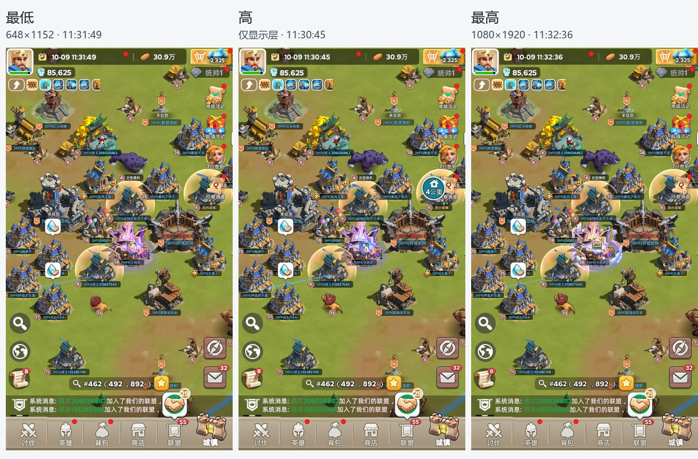

三份画面均位于地图 #462（492，892）附近：高11:30:45、最低11:31:49、最高11:32:36。最低与最高相差47秒。71组同源网格在近似相同屏幕位置匹配；动态角色姿态、特效周期和聊天数字仍会变化。

**最低主画面宽高各为最高的0.6，像素数为36%。UI也绘入这张648×1152目标，再放大显示，所以UI清晰度一起下降。** 显示层的1080×1920目标不能当作最低档的实际场景分辨率。“高”档拷贝输入为756×1344，宽高为1080×1920的0.7，随后放大到1080×1920；由于缺少场景绘制，只能确认其显示输入尺寸，不能核实场景生成过程。

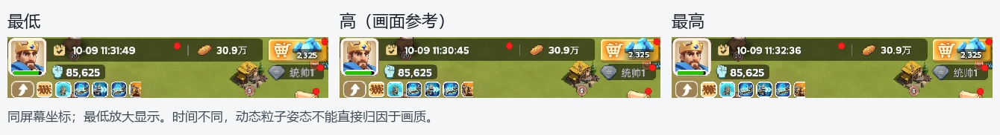

## 绘制流程与差异

两份完整样本的主场景都只有一张颜色目标＋D24S8深度目标，按顺序绘制地面、骨骼模型、建筑图块、特效、标牌及UI。主体建筑大量采用预绘制精灵图集，而角色和行军物体使用真正的骨骼网格。捕获还包含模拟器的横向预览和手机显示表面。

| 绘制类别 | 最低次数 | 最高次数 | 最高−最低 |
| --- | --- | --- | --- |
| 地面 | 5 | 5 | +0 |
| 骨骼模型 | 14 | 14 | +0 |
| 角色描边 | 0 | 6 | +6 |
| 建筑及场景图块 | 36 | 40 | +4 |
| 材质及粒子特效 | 45 | 73 | +28 |
| 标牌粒子 | 48 | 48 | +0 |
| 附加遮罩叠加 | 0 | 1 | +1 |
| 区域边界 | 2 | 2 | +0 |
| UI图集与界面 | 48 | 48 | +0 |

**最高档比最低多39次大世界绘制：材质／粒子特效净多28次，角色描边多6次，建筑图块多4次，附加遮罩叠加多1次。骨骼本体和UI绘制数量没有减少。** 分类基于Shader算法、几何布局和逐绘制截图；特效与UI标牌相邻，不代表它们都是整屏处理。

最高多提交12,638个三角形，其中11,940个来自把部分角色本体再绘制一遍做描边，约占新增三角形的94.5%。角色本体的提交几何仍是两档各16,815个三角形。

下面按构成顺序展示最高档，图片横向排列。E300是骨骼本体结束，E351含描边，E880含建筑和材质特效，E1343含完整UI。

| 地面＋骨骼本体 · E300 | 增加描边 · E351 | 建筑＋特效 · E880 | UI完成 · E1343 |
| --- | --- | --- | --- |
| 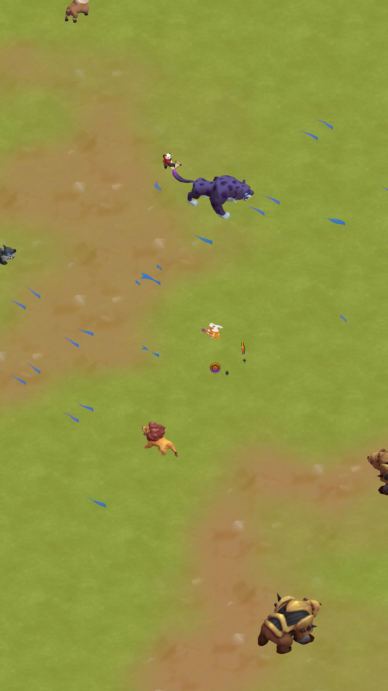 |  | 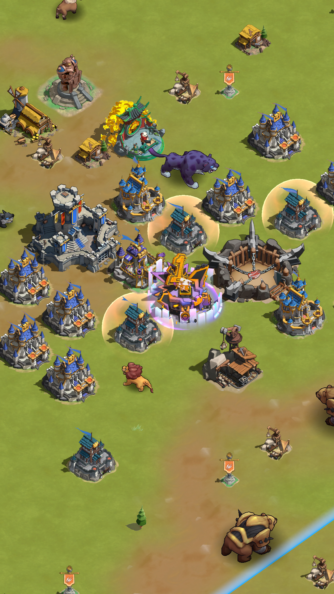 | 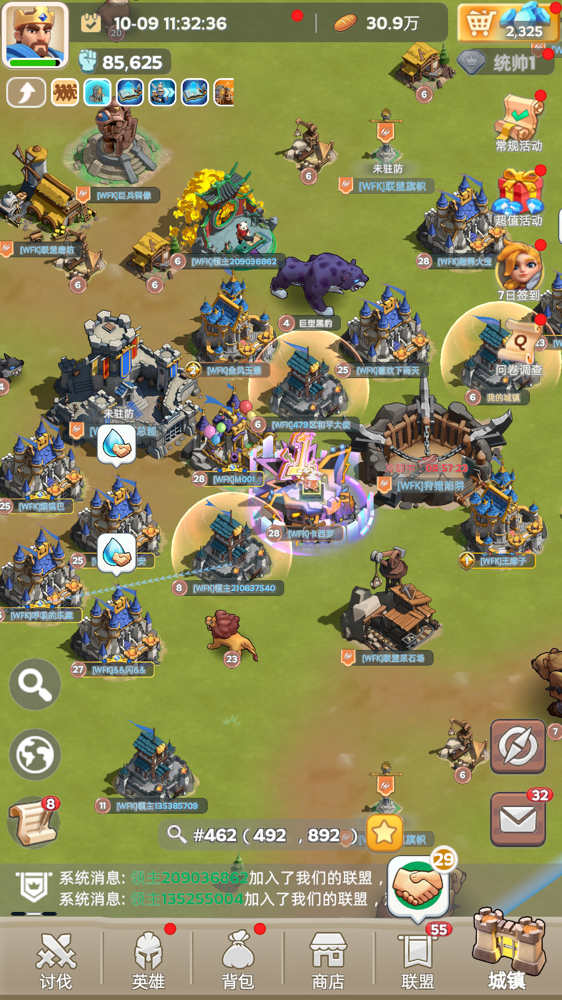 |

## 功能对比与具体例子

| 功能 | 最低 | 最高 | 核对依据 |
| --- | --- | --- | --- |
| 整体分辨率 | 宽高0.6；UI同样受影响 | 宽高1.0 | 主目标描述＋UI输出绑定 |
| 角色贴图 | 9张逐像素匹配的半尺寸版本 | 对应完整尺寸；均保留Mip | 最低mip0＝最高mip1 |
| 地面素材贴图 | 15张逐像素匹配的半尺寸版本 | 对应完整尺寸；均保留Mip | 最低mip0＝最高mip1 |
| 建筑与UI大图集 | 代表大图集2048²、单层Mip | 代表大图集2048²、单层Mip | 尺寸、格式和像素相同 |
| GPU骨骼动画 | 本体14次；保留4影响骨骼循环 | 本体14次；同核心代码和13张数据图 | Shader SHA-256及输入布局 |
| 角色黑色描边 | 没有额外描边通道 | 6次蒙皮＋法线外扩＋纯黑输出 | 同帧关闭后3249个RGB像素变化 |
| 中央紫色城堡竖向彩色光片 | 未见该家族绘制 | 25次；视角渐变＋颜色图＋通道Mask | 同帧关闭后12727个RGB像素变化 |
| 金色护盾 | 保留相同Shader家族 | 保留相同Shader家族 | VS/PS原始代码哈希相同 |
| 基础光斑、UV滚动与四采样特效 | 仍大量保留 | 仍保留并叠加额外层 | 对应家族逐代码核对 |
| 复杂素材扰动／遮罩家族 | 代表PS 3个静态采样点 | 对应扩展PS 5个静态采样点 | 代码有额外素材采样和UV运算 |
| 建筑图块提交 | 36次，468个提交三角形 | 40次，468个提交三角形 | 更多提交拆分，几何总量相同 |
| 后处理／多重采样 | 未识别到Bloom等链；主目标1×采样 | 未识别到Bloom等链；主目标1×采样 | 通道依赖、采样源、Shader及纹理描述 |

### 狮子：最高档增加黑色描边

本体最低E228、最高E229：均为1,785面、1,162个引用顶点，GPU蒙皮核心VS／PS代码完全相同。角色颜色图从128²升至256²，最高另加E316描边：再做一次蒙皮，将法线方向外扩，然后输出黑色。六组描边共7个实例，增加11,940个提交三角形。

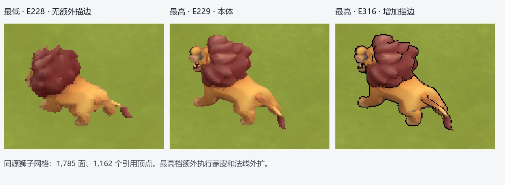

**独立回放副本关闭6次描边绘制后，3,249个最终RGB像素变化，狮子的黑色外轮廓明确消失。** 原样副本与原始截帧逐字节一致；这个开关验证只确认描边贡献，不代表游戏提供相同的独立开关。

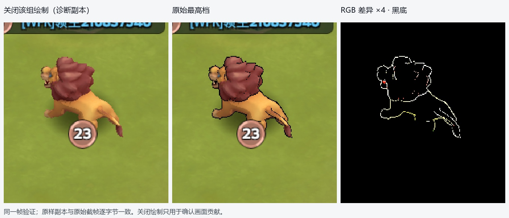

### 紫色城堡：最高档增加彩色竖向光片

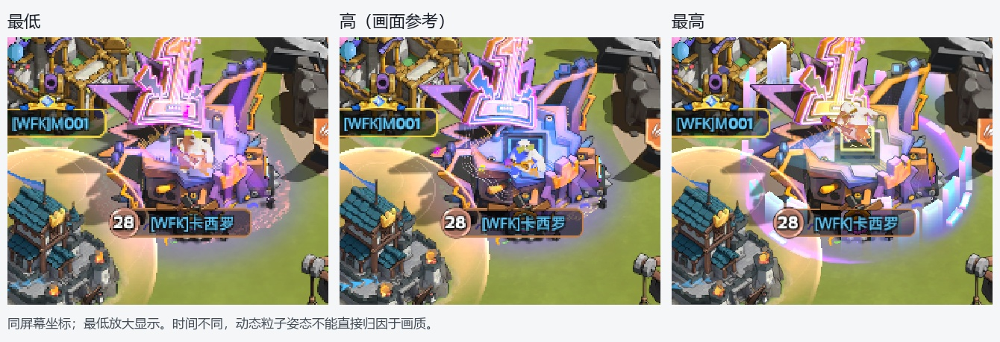

最高Shader 659892／659893提交25次，每次10面，沿中央城堡周围布置竖向光片。PS使用法线与视角方向的点积作渐变，采样256²颜色渐变图659426与128²灰度Mask138506，叠加顶点色、强度、通道Mask与透明度整形。最低没有这个Shader家族绘制。

**同一帧关闭这25次绘制后，12,727个RGB像素变化，彩色竖向光片消失；底部的环状光晕和其他装饰仍保留。** 因而此差异可以归到这组局部材质特效，不能称为Bloom开关。

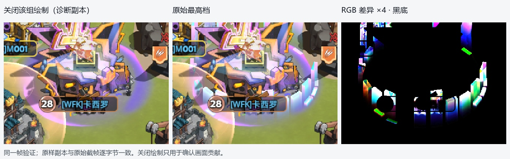

### 护盾与复杂特效

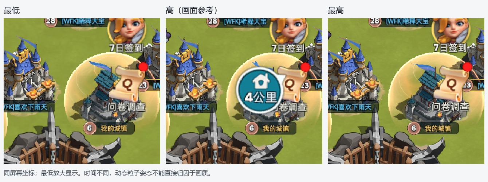

金色护盾最低690584／690585与最高140146／140147的VS、PS原始代码哈希相同；两档均9次绘制，使用相同512²噪声657695等素材。不能概括成“低配关闭所有复杂特效”。

另一通用家族最低690409／690410为9次、PS有3个静态取样点；最高扩展版660499／660500为8次、PS有5个静态取样点，增加素材UV扰动／遮罩输入。静态取样点包含分支，并不等于每像素固定执行次数。更复杂的3至6采样家族也在最高出现，但不同特效时刻会改变个体粒子数量。

基础光斑（最低690392／690393与最高138775／138776）、四采样环形特效（最低690398／690399与最高613003／613004）核心代码相同。最高还多用64×32边缘光片、512×256光条等素材。标牌粒子两组各24次，两档次数相同但本帧几何数量略有变化。

## 贴图尺寸、Mip与格式

**24对同源贴图已逐字节核对：最低mip0完全等于最高mip1。** 最低宽高各减半，Mip链也少最顶层。24对合计从最高45.25 MiB降到最低11.31 MiB，减少33.94 MiB。包含15张地面素材和9张骨骼模型颜色图。

| 代表贴图 | 最低 | 最高 | 规格与证据 |
| --- | --- | --- | --- |
| 狮子颜色图 | 688234 · 128² · 8层 | 707304 · 256² · 9层 | RGBA8 sRGB；最低顶层等于最高Mip1 |
| 持武器角色颜色图 | 688246 · 128² · 8层 | 707316 · 256² · 9层 | RGBA8 sRGB；逐字节匹配 |
| 地面细节图 | 688288 · 512² · 10层 | 707358 · 1024² · 11层 | RGBA8 sRGB；逐字节匹配 |
| 地面混色素材 | 688458 · 256² · 9层 | 707524 · 512² · 10层 | RGBA8 sRGB；逐字节匹配 |
| 地面特殊输入 | 688518 · 128² · 8层 | 707582 · 256² · 9层 | RGBA8 UNORM；逐字节匹配 |
| 小型行军素材 | 688983 · 128² · 8层 | 708039 · 256² · 9层 | RGBA8 sRGB；逐字节匹配 |
| 建筑图集 | 656891 · 2048² · 1层 | 656891 · 2048² · 1层 | RGBA8 sRGB；像素相同 |
| 建筑／装饰图集 | 658964 · 2048² · 1层 | 658964 · 2048² · 1层 | RGBA8 sRGB；像素相同 |
| UI图集 | 136252 · 2048² · 1层 | 136252 · 2048² · 1层 | RGBA8 sRGB；像素相同 |
| 护盾噪声 | 657695 · 512² · 1层 | 657695 · 512² · 1层 | RGBA8 sRGB；像素相同 |
| 光条素材 | 659343 · 256×128 · 1层 | 659343 · 256×128 · 1层 | RGBA8 sRGB；像素相同 |
| 骨骼矩阵数据 | 13张 · RGBA16F · 单层Mip | 相同13张且像素相同 | 合计2.05 MiB；两档相同 |

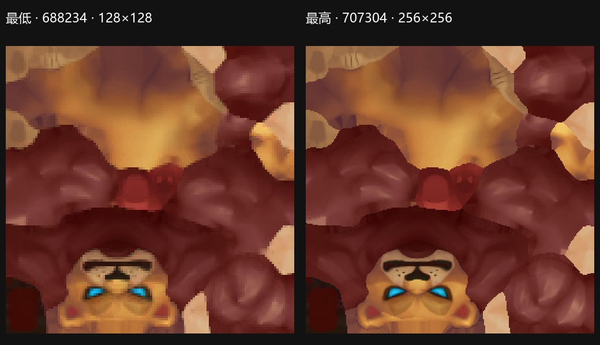

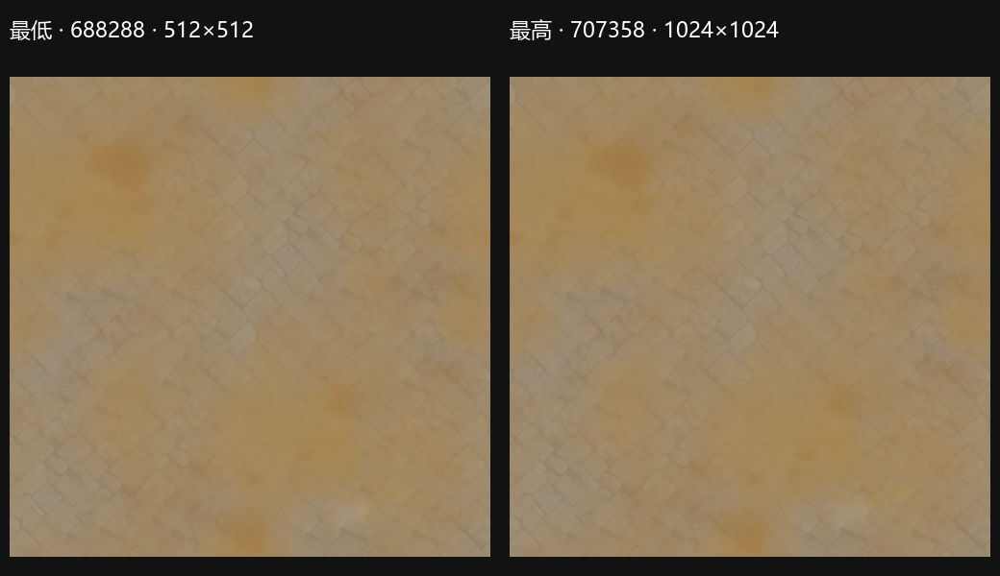

**建筑图集和UI并未跟着统一降规格。** 例如656891、658964、136252两档像素完全相同，均2048²、RGBA8 sRGB、单层Mip。单张描述容量16 MiB。两份清单都存在19张宽度至少2048、单层Mip的纹理，不能把贴图策略理解成全部素材统一降一档。

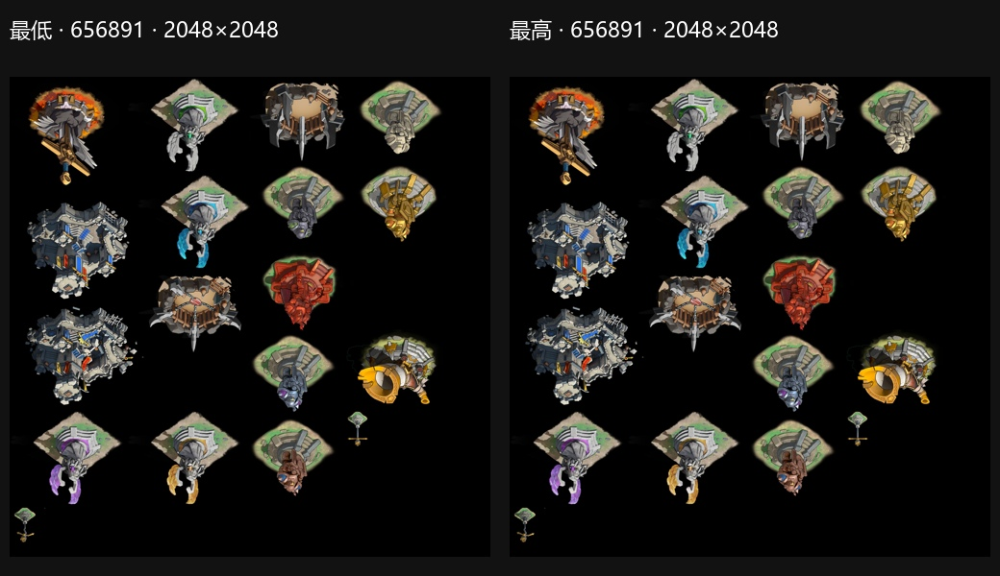

| 使用路径 | 最低采样纹理 | 最低有Mip | 最高采样纹理 | 最高有Mip | 说明 |
| --- | --- | --- | --- | --- | --- |
| 地面路径 | 21 | 15 | 21 | 15 | 基础素材有Mip；控制／颜色辅助输入部分单层 |
| 骨骼本体路径 | 23 | 9 | 23 | 9 | 计入13张无Mip骨骼数据图＋颜色图 |
| 建筑／场景图块 | 17 | 0 | 17 | 0 | 大图集和噪声均单层 |
| UI图集与界面 | 13 | 0 | 13 | 0 | 图集／字体／辅助纹理单层 |
| 材质与粒子特效 | 36 | 1 | 43 | 3 | 绝大多数无Mip，存在少数例外 |
| 标牌粒子 | 2 | 0 | 2 | 0 | 128²及64²单层素材 |

分类内去重，不同路径会共享同一纹理，横向总和不能当作全帧唯一纹理数量。Mip存在还需结合采样器：角色和地面代表输入允许访问完整Mip链，mip filter为Point，即选择单一Mip层；不能据此断言画面实际采样了哪一级。

截帧纹理格式均为RGBA8 sRGB／UNORM、RGBA16F、R8或D24S8；没有发现ASTC、ETC、BC或PVRTC。**sRGB是颜色空间，不是压缩格式。** 这些是模拟器回放可见格式，不能据此判断真机包源资源的压缩配置。

## 普通资源与GPU骨骼动画

| 资源代表 | 事件 | 面数 | 引用顶点数 | 说明 |
| --- | --- | --- | --- | --- |
| 狮子 | 最低E228／最高E229 | 1,785 | 1,162 | 最高额外E316描边 |
| 持武器角色 | 最低E206／最高E207 | 1,218 | 1,062 | 两档同网格规格 |
| 另一角色本体 | 最低E213／最高E214 | 1,029 | 866 | 两档同网格规格 |
| 大型角色代表 | 最低E242／最高E243 | 2,522／实例 | 1,780 | 本帧2实例；最高重复描边 |
| 小型行军模型 | 最低E271／最高E272 | 152／实例 | 144 | 本帧5实例 |
| 另一行军模型 | 最低E278／最高E279 | 98／实例 | 108 | 本帧13实例 |
| 建筑精灵图块 | 最低E436／最高E508 | 2 | 4 | 主体用预绘制图集；一组可含多块 |
| 植被实例图块 | 最低E332／最高E392 | 2／实例 | 4 | 本帧128实例；另一次39实例 |

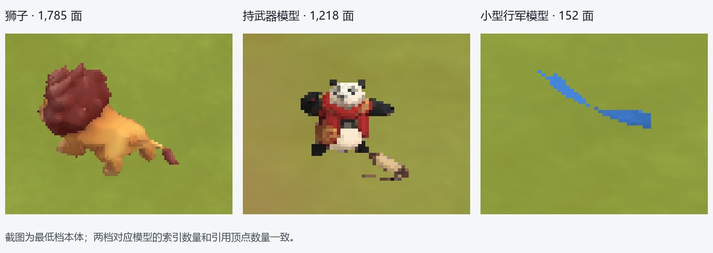

两档代表本体网格的面数、引用顶点数量相同。本次没有把尚未验证的模型LOD机制列作结论。

**角色仍采用GPU Skinning＋骨骼矩阵纹理，最低没有切换成VAT。** 顶点带骨骼索引与权重，Shader遍历4个影响，只处理权重大于0的项；每有效影响读取6组三／四通道纹理数据，组合两组三行矩阵后进行加权蒙皮，并更新法线。实例参数提供动画行位置、模型变换和颜色；行军模型本帧有5、13等多实例绘制。

13张RGBA16F骨骼数据纹理两档尺寸与内容全部相同，单层Mip，总描述容量2.05 MiB。典型狮子输入84×236，每行按3 texel矩阵布局可容纳28个矩阵槽，图高236是存储行数。**矩阵槽容量不能直接当作真实有效骨骼数，存储行也不能直接当作某个动作的总帧数**：还包含静态矩阵与动作布局，缺少源动画表时不作过度推算。

最高的描边会额外执行蒙皮；最低保留本体动画，只裁掉这次重复通道。植被图块采用2面网格做128／39实例绘制，其像素Shader相同，顶点Shader变体有差异，需要按代码和资源看待，不能把所有实例绘制都称作骨骼动画。

## 后处理与性能边界

**两档主场景未识别到Bloom、SSAO、景深、运动模糊、FXAA／TAA或全屏LUT调色链。** 没有Compute Dispatch，主颜色和深度目标均1×采样，没有MSAA目标。全景发光来自局部贴图、UV／颜色运算和混合；渐变图659426也只参与城堡光片材质，不是全屏调色LUT。

主场景直接把UI绘入颜色目标。外围有模拟器预览、手机画面拷贝和显示方向转换；这些表面不能串成游戏后处理链。只表示现有大世界截帧的路径，不能覆盖其他玩法或画质模式。

可以确认最低减少像素量、部分源图带宽／容量、重复蒙皮和特效层数。**绘制次数和素材容量无法换算真机FPS或GPU毫秒**；本报告没有把桌面回放耗时当作手机性能。特效仍有多层透明叠加，耗时大小需要真机计时确定。

详细数据、完整Shader分类和24对贴图清单见[详细附录](奔奔王国-大世界-详细附录.md)。图片使用相对路径，发送报告时保留两个Markdown与images目录即可。
