# 无尽冬日渲染速览

普通资源只列面数、贴图尺寸／格式／Mip；特殊实现单独说明。基于满配、大世界1、行军三份截帧，名称按画面外观描述。

## 目录
- [00 · 总结](#n)
- [01 · 总览](#overview)
- [02 · 模型规格](#scene)
    - [02.1 模型与贴图](#bone-model-gallery)
    - [02.2 建筑与植被规格](#static-models)
- [03 · 贴图规格与容量](#memory)
    - [03.1 尺寸、格式与 Mip](#mip-inventory)
- [04 · 特殊项：骨骼动画](#animation)
    - [04.1 三种方案的原理](#animation-principle)
    - [04.2 当前方案、常规 GPU Skinning 与 VAT 对比](#animation-comparison)
    - [04.3 骨骼绘制少了什么](#animation-screenshot)
- [05 · 高低配与特效](#quality-comparison)
    - [05.1 特效功能差异](#effect-features)
    - [05.2 粒子截图对比](#particle-comparison)
- [06 · 特殊项：567750 遮罩](#texture-567750)


<a id="n"></a>

## 00 总结
#### 渲染部分
* 无任何后处理包括AA
* 低配整体分辨率0.6
* 高低配drawcall差异主要在特效部分
* 阴影512的片
    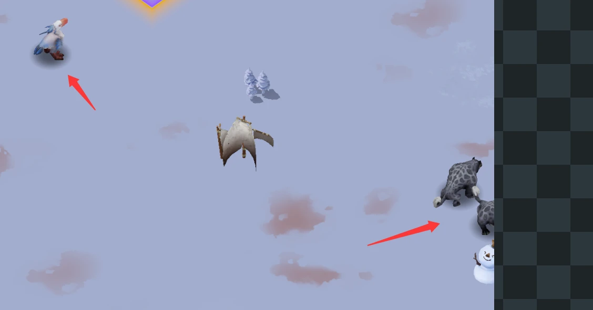
#### 特效部分
* shaderlod 分级，低配主要去掉了扭曲相关复杂计算
* 特效lod，低配约为满配的一半
#### 动画部分
* BAT：GPU skin + Texture预计算骨骼子父集transfrom
    * 这个已经验证了。VAT虽然在极限情况(1000obj)是效果最好的，但占的内存会更多。考虑到我们游戏目前不会有那么多东西，所以用无尽冬日的GPUSkin+Tex应该更合理。(这里的Tex都不能压缩不能开mip)
    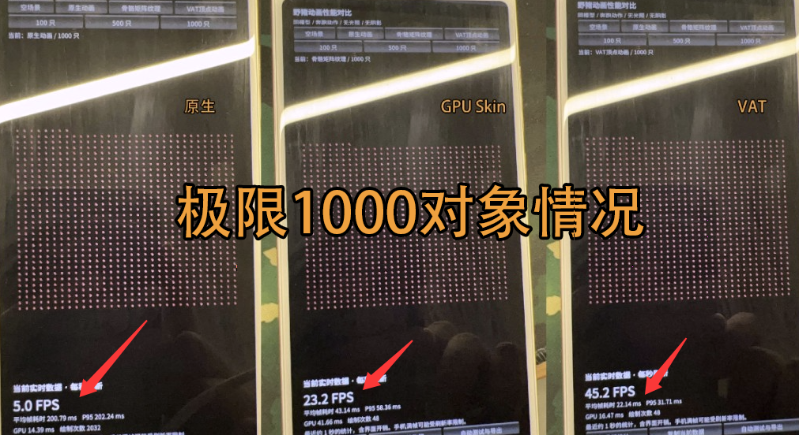
    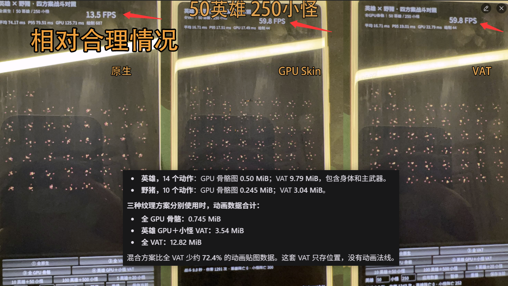
* 动画lod。例如行军低配只有部分模型，坐骑直接不渲染了
#### 贴图部分
* 有开mip
* 高低配没差异(TL目前是低配开了mip的half res)
* 大世界下，基本分辨率控制在了256左右，少数512和1024(所以他们行军的角色放大了很糊)
* 城堡主体都用的贴图，小部分动态(例如雪人装饰，行军，风车等)用的模型走BAT
    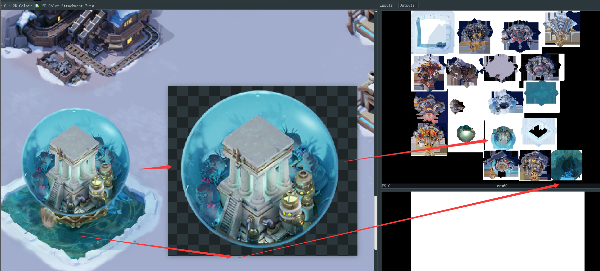

---
<a id="overview"></a>

## 01 · 总览

| 项目 | 满配 | 大世界1 · 低配 | 行军 · 低配 |
| --- | ---: | ---: | ---: |
| 主画面分辨率 | 1080×1920 | 648×1152 | 648×1152 |
| 相对渲染比例（宽／高） | 1.0 | 0.6 | 0.6 |
| 相对像素总量 | 100% | 36% | 36% |
| 每次主场景绘制 | 1,586 次 | 1,147 次 | 1,011 次 |
| 通用特效与叠加绘制 | 960 次 | 488 次 | 401 次 |
| UI 图集与文字绘制 | 469 次 | 476 次 | 467 次 |
| 骨骼动画绘制 | 28 次 | 23 次 | 21 次 |
| 已核对纹理载荷 | 511.02 MiB | 460.95 MiB | 426.07 MiB |

**最明显的差别是低配降低分辨率、减少特效绘制。** 行军低配比满配少 575 次主场景绘制，其中 559 次来自通用特效与叠加，UI 仅少 2 次。

大世界1 在同一捕获中重绘了两次主场景，上表按单次比较。纹理载荷分别核对 277／219／186 项，包含驻留资源差异，不是进程显存或纯画质降档节省量。

> **低配为 0.6 倍渲染，UI 也跟着降低分辨率。** 1080×1920 → 648×1152，像素总量为 36%；放大显示后布局占比不变，但文字与图标变软。截帧不能确认上层配置名称是 Render Scale 还是固定 DPI。

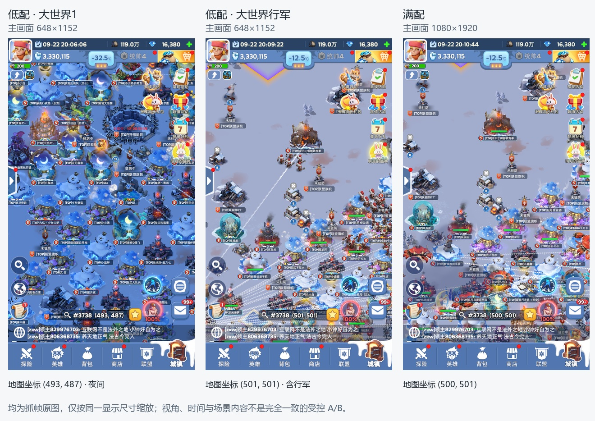

三份截帧的地点、时间和战斗状态有差异；可比较资源与绘制结构，不能直接归因全部差异于画质开关。

<a id="scene"></a>

## 02 · 模型规格

<a id="bone-model-gallery"></a>

### 02.1 模型与贴图

**面数按单次绘制、单实例的三角形计，不乘实例数。** 复合装饰按部件列，不当作整座建筑总面数。外观图在本次捕获中均为 RGBA8 sRGB；通用 4×4 白图不重复列。

| 模型／部件 | 三角面数 | 外观／遮罩贴图尺寸 | 贴图 Mip |
| --- | ---: | --- | --- |
| 布帆／帐篷 · E159 | 526 | 256×256 | 有（9 级） |
| 雪人 · E173 | 1,067 | 512×512 | 有（10 级） |
| 桅杆与船形装饰 · E166 | 1,081 | 512×512 | 有（10 级） |
| 白色海鸟 · E248 | 723 | 256×256 | 有（9 级） |
| 蓝色鲸形装饰 · E180 | 876 | 256×256 | 有（9 级） |
| 带翼机械装饰 · E4909 | 986 | 256×128 | 有（9 级） |
| 红色机械蟹 · E4916 | 1,444 | 256×256 | 有（9 级） |
| 鹿形动物（边缘局部） · E262 | 1,226 | 256×256 | 有（9 级） |
| 雪豹状动物（局部） · E194 | 1,275 | 256×256 | 有（9 级） |
| 动物局部 · E255 | 658 | 1024×1024 | 有（11 级） |
| 复合装饰：树枝部件 · E1806 | 49 | 512×512＋256×256 | 混用：颜色图有，遮罩无 |
| 复合装饰：叠加部件 · E1753 | 50 | 512×512＋256×256 | 混用：颜色图有，遮罩无 |
| 复合装饰：垂挂部件 · E1812 | 375 | 512×512＋256×256 | 有（10／9 级） |
| 书本雪景（6 次部件绘制） | 每次 17～586 | 512×512、1024×1024；另有 4×4 辅助图 | 大图有，辅助图无 |

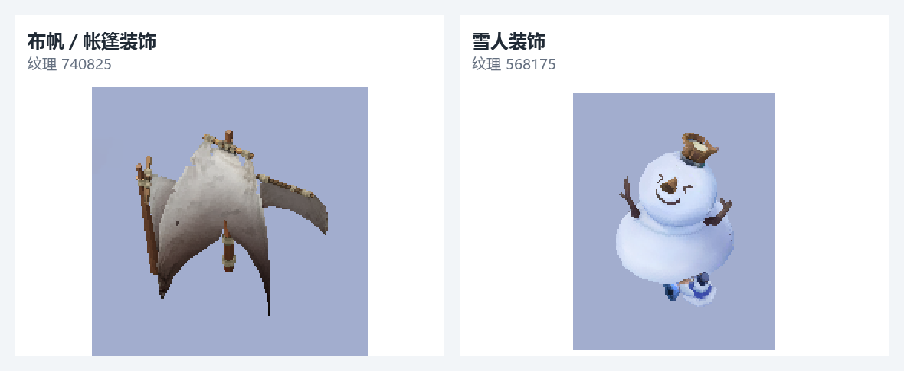

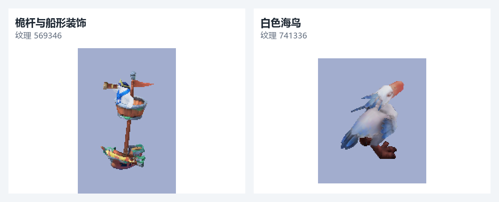

[其他模型截图与对应事件](满配-rdc-详细附录.md#bone-model-gallery)

<a id="static-models"></a>

### 02.2 建筑与植被规格

| 代表部件 | 三角面数 | 代表事件（满配） |
| --- | ---: | --- |
| 雪地平台底座 | 29 | E557 |
| 另一组建筑底座 | 57 | E746 |
| 植被／山石图块 | 2／实例 | E240；一次绘制 22 个实例 |

<a id="memory"></a>

## 03 · 贴图规格与容量

<a id="mip-inventory"></a>

### 03.1 尺寸、格式与 Mip

| 用途／代表 | 尺寸 | 捕获格式 | Mip | 备注 |
| --- | --- | --- | --- | --- |
| 地形控制图 42095 | 1024×1024 | RGBA8 sRGB | 无 | RGB 通道控制混色 |
| 地形输入 785772、785840 | 512×512 | RGBA8 sRGB | 有，10 级 | 细节／辅助输入 |
| 地形输入 785912 | 1024×1024 | RGBA8 sRGB | 有，11 级 | 地形变体输入 |
| 建筑主体大图集 | 代表为 2048×2048 | RGBA8 sRGB | 无 | 每张 16 MiB；不是所有图块只有 2 个三角形 |
| 角色／骨骼装饰外观 | 代表为 256×128～1024×1024 | RGBA8 sRGB | 多数有 | 满配 23 项多级、3 项单层 |
| 烟雾／火焰图集 567942 | 256×256 | RGBA8 sRGB | 无 | 高低配相同尺寸、相同像素 |
| 特效整体 | 按资源区分 | 以 RGBA8 sRGB 为主 | 混用 | 满配 44 项多级、131 项单层 |
| UI 图集 42115 | 2048×2048 | RGBA8 sRGB | 无 | 16 MiB |
| 字体 786448 | 1024×1024 | R8 | 无 | 1 MiB |
| 骨骼矩阵图 | 随骨架与样本数变化 | RGBA16F | 无 | 17 张合计 4.90 MiB |
| 567743 颜色图＋567750 遮罩 | 各 2048×2048 | RGBA8 sRGB | 无 | 各 16 MiB，合计 32 MiB |

这些是捕获中的资源配置，不是对方正式制作规范。RGBA8 在此处是未压缩格式，不能据此断定手机安装包源资源也未压缩。

**容量大头是图集：21 张 2048² 单层 RGBA8 共 336 MiB。** 已知 277 项合计 511.02 MiB；完整 Mip 检查覆盖满配全部 281 项，其中 72 项多级、209 项单层。

[全部 694 条跨截帧纹理规格](满配-rdc-详细附录.md#toc-23-3) · [按用途与画质统计 Mip](满配-rdc-详细附录.md#mip-inventory)

<a id="animation"></a>
<a id="bone-counts"></a>

## 04 · 特殊项：GPU 骨骼动画

本帧使用 **GPU Skinning＋骨骼矩阵图**，不是每顶点位置 VAT。每个矩阵占 3 个 RGBA 像素；顶点最多受 4 根骨骼影响，Shader 组合绑定矩阵与当前姿态矩阵后蒙皮。

| 代表 | 骨骼数 | 存储姿态样本 | 矩阵图 |
| --- | ---: | ---: | --- |
| 布帆／帐篷 | 8 | 80 | 24×81 |
| 雪人 | 存储 35，本帧使用 31 | 410 | 105×411 |
| 书本雪景 | 存储 131，本帧使用 130 | 564 | 393×565 |
| 鹿形动物 | 29 | 543 | 174×272；横向分两块 |

**姿态样本不是动作数量或 FPS。** 比如 80 个样本可能覆盖一个或多个动作，缺少动作表不能拆分。鹿形动物有横向分块，骨骼数不能直接按整张宽度÷3计算。

28 次蒙皮绘制中，11 次采用 Linear、17 次采用 Point。原实现满 4 个有效影响时最多读取 24 次骨骼纹理；这是算法取样数，不是实测缓存缺失次数。

<a id="animation-principle"></a>

### 04.1 三种方案的原理

这里需要先澄清概念：**当前方案本身就是 GPU Skinning**，更准确地说是“骨骼矩阵纹理驱动的 GPU Skinning（也常称 BAT）”。它与通常所说的“常规 GPU Skinning”都保留骨骼、权重和蒙皮语义，主要区别是骨骼姿态数据从哪里来；VAT 则直接记录每个顶点的形变结果，不再按骨骼权重计算。

- **当前方案：骨骼矩阵纹理 GPU Skinning。** 网格顶点保存原始位置、骨骼索引和权重；各骨骼在各姿态样本下的矩阵预先排入 RGBA16F 纹理。运行时每个实例给出动作区间／时间，顶点 Shader 按“时间＋骨骼索引”读取矩阵，再按权重对最多 4 根骨骼的结果加权。它把逐实例的动画姿态求解和大量矩阵上传，换成了 GPU 顶点纹理读取与蒙皮计算。

- **常规 GPU Skinning。** CPU Animator 通常先计算当前帧骨骼层级和蒙皮矩阵，再通过 Uniform、Constant Buffer 或 Structured Buffer 传给 GPU。顶点 Shader 仍按骨骼索引和权重加权变形，但只读取当前姿态矩阵，不需要保存整段动画的矩阵纹理。角色数量多时，CPU 姿态计算、矩阵上传和每实例状态管理更容易成为成本。

- **VAT（Vertex Animation Texture）。** 离线把每一帧、每一个顶点的位置／位移写入纹理，需要光照时通常还要保存法线，必要时再保存切线。运行时顶点 Shader 根据顶点编号与动画时间直接取出形变后的位置，通常不再进行骨骼矩阵加权。它适合布料、软体和复杂离线形变，但骨骼、关节、挂点等语义不会天然保留。

可将三者的数据流简化为：

```text
常规 GPU Skinning：动画参数 → CPU 求当前骨骼矩阵 → 上传当前矩阵 → GPU 按权重蒙皮
当前矩阵图方案：动画时间 → GPU 读取预存骨骼矩阵 → GPU 按权重蒙皮
VAT：动画时间 → GPU 读取预存顶点位置／法线 → 直接还原顶点形变
```

<a id="animation-comparison"></a>

### 04.2 当前方案、常规 GPU Skinning 与 VAT 对比

| 对比项 | 当前：骨骼矩阵图 GPU Skinning | 常规 GPU Skinning | VAT |
| --- | --- | --- | --- |
| 动画数据 | 每帧每根骨骼的矩阵 | 当前帧骨骼矩阵；动画曲线通常由 CPU 计算 | 每帧每个顶点的位置／位移，常另带法线 |
| 数据量增长 | 骨骼数 × 采样帧数 | 运行时主要保留当前骨骼矩阵；另有动画曲线资源 | 顶点数 × 采样帧数，通常明显更大 |
| 顶点端工作 | 纹理取骨骼矩阵＋多骨骼加权；本实现 4 影响上限路径最多 24 次矩阵纹理读取 | Buffer 取当前矩阵＋多骨骼加权 | 通常读取位置并插值；若需要法线／切线会增加读取 |
| CPU 与上传 | 适合减少大量实例逐帧姿态求解和矩阵上传 | CPU Animator、骨骼层级计算及逐实例矩阵上传较多 | 运行时 CPU 很轻，主要传动画时间／帧索引 |
| 动画混合／IK | 可实现，但需要多动作取样、混合或额外数据路径；当前抓帧不能证明已支持 | 最灵活，容易做状态混合、IK、瞄准和局部骨骼控制 | 以烘焙回放为主；动态 IK、局部骨骼控制较困难 |
| 挂点／武器 | 保留骨骼语义，可额外读取目标骨骼矩阵 | 天然保留骨骼 Transform，最方便 | 需额外烘焙挂点轨迹或单独维护骨架 |
| 网格与 LOD | 同骨架的兼容网格／LOD 可共享动画矩阵数据 | 同骨架兼容网格可共享动画与姿态 | 顶点顺序和数量变化通常需要各 LOD 分别烘焙 |
| 复杂形变 | 适合角色、旗帜、机械件等能由少量骨骼表达的形变 | 同左，受骨架表达能力限制 | 擅长布料、软体、流体表面等难以骨骼化的形变 |
| 实例化 | 很适合；实例只需提供时间、动作区间和物体参数 | 可以做，但不同实例姿态矩阵的管理与上传更复杂 | 很适合；实例通常只需提供时间和片段参数 |
| 主要代价 | 顶点纹理带宽、蒙皮 ALU、动画纹理容量与采样边界管理 | CPU 动画开销、矩阵上传及 Draw/实例数据管理 | 动画纹理容量、显存带宽、LOD 重复烘焙及交互能力受限 |

以本次抓帧为准，17 张骨骼矩阵纹理合计仅 **4.90 MiB**，当前方案的动画存储并不突出；28 次相关绘制却提交了较多顶点／索引引用，因此更应先在目标设备测量顶点阶段耗时，而不是仅因“GPU Skinning”名称就改成 VAT。若主要对象仍是可由少量骨骼表达的装饰和动物，当前方案更符合数据复用与实例化需求；只有复杂布料／软体形变无法用骨骼可靠还原时，才值得按对象评估 VAT。

<a id="animation-screenshot"></a>

### 04.3 低配骨骼绘制少了什么：对应位置截图

下面对照同名城堡的对应位置。左为满配，右为行军低配；通过 34 组相同网格的位置对齐，低配仅放大到相同显示尺度。

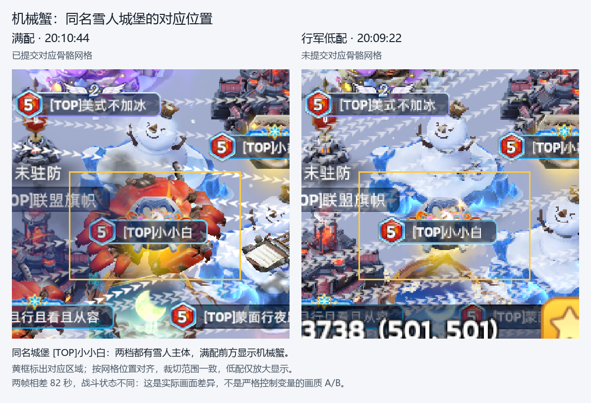

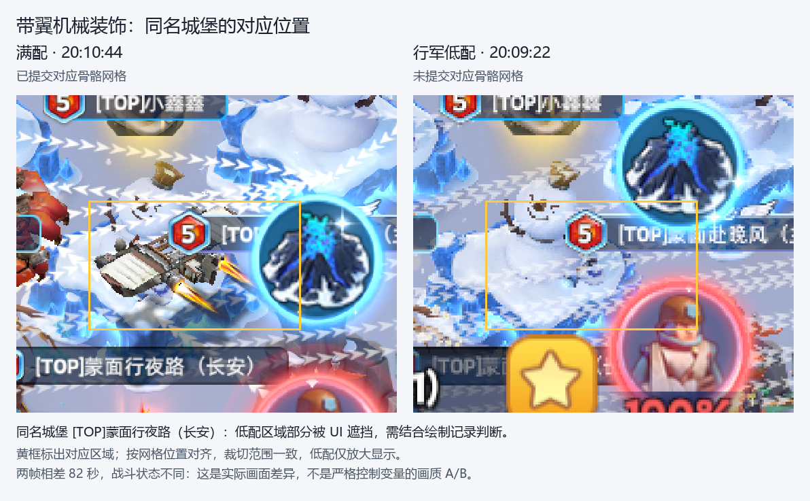

满配 E4909 提交 2 个带翼装饰实例，E4916 提交 5 个机械蟹实例；行军低配未找到这两种对应网格的骨骼绘制。**这里少的是附加装饰，雪人建筑主体仍在。** 两帧相差 82 秒、战斗状态不同，因此不能仅凭这组图断定是画质开关直接关闭。


[完整骨骼／样本计数](满配-rdc-详细附录.md#toc-08-3) · [实现、限制与 VAT 取舍](满配-rdc-详细附录.md#skinning-deep-dive)

<a id="quality-comparison"></a>
<a id="resolution-scaling"></a>

## 05 · 高低配与特效

| 项目 | 大世界1 · 低配 | 行军 · 低配 | 满配 |
| --- | ---: | ---: | ---: |
| 渲染分辨率 | 648×1152 | 648×1152 | 1080×1920 |
| 每次主场景绘制 | 1,147 | 1,011 | 1,586 |
| 通用特效与叠加绘制 | 488 | 401 | 960 |
| UI 图集／文字绘制 | 476 | 467 | 469 |
| 骨骼动画绘制 | 23 | 21 | 28 |

> **行军低配与满配相差 575 次主场景绘制，其中 559 次来自通用特效与叠加；UI 仅差 2 次。**

大世界1 内有两次主场景重绘，表中按单次统计。低配仍使用骨骼矩阵动画，也没有统一缩小源贴图。以上是样本差异，不是严格控制变量后的画质收益。

<a id="effect-features"></a>

### 05.1 特效功能差异

| 功能／组合 | 低配 | 满配 |
| --- | --- | --- |
| 主图颜色、Alpha 整形 | 有 | 有 |
| 独立 Mask、RGBA 通道选择 | 有 | 有 |
| 多层 UV 滚动、噪声、基础 UV 扰动 | 有 | 有 |
| 多 Mask 与 Alpha 裁切 | 有 | 有 |
| 序列图素材、顶点辅助取样 | 有 | 有 |
| 扰动＋Alpha 整形特定组合 | 未见该变体 | 27 次 |
| 扰动＋独立 Mask 特定组合 | 未见该变体 | 52 次 |
| 扰动＋多 Mask＋裁切复杂组合 | 未见该变体 | 80 次 |
| 另一复杂扰动／裁切变体 | 未见该变体 | 11 次 |
| 特定双贴图流动条纹 | 未见该变体 | 8 次 |

“未见”指这两份低配没有提交相同 Shader 组合，不代表低配全局禁止该功能。这里的扰动主要改变素材 UV，不是已证实的屏幕折射。

<a id="particle-comparison"></a>

### 05.2 粒子截图对比

**基础烟雾：两档均为 2 个三角形、256² 单层图、1 次片元取样；贴图和 Shader 代码一致。** 对比事件为行军 E289、满配 E310，画面差异包含粒子相位与参数差异。

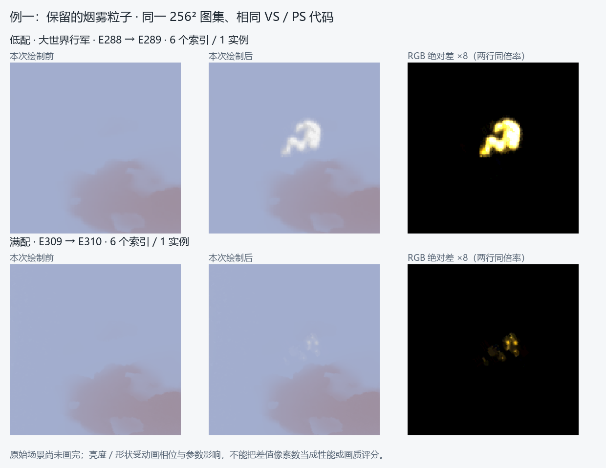

**复杂叠加：满配 E4525 为 2 个三角形，绑定 5 张输入图、最多 6 个静态取样点，包含扰动／Mask／裁切。** 对应家族满配 80 次，两份低配均未见。

**例二可见特效分级／LOD 式裁减的线索。** 同名蘑菇城堡在满配中有更明显的两侧烟线、周围光点与柔光；行军低配中这些装饰层明显减少或未显示，主体与战斗提示仍保留。可将它记为“装饰特效随档位／状态裁减”的观察线索；目前没有控制距离、画质与战斗状态，尚不能确认具体触发规则。

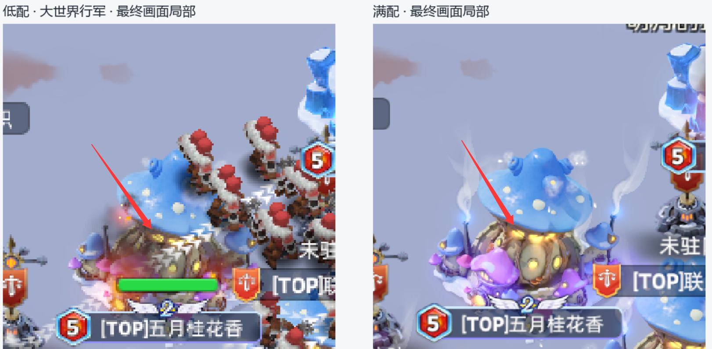

红箭头处，满配檐下窗光更亮，低配仍可见黄色窗光；低配同时有部队、受击效果与血条。图中的全部烟线、光点由多次绘制构成，不能都归因于 E4525，也不能仅凭外观把窗光差异归因于 567750。

[查看例二单次叠加的绘制分解](images/mushroom-effect-comparison.png)

<a id="texture-567750"></a>

## 06 · 特殊项：567750 四通道遮罩

**2048²、RGBA8 sRGB、无 Mip、16 MiB；高低配都使用。** 它与颜色图 567743 配套，用四个通道控制四组附加颜色，可表现为局部自发光；不是直接存最终 RGB 发光颜色的普通自发光图。

**“满配更亮”不等于“这张图只在满配使用”。** 满配 E582 与行军低配 E590 使用相同 Shader，并同时采样 567743＋567750；另一份低配“大世界1”的 E581 已通过关闭／保留通道回放，验证 R 通道有实际颜色贡献。因而 567750 不是高配专用。

例二红箭头确实显示檐下亮度差异，但尚未把该差异定位到 567750 的单独贡献。这里保留“高低配存在外观差异”的观察，和上节的装饰特效裁减分开说明。

| 通道 | 用途 | 已核对代表事件中的表现 |
| --- | --- | --- |
| R | 第一组附加颜色区域 | 开启，主要让局部暖色灯点变亮 |
| G | 第二组附加颜色区域 | 颜色强度为 0 |
| B | 第三组附加颜色区域 | 颜色强度为 0 |
| A | 第四组附加颜色区域 | 颜色强度为 0；不控制最终透明度 |

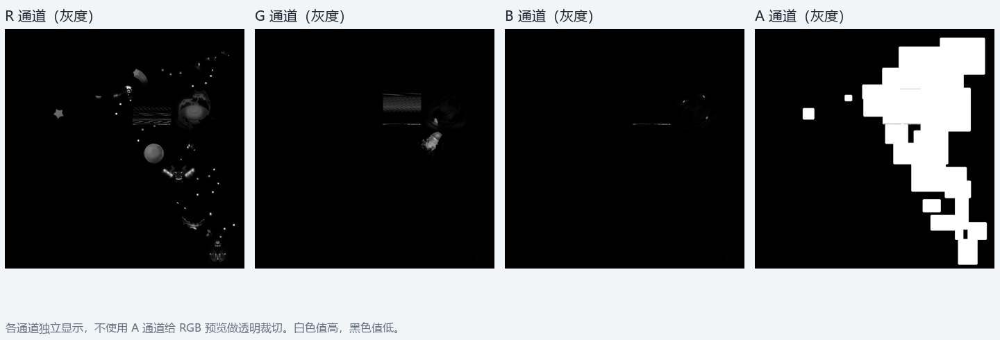

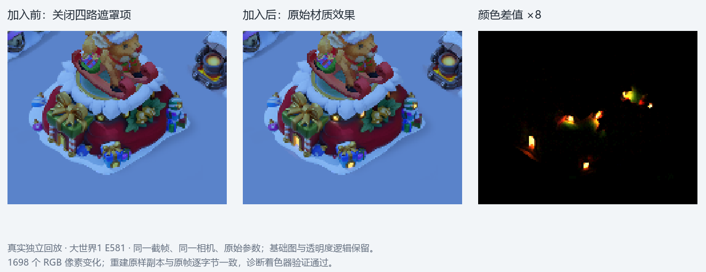

大世界1 E581 中，仅 R 就能重现原效果；关闭附加颜色后有 1,698 个 RGB 像素变化，Alpha 不变。G/B/A 只是在这个参数状态下关闭，不能推断永远不用。对比关闭的是颜色贡献，仍保留采样，不能用于测算删图后的性能收益。

更多 Shader、纹理清单、骨骼数据与核对过程见 [详细附录](满配-rdc-详细附录.md)。
