RENDERDOC CAPTURE REVIEW · 2026-09-23

# 满配.rdc · 全帧渲染分析

大地图、骨骼动画、特效与 UI；重复项按 Shader 家族归纳，每类保留一至两个代表。

| 全帧指标 | 数值 |
| --- | --- |
| 已检查绘制次数 | 1,591 |
| VS / PS 资源对 | 53 |
| 连续图集／字体交替绘制 | 319 |
| 277 项已知纹理有效载荷 | 511.02 MiB |

> **2026-09-24 补充：** [纹理 567750 · RGBA 与前后对比](#texture-567750) ／ [全部 694 项纹理 Mip 清单](#mip-inventory) ／ [三份截帧的 LOD 核对](#lod-distance)

## 目录

- [**01 · 结论与优先级**](#overview)
    - [01.1 最值得先做的三件事](#toc-01-1)
    - [01.2 保持的合理设计](#toc-01-2)
- [**02 · 范围与全帧指标**](#scope)
- [**03 · 渲染流程与目标依赖**](#pipeline)
- [**04 · 画面逐层构成**](#stages)
    - [04.1 第一排：地表 → 骨骼动画 → 场景图集](#toc-04-1)
    - [04.2 第二排：特效叠加 → 世界内容完成 → 标牌与界面](#toc-04-2)
- [**05 · 重复绘制归类**](#distribution)
    - [05.1 按 Shader 功能归类的绘制数量](#toc-05-1)
- [**06 · 地表、建筑与装饰**](#scene)
    - [06.1 地表：少量 draw，大面积像素工作](#toc-06-1)
    - [06.2 区域边界与图集化场景](#toc-06-2)
- [**07 · 骨骼动画与 VAT 辨别**](#animation)
    - [07.1 从 Shader 还原出的数据路径](#toc-07-1)
    - [07.2 两个代表例子](#toc-07-2)
- [**08 · 骨骼数量与动画帧数核算**](#bone-counts)
    - [08.1 姿态样本不是动作：一个动作由多个样本组成](#toc-08-1)
    - [08.2 模型截图：把骨骼数据对到实际对象](#toc-08-2)
    - [08.3 逐纹理骨骼与帧数对照](#toc-08-3)
    - [08.4 为什么不能只看纹理宽高](#toc-08-4)
    - [08.5 计数方法与可信边界](#toc-08-5)
- [**09 · GPU Skinning＋矩阵图：实现与限制**](#skinning-deep-dive)
    - [09.1 骨骼矩阵解决什么问题](#toc-09-1)
    - [09.2 一张矩阵图怎么摆](#toc-09-2)
    - [09.3 本帧一次顶点蒙皮到底做了什么](#toc-09-3)
    - [09.4 时间插值：这份抓帧有两种实际路径](#toc-09-4)
    - [09.5 从制作到运行的完整方案](#toc-09-5)
    - [09.6 动画混合、挂点与交互怎么补](#toc-09-6)
    - [09.7 主要限制与应对](#toc-09-7)
    - [09.8 这份实现最值得验证的改进](#toc-09-8)
- [**10 · GPU Skinning 与 VAT 选型**](#skinning-vat)
    - [10.1 常规 GPU Skinning 必须有一张骨骼矩阵图吗？](#toc-10-1)
    - [10.2 一个明确假设下的容量例子](#toc-10-2)
    - [10.3 这份抓帧该怎么选](#toc-10-3)
- [**11 · 粒子与材质特效**](#effects)
    - [11.1 例一：火焰／光斑等单贴图特效](#toc-11-1)
    - [11.2 例二：多纹理扰动、遮罩与裁切](#toc-11-2)
    - [11.3 应控制的成本](#toc-11-3)
- [**12 · 特效共性、预算与验证**](#effects-standards)
    - [12.1 已观察到的共性](#toc-12-1)
    - [12.2 为什么应优先排查特效](#toc-12-2)
    - [12.3 适合你们建立的规范草案（建议，非对方已有标准）](#toc-12-3)
    - [12.4 最小验证顺序](#toc-12-4)
- [**13 · 高低配置对照**](#quality-comparison)
    - [13.1 这组对比支持哪些结论](#toc-13-1)
    - [13.2 按 Shader 代码匹配的特效家族](#toc-13-2)
- [**14 · 0.6 渲染比例、DPI 与 UI**](#resolution-scaling)
    - [14.1 DPI 和 Render Scale 应如何区分](#toc-14-1)
    - [14.2 UI 是否也跟着缩小？](#toc-14-2)
    - [14.3 如果希望场景省像素、UI 仍清晰](#toc-14-3)
- [**15 · 特效功能对比：低配与满配**](#effect-features)
    - [15.1 展开绘制数量与 Shader 证据（12 项）](#toc-15-1)
    - [15.2 无法从这组数据列成高低配开关的项目](#toc-15-2)
- [**16 · 粒子与局部截图对照**](#particle-comparison)
    - [16.1 例一：基础烟雾粒子仍用相同算法与源图](#toc-16-1)
    - [16.2 例二：同名蘑菇城堡附近的额外叠加](#toc-16-2)
    - [16.3 据此可以借鉴的性能规范](#toc-16-3)
- [**17 · UI、标牌与合批**](#ui)
    - [17.1 建议按这个次序改](#toc-17-1)
- [**18 · 纹理容量与压缩**](#memory)
    - [18.1 最大头：21 张 2048² 单 mip RGBA8 图集](#toc-18-1)
- [**19 · 性能证据与计时边界**](#performance)
    - [19.1 目前能确认与不能确认的瓶颈](#toc-19-1)
- [**20 · 优化顺序与验证方法**](#plan)
    - [20.1 建议补采的最小对照集](#toc-20-1)
- [**21 · 覆盖范围与未决项**](#limits)
- [**22 · 完整 Shader 清单与证据**](#appendix)
    - [22.1 证据文件索引](#toc-22-1)
- [**23 · 全部纹理的 Mip 分类清单**](#mip-inventory)
    - [23.1 按用途对照：数字为“多级 / 单层（合计）”](#toc-23-1)
    - [23.2 具体贴图与例外](#toc-23-2)
    - [23.3 694 项完整清单](#toc-23-3)
- [**24 · 跨截帧距离与模型 LOD 核对**](#lod-distance)
    - [24.1 例一：雪地平台底座](#toc-24-1)
    - [24.2 例二：另一组建筑底座](#toc-24-2)
- [**25 · 纹理 567750：RGBA 与前后对比**](#texture-567750)
    - [25.1 RGBA 四个通道分别在做什么](#toc-25-1)
    - [25.2 实际计算关系](#toc-25-2)
    - [25.3 加入前后对比：真实截帧独立回放](#toc-25-3)
    - [25.4 人为开启 G/B/A 时会怎样（原贴图材质示意）](#toc-25-4)
    - [25.5 原始截帧中的使用位置](#toc-25-5)

<a id="overview"></a>

## 01 · 结论与优先级

**这是一帧以图集精灵、少量骨骼动画和大量材质特效构成的大地图画面。** 主要压力线索集中在界面／标牌提交、特效密度与未压缩图集容量。骨骼矩阵贴图方案本身已经比较节省数据，不是首先该推翻的部分。

<a id="toc-01-1"></a>

### 最值得先做的三件事

- **先查标牌与 UI 批次。** 同一 UI Shader 共 449 次调用；EID 5159–6431 连续 319 次在图集和字体之间交替。

- **建立城堡特效的距离／屏幕面积预算。** 通用特效与叠加 Shader 归类合计 960 次绘制，部分也用于界面效果。不要把此数字理解成粒子数量。

- **查图集驻留及压缩回退。** 核对到的 277 个纹理资源有效载荷约 511.02 MiB，其中 21 张 2048² RGBA8 图集占 336 MiB。

<a id="toc-01-2"></a>

### 保持的合理设计

已有图集复用、实例化植被、骨骼矩阵贴图、单通道字体，以及主体单颜色目标 + 深度的简单渲染结构。优化重点应放在实际重复提交与资源规模，而不是统一换成 VAT 或增加复杂渲染通道。


图注：EID 7498 输出：本次主场景的可辨识画面。该画面用于技术分析；抓帧还包含其他显示表面。

> 报告中的“已确认”来自全量 draw／Shader 绑定和纹理读取；“建议验证”是优化假设。桌面回放计时不能代表手机帧时间。分析日期：2026-09-23。

> **重点标注：0.6 倍渲染，UI 也跟着缩小。** 
> 
> 这里“缩小”指 UI 的渲染像素尺寸：游戏 UI 随世界一起画入 648×1152，宽高为满配的 60%，总像素为 36%；放大显示后布局占比通常保持，文字与图标清晰度随之下降。
> 
> [查看分辨率与 UI 证据](#resolution-scaling)

<a id="scope"></a>

## 02 · 范围与全帧指标

| 项目 | 结果／统计口径 |
| --- | --- |
| 抓帧 | 满配.rdc；C:/Users/admin/Desktop/WJDR/满配.rdc |
| 图形接口 | Vulkan；104 个 Shader 带 ANGLE 标识；宿主表面 190 / 520 两个 Shader 为 Glslang |
| Draw Call | 1,591；其中主场景 1,586，其他表面／拷贝 5 |
| Shader | 53 组 VS + PS 资源对；53 个 VS、53 个 PS，所有 draw 均已检查绑定 |
| 提交量 | 229,868 个顶点／索引引用（乘以 instanceCount）；不是唯一顶点数，也不是直接统计出的三角面数 |
| 粒度 | 531 次 draw 仅提交 ≤6 个索引／顶点；682 次 ≤12；中位数为 18（不乘实例数） |
| 实例化 | 7 次 instanceCount >1，最大 22；不能把 RenderDoc 的 Instanced 标志直接等同于有效多实例合批 |
| 资源总量 | 抓帧列出 281 个纹理、39 个 Buffer；本报告核对了 273 个采样纹理和相关附件，共 277 个纹理描述 |
| 主目标 | 1080 × 1920，R8G8B8A8\_SRGB；深度 D24S8；已核对资源的采样数均为 1 |
| 通道 | 5 个自动 Colour Pass 分组，内含 6 段实际 render pass；2 次 Present；0 次 Compute Dispatch |

主场景的 ANGLE 标识说明游戏绘制使用经过 ANGLE 转译的着色器与 Vulkan 命令流，符合 OpenGL ES／WebGL 宿主路径；两个 Glslang Shader 属于另一个显示表面家族。它们本身不能证明具体客户端引擎、版本或手机原生后端。报告不把当前工作区的 Unity 配置套到这份抓帧上。

证据：get\_capture\_status.json、get\_frame\_summary.json、get\_draw\_calls.json；pipelines/ 内 1,591 份状态；shaders/ 内 106 份反汇编；analysis.json。

<a id="pipeline"></a>

## 03 · 渲染流程与目标依赖

| 分组／事件 | 输入 → 输出 | 用途判定 |
| --- | --- | --- |
| #1：36、71 | 1257 / 304 → 1266（300 × 200） | 两段小表面绘制，之后 EID 75 Present。属于主场景之外的显示表面；宿主用途为推断。 |
| #2：136–7412 | 场景纹理与动画数据 → 786473；深度 786479 | 地表、建筑图块、动画、特效、标牌、界面，共 1,586 draw。开始清颜色和深度，结束保留颜色，深度 Don’t Care。 |
| #3：7456 | 786428 → 310（1080 × 1920） | 单次 RGB 取样并输出 alpha=1。输入并不是 786473；不能强行串成主场景的后处理链。 |
| #4：7498 | 786473 → 786659（1080 × 1920） | 单取样拷贝；导出画面方向由倒置转为正常，属于展示／方向处理路径。 |
| #5：7540 | 1257 → 653867（1142 × 2030） | 另一宿主表面绘制，随后 EID 7544 Present。该目标直接读回为黑色，不能据此声称游戏最终显示黑屏。 |

**这不是一条“场景 → Bloom → 色调映射 → 最终屏幕”的五段链。** 两个 Present、多组目标及独立输入源表明抓帧同时包含多个表面的工作。最后一个 draw／Present 不一定就是需要分析的游戏主画面。

本次可见路径中没有独立 G-buffer、阴影图生成、SSAO、Bloom 模糊链或 TAA 历史重投影通道；没有 Compute Dispatch。发光外观主要来自特效贴图、颜色／Alpha 运算与叠加。未发现这些通道仅限定于此抓帧，不能推论游戏所有画质模式都没有。

证据：各通道首末 draw details、输入绑定；3568\_pixel.txt、3596\_pixel.txt、520\_pixel.txt；event-7456 / 7498 / 7540 的纹理读回。

<a id="stages"></a>

## 04 · 画面逐层构成

以下选择主目标 786473 的六个时间点，看画面如何累积。主场景原始 RT 方向倒置，图中统一做了垂直翻转以便阅读；未做美化或重新渲染。

<a id="toc-04-1"></a>

### 第一排：地表 → 骨骼动画 → 场景图集

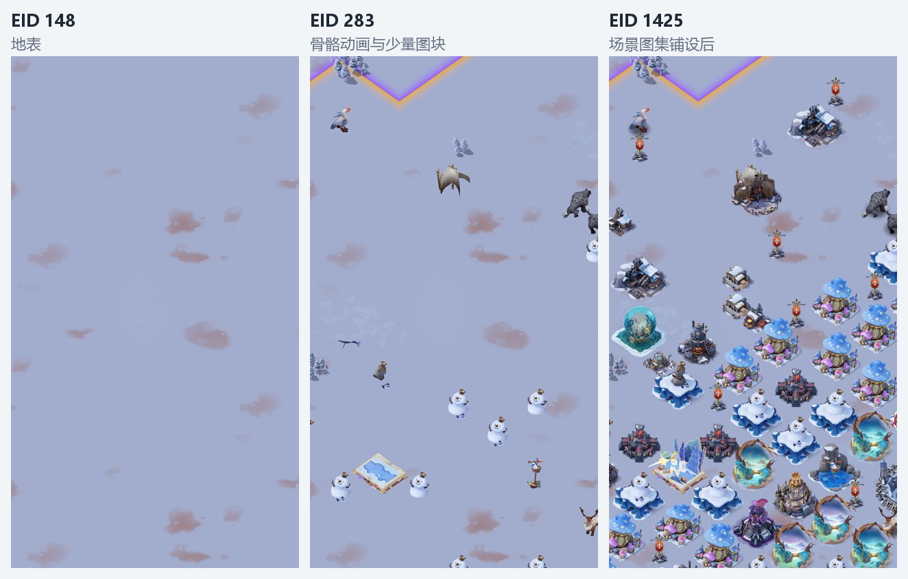

查看独立原图：[EID 148 · 地表](images/stage-148.jpg) ｜ [EID 283 · 骨骼动画与少量图块](images/stage-283.jpg) ｜ [EID 1425 · 场景图集铺设后](images/stage-1425.jpg)

<a id="toc-04-2"></a>

### 第二排：特效叠加 → 世界内容完成 → 标牌与界面

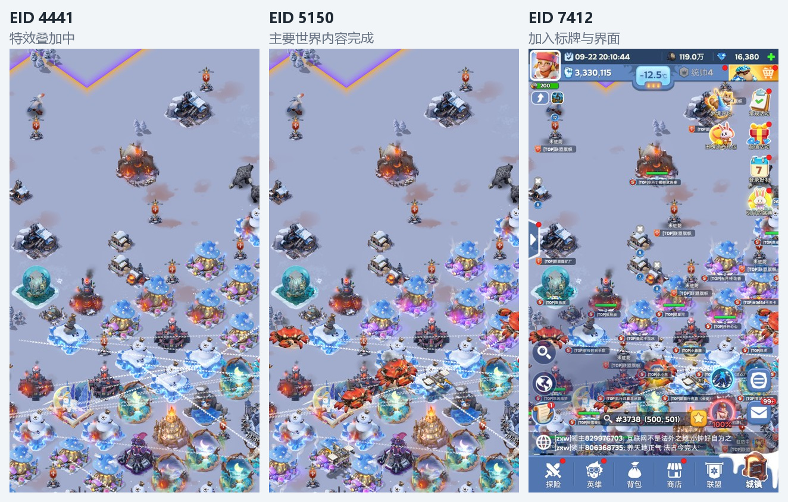

查看独立原图：[EID 4441 · 特效叠加中](images/stage-4441.jpg) ｜ [EID 5150 · 主要世界内容完成](images/stage-5150.jpg) ｜ [EID 7412 · 加入标牌与界面](images/stage-7412.jpg)

图注：每排从左向右按绘制时间推进，两排共六个阶段。六张截图保持相同尺寸与完整画面，仅拼接排列，方便对比新增内容。

EID 136–5150 共 1,068 次绘制，主要为世界内容；EID 5159–7412 共 518 次，为标牌／界面及其特效。该分段按实际时间位置统计，不意味着每个 Shader 只服务一种对象。

<a id="distribution"></a>

## 05 · 重复绘制归类

<a id="toc-05-1"></a>

### 按 Shader 功能归类的绘制数量

| Shader 功能分类 | 绘制次数 | 占全帧比例 |
| --- | ---: | ---: |
| 通用特效与叠加 | 960 | 60.3% |
| UI 图集与文字 | 469 | 29.5% |
| 场景精灵与装饰 | 93 | 5.8% |
| 骨骼动画 | 28 | 1.8% |
| 界面专用叠加 | 19 | 1.2% |
| 场景发光图 | 12 | 0.8% |
| 宿主与画面拷贝 | 5 | 0.3% |
| 地表 | 4 | 0.3% |
| 区域边界 | 1 | 0.1% |
| **合计** | **1,591** | **100%** |

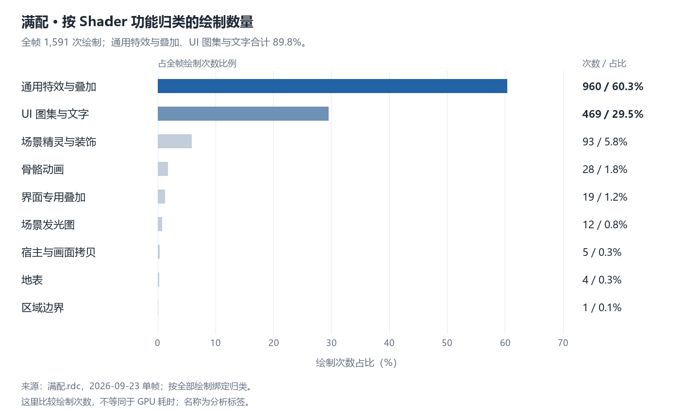

图注：横轴为绘制次数占全帧 1,591 次的比例；纵轴为 Shader 功能分类。通用特效与叠加、UI 图集与文字合计占 **89.8%**。

来源：满配.rdc，2026-09-23 单次抓帧、全部绑定。占比保留一位小数，各行相加可能存在舍入误差；绘制次数占比不等于 GPU 耗时占比。

“通用特效与叠加”含火焰、光斑、噪声、遮罩、流动条纹等 Shader 家族，也可能复用于 UI；它不能用于倒推出 ParticleSystem 数量。53 个资源对也不等于 53 份原始 Shader 文件或 53 种游戏材质。

| 重复最多的资源对 | 次数 | 代表事件 | 观察 |
| --- | --- | --- | --- |
| UI 图集与文字 | 449 | 5159, 5163 | VS 3869 / PS 3870 |
| 单贴图特效／亮度与透明度整形 | 247 | 308, 309 | VS 788113 / PS 788114 |
| 主纹理 + 通道遮罩特效 | 142 | 597, 660 | VS 788195 / PS 788196 |
| 多层滚动／噪声特效 | 134 | 1506, 1507 | VS 7876 / PS 7877 |
| 光斑／边缘淡出特效 | 91 | 1959, 1960 | VS 7869 / PS 7870 |
| 场景图集／预乘 Alpha 精灵 | 83 | 214, 230 | VS 42612 / PS 42613 |
| 多层遮罩／扰动／裁切特效 | 80 | 300, 1820 | VS 788323 / PS 788324 |
| 双取样扰动／遮罩特效 | 52 | 494, 590 | VS 788158 / PS 788159 |

<a id="scene"></a>

## 06 · 地表、建筑与装饰

<a id="toc-06-1"></a>

### 地表：少量 draw，大面积像素工作

EID 136 使用 42095（1024² RGB 控制图）和 785772（512² 纹理）。PS 多次以不同尺度读取控制图的 R/G/B 通道，混合几组颜色；另有世界位置、法线、视线／光照方向构造的高光计算。静态反汇编中有 7 个纹理取样点。EID 144、148 使用 8 取样点变体，并增加纹理 785840。

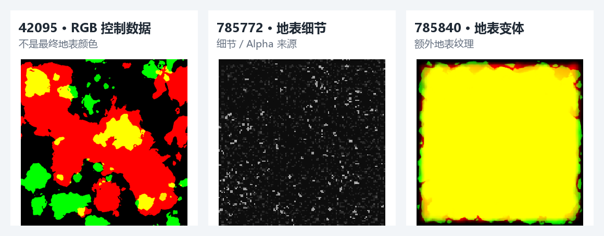

| 位置 | 贴图与用途 | 独立原图 |
| --- | --- | --- |
| 1 | 42095：RGB 控制数据，不是最终地表颜色 | [查看原图](images/tex-42095.png) |
| 2 | 785772：地表细节／Alpha 来源 | [查看原图](images/tex-785772.png) |
| 3 | 785840：额外地表变体纹理 | [查看原图](images/tex-785840.png) |

图注：预览按版面等比缩放，保持完整内容；显示大小不代表源纹理的分辨率比例。

这类地表在最早阶段覆盖大片画面，适合检查控制图重复采样、远景细节与高光是否必要。其数量只有 4 次，却不能忽略像素成本。是否值得缓存或简化，应结合相机是否移动、地图是否动态修改验证。

<a id="toc-06-2"></a>

### 区域边界与图集化场景

EID 222：读取 42183 的当前格与邻格信息，做通道比较、边缘判断，再读取 42136 和 64 × 1 的 42125 色带。它更符合地图区域／边界可视化路径，不是全屏后处理。精确业务语义需要原始材质命名确认。

EID 214／230 的 42612–42613 家族共有 83 次：读取主图集和另一 Alpha 来源，混合 Alpha 后乘顶点颜色，再做预乘 Alpha 输出。配合阶段截图，可确认很多建筑／地面外观采用图集图块铺设。不能仅因为输入是一张建筑图集，就声称整个建筑一定是单个四边形；部分 draw 提交了更复杂网格。

EID 240 使用植被／山石图集 42200，6 个索引、22 个实例，PS 含 Kill 裁切；这是有效的多实例绘制例子。EID 291／320 的软圆形贴图更像阴影片／投影，不能称作实时阴影图。

证据：EID 136、144、148、214、222、230、240、291、320；788063、788071、42547、42613、788089、42746 的 PS。

<a id="animation"></a>

## 07 · 骨骼动画与 VAT 辨别

**之前那张彩条图的结论成立：是骨骼矩阵纹理驱动的 GPU Skinning。** 本帧共找到 17 张 RGBA16F 动画数据纹理，相关蒙皮 Shader 家族合计 28 次绘制；共提交 101,172 个索引引用（已乘实例数），占全帧引用量约 44.0%。

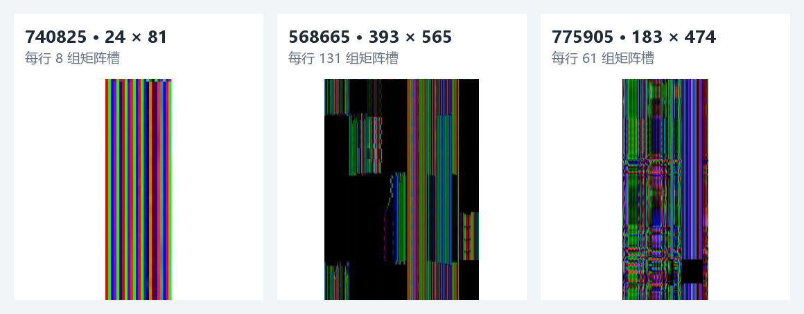

| 位置 | 贴图与用途 | 独立原图 |
| --- | --- | --- |
| 1 | 740825：24 × 81，8 组矩阵槽／行 | [查看原图](images/tex-740825.png) |
| 2 | 568665：393 × 565，131 组矩阵槽／行 | [查看原图](images/tex-568665.png) |
| 3 | 775905：183 × 474，61 组矩阵槽／行 | [查看原图](images/tex-775905.png) |

图注：预览按版面等比缩放，保持完整内容；显示大小不代表源纹理的分辨率比例。

<a id="toc-07-1"></a>

### 从 Shader 还原出的数据路径

- 每 3 个 RGBA texel 组成一组 3×4 仿射矩阵。新补读的 28 次原生常量确认：固定矩阵读取左侧第 0 行，动画矩阵使用另一组 UV。42728 还包含两列横向动画块，不能一律用宽÷3 当骨骼数。完整计数见下一节。

- VS 遍历最多 4 个骨骼影响，权重大于零才进入取样；每个有效影响读取两组各 3 个 texel，并组合矩阵，再与顶点位置做点积，最后加权累加。

- 两组三行矩阵先相乘，构成“当前姿态 × 固定绑定变换”的蒙皮矩阵；这两组并非用于彼此 lerp。时间插值是另一层：11 次 draw 的骨骼采样器为 Linear，17 次为 Point；前者在小数 V 坐标上插值相邻姿态行，后者选取最近行。

- 之后应用实例物体矩阵及视图投影；有些变体额外在 VS 读取彩色噪声／辅助纹理。EID 730 的变体静态有 7 个 VS 取样点。

- 以原始 Shader 路径计算，满 4 个非零影响时最多执行 24 次骨骼纹理取样；这不是对纹理缓存缺失次数或 GPU 最终机器指令的测量。

<a id="toc-07-2"></a>

### 两个代表例子

EID 159：1,578 个索引、1 个实例；VS 读 740825，PS 读帐篷图集 785864。EID 173：3,201 个索引、9 个实例，同属简单蒙皮家族，体现了动画与实例化可以同时工作。

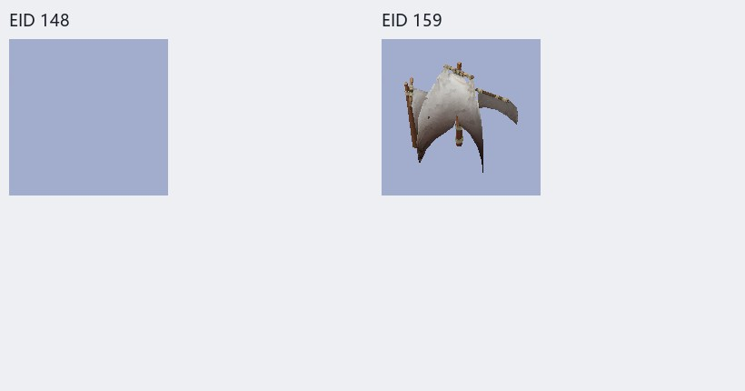

图注：EID 148 → 159：同一帧中这次蒙皮绘制带来的局部画面变化。

17 张动画数据纹理合计约  **4.90 MiB** ，只占已核对纹理载荷约 0.96%。相较图集容量，存储优化优先级较低；这不能单独证明顶点蒙皮耗时小。建议先评估距离 LOD、网格和影响数裁剪；单纯降低动画播放采样频率不会减少每次绘制的顶点蒙皮工作。没有理由仅为减少 draw 把整个方案改成直接记录每顶点位置的 VAT。

证据：所有含 VS 四影响循环的 7 个资源对；17 张 R16G16B16A16\_FLOAT 纹理；42738\_vertex.txt；EID 159/173/730/1630。

[查看这些骨骼数据对应的模型截图与逐模型计数](#bone-model-gallery)。模型图库位于下一节，包含布帆、雪人、船形装饰、海鸟、鲸形装饰、书本雪景及机械装饰。

<a id="bone-counts"></a>

## 08 · 骨骼数量与动画帧数核算

**已逐张计算 17 张动画纹理，并从 28 次绘制的实际顶点权重核对骨骼索引。** 下表区分“存储的骨骼矩阵数”和“本帧网格确实引用的骨骼数”。前者包括未被当前网格使用的槽位；它不等于美术源文件中全部控制器、挂点或骨架节点的数量。

> **24×81 的示例：8 根骨骼，1 行固定绑定矩阵＋80 个存储姿态样本。** 
> 
> “80”是存储的姿态样本数，不能直接叫 80 FPS，也不能在缺少动作表时认定单个动作长度就是 80 帧。

<a id="toc-08-1"></a>

### 姿态样本不是动作：一个动作由多个样本组成

**动作** 是“待机、跑步、攻击”这样的完整片段； **姿态样本** 是这个片段在某个采样时刻，整套骨骼的姿势。以前的“姿态帧槽／插槽”只是指它在动画图里的存储位置，本报告改用“存储姿态样本数”。

| 示例 | 样本区间 | 姿态样本数量 |
| --- | --- | --- |
| 待机动作 | 0 → 1 → … → 59 | 60 |
| 跑步动作 | 60 → 61 → … → 89 | 30 |
| 同一张动画图合计 | 2 个动作 | 90 |

> 仅为概念示意，非本抓帧的动作分段结果。

每个姿态样本通常包含该模型所有存储骨骼的矩阵。例如 8 根骨骼、80 个姿态样本，动画部分共存 8×80＝640 个骨骼姿态矩阵；另存 8 个固定绑定矩阵，总计 648 个矩阵，恰好占 24×81 个 RGBA 像素。要把这 80 个样本分成几个动作，还需要动作表中的起点、长度和采样率。

<a id="toc-08-2"></a>

### 模型截图：把骨骼数据对到实际对象

以下是满配抓帧的实际画面裁切，按对应 draw 的颜色变化定位代表实例。名称按截图外观描述，不是恢复出的源模型名。多次绘制共用一张动画图时合并展示；局部截图可能包含邻近对象。

<a id="bone-model-gallery"></a>

图库按每排两到三张横向排列，表格顺序与图片从左到右一致。拼图中的模型裁切统一放大 2 倍，不增加细节、不再裁切；不同对象的裁切范围不同，不用于比较世界空间大小。姿态样本数不是动作数。

#### 布帆与雪人

<a id="bone-shot-740825"></a>

<a id="bone-shot-568175"></a>

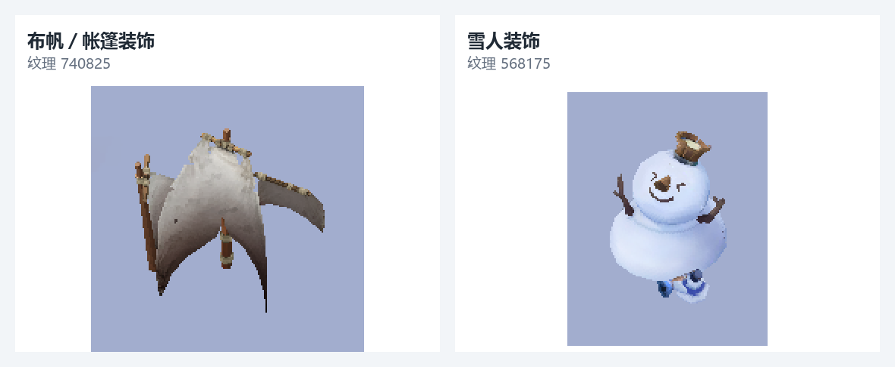

| 位置／模型 | 存储骨骼（根） | 本帧引用（根） | 姿态样本（个） | 纹理／绘制事件 | 独立原图 |
| --- | --- | --- | --- | --- | --- |
| 1 · 布帆／帐篷装饰 | 8 | 8 | 80 | 740825 · E159 | [查看原图](images/model-740825.png) |
| 2 · 雪人装饰 | 35 | 31 | 410 | 568175 · E173 | [查看原图](images/model-568175.png) |

#### 船形装饰与海鸟

<a id="bone-shot-569346"></a>

<a id="bone-shot-741336"></a>

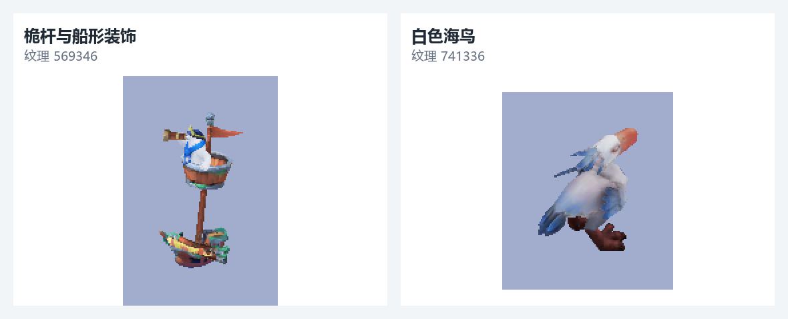

| 位置／模型 | 存储骨骼（根） | 本帧引用（根） | 姿态样本（个） | 纹理／绘制事件 | 独立原图 |
| --- | --- | --- | --- | --- | --- |
| 1 · 桅杆与船形装饰 | 26 | 25 | 390 | 569346 · E166 | [查看原图](images/model-569346.png) |
| 2 · 白色海鸟 | 15 | 15 | 291 | 741336 · E248 | [查看原图](images/model-741336.png) |

#### 鲸形装饰与书本雪景

<a id="bone-shot-569539"></a>

<a id="bone-shot-568665"></a>

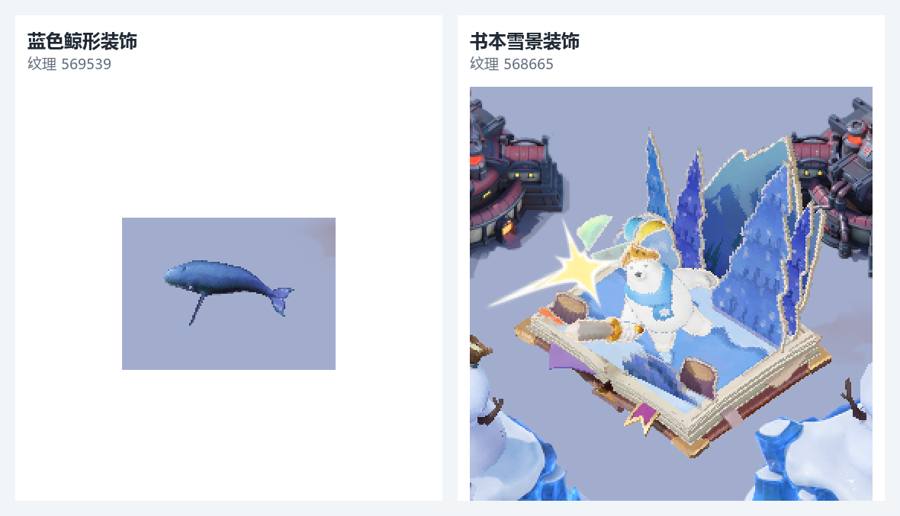

| 位置／模型 | 存储骨骼（根） | 本帧引用（根） | 姿态样本（个） | 纹理／绘制事件 | 独立原图 |
| --- | --- | --- | --- | --- | --- |
| 1 · 蓝色鲸形装饰 | 18 | 18 | 72 | 569539 · E180 | [查看原图](images/model-569539.png) |
| 2 · 书本雪景装饰 | 131 | 130 | 564 | 568665 · E269、E276、E283、E730、E737、E1598 | [查看原图](images/model-568665.png) |

#### 两类机械装饰

<a id="bone-shot-773301"></a>

<a id="bone-shot-799499"></a>

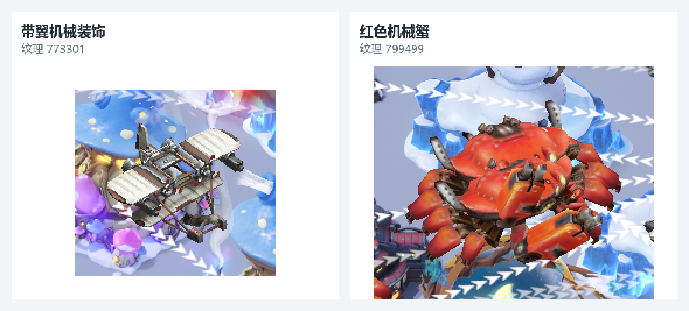

| 位置／模型 | 存储骨骼（根） | 本帧引用（根） | 姿态样本（个） | 纹理／绘制事件 | 独立原图 |
| --- | --- | --- | --- | --- | --- |
| 1 · 带翼机械装饰 | 17 | 16 | 120 | 773301 · E4909 | [查看原图](images/model-773301.png) |
| 2 · 红色机械蟹 | 44 | 43 | 362 | 799499 · E4916 | [查看原图](images/model-799499.png) |

#### 其他 6 组可见局部截图

这些对象有屏幕边缘裁切，或只有复合装饰的某一部分由对应骨骼图驱动。下图保留实际可见范围。

#### 画面边缘的动物局部

<a id="bone-shot-42728"></a>

<a id="bone-shot-42731"></a>

<a id="bone-shot-48362"></a>

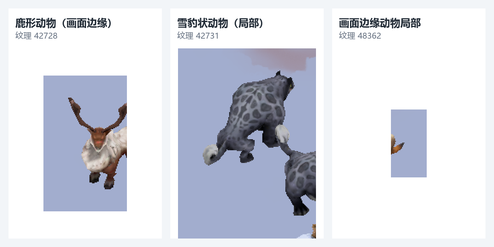

| 位置／模型 | 存储骨骼（根） | 本帧引用（根） | 姿态样本（个） | 纹理／绘制事件 | 独立原图 |
| --- | --- | --- | --- | --- | --- |
| 1 · 鹿形动物（画面边缘） | 29 | 29 | 543 | 42728 · E262 | [查看原图](images/model-42728.png) |
| 2 · 雪豹状动物（局部） | 23 | 23 | 374 | 42731 · E194 | [查看原图](images/model-42731.png) |
| 3 · 画面边缘动物局部 | 16 | 16 | 435 | 48362 · E255 | [查看原图](images/model-48362.png) |

#### 复合装饰局部

<a id="bone-shot-568987"></a>

<a id="bone-shot-568990"></a>

<a id="bone-shot-568999"></a>

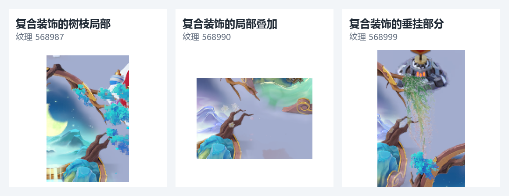

| 位置／模型 | 存储骨骼（根） | 本帧引用（根） | 姿态样本（个） | 纹理／绘制事件 | 独立原图 |
| --- | --- | --- | --- | --- | --- |
| 1 · 复合装饰的树枝局部 | 11 | 11 | 184 | 568987 · E1630、E1682、E1806 | [查看原图](images/model-568987.png) |
| 2 · 复合装饰的局部叠加 | 25 | 25 | 214 | 568990 · E1706、E1753 | [查看原图](images/model-568990.png) |
| 3 · 复合装饰的垂挂部分 | 135 | 130 | 121 | 568999 · E1747、E1812 | [查看原图](images/model-568999.png) |

纹理 568996、569486、775905 对应的绘制在这帧没有改变主目标 RGB，无法从本次画面提取有识别意义的模型截图；它们仍保留在下方骨骼数据表中。RGB 不变不代表没有 GPU 工作，也不能确定原因为出屏、遮挡还是材质状态。

证据：bone\_screenshots/model\_screenshots.json 记录纹理—EID—裁切坐标—颜色差值对应关系；assets/bone-models/ 保存原始事件画面、代表裁切和定位掩码。画面统一垂直翻转以便阅读。

<a id="toc-08-3"></a>

### 逐纹理骨骼与帧数对照

| 纹理 ID／模型对照 | 尺寸 / px | 存储骨骼数 | 本帧引用数 | 姿态样本数\* | 时间取样 | 布局说明 |
| --- | --- | --- | --- | --- | --- | --- |
| 42728<br>[鹿形动物（画面边缘）](#bone-shot-42728) | 174×272 | 29 | 29 | **543** | Linear | 29 骨骼 × 2 列；左 271＋右 272 个样本，含 134 个重复姿态样本 |
| 42731<br>[雪豹状动物（局部）](#bone-shot-42731) | 69×375 | 23 | 23 | **374** | Linear | 单列；第 0 行固定矩阵 |
| 48362<br>[画面边缘动物局部](#bone-shot-48362) | 48×436 | 16 | 16 | **435** | Linear | 单列；第 0 行固定矩阵 |
| 568175<br>[雪人装饰](#bone-shot-568175) | 105×411 | 35 | 31 | **410** | Linear | 单列；第 0 行固定矩阵 |
| 568665<br>[书本雪景装饰](#bone-shot-568665) | 393×565 | 131 | 130 | **564** | Point | 单列；第 0 行固定矩阵 |
| 568987<br>[复合装饰的树枝局部](#bone-shot-568987) | 33×185 | 11 | 11 | **184** | Point | 单列；第 0 行固定矩阵 |
| 568990<br>[复合装饰的局部叠加](#bone-shot-568990) | 75×215 | 25 | 25 | **214** | Point | 单列；第 0 行固定矩阵 |
| 568996<br>本帧无可辨识颜色变化 | 102×58 | 34 | 34 | **57** | Point | 单列；第 0 行固定矩阵 |
| 568999<br>[复合装饰的垂挂部分](#bone-shot-568999) | 405×122 | 135 | 130 | **121** | Point | 单列；第 0 行固定矩阵 |
| 569346<br>[桅杆与船形装饰](#bone-shot-569346) | 78×391 | 26 | 25 | **390** | Linear | 单列；第 0 行固定矩阵 |
| 569486<br>本帧无可辨识颜色变化 | 75×193 | 25 | 25 | **192** | Linear | 单列；第 0 行固定矩阵 |
| 569539<br>[蓝色鲸形装饰](#bone-shot-569539) | 54×73 | 18 | 18 | **72** | Linear | 单列；第 0 行固定矩阵 |
| 740825<br>[布帆／帐篷装饰](#bone-shot-740825) | 24×81 | 8 | 8 | **80** | Linear | 单列；第 0 行固定矩阵 |
| 741336<br>[白色海鸟](#bone-shot-741336) | 45×292 | 15 | 15 | **291** | Linear | 单列；第 0 行固定矩阵；含 2 个重复姿态样本 |
| 773301<br>[带翼机械装饰](#bone-shot-773301) | 51×121 | 17 | 16 | **120** | Linear | 单列；第 0 行固定矩阵 |
| 775905<br>本帧无可辨识颜色变化 | 183×474 | 61 | 61 | **473** | Point | 单列；第 0 行固定矩阵 |
| 799499<br>[红色机械蟹](#bone-shot-799499) | 132×363 | 44 | 43 | **362** | Linear | 单列；第 0 行固定矩阵 |

**\* 存储姿态样本数已扣除固定绑定矩阵，并计入横向动画块；包含重复姿态、补齐或保持样本。** 动作名称、动作起始偏移、有效长度和采样 FPS 不在这些 GPU 数据中，无法可靠拆成“待机多少帧、跑步多少帧”。重复姿态也可能是合法的静止保持，不能直接删除或把去重后的数量称作有效帧数。

<a id="toc-08-4"></a>

### 为什么不能只看纹理宽高

| 代表 | 计算与核对 | 结论 |
| --- | --- | --- |
| 740825 · E159 | 24÷3＝8；权重大于 0 的骨骼索引覆盖 0–7；固定 V＝0.5/81；81−1＝80 | 8 根均被使用，80 个姿态样本 |
| 568175 · E173 | 105÷3＝35；当前网格仅引用其中 31 个索引；411−1＝410 | 存储 35 根，本帧引用 31 根；410 个姿态样本；9 个实例共用该图、动画行不同 |
| 568665 · 六个 draw | 393÷3＝131；六个网格部分合计引用 130 个索引；565−1＝564 | 不能把每个子网格的骨骼数相加；共享同一个姿态时间 |
| 42728 · E262 | 输入骨骼索引只有 0–28；两实例动画 U 基址相差 0.5，即 87 像素＝29×3；固定矩阵 U 仍在左列 | 实际 29 根，两列姿态块，宽÷3 得到的 58 是横向矩阵槽数 |
| 42728 · 姿态样本 | 左列第 0 行为固定矩阵，其余 271 个样本；右列全部 272 行为姿态数据；271＋272＝543 | 左列有 137 个不同姿态，尾部 134 行与第 137 行相同；不能武断认作 543 帧的单一动作 |

<a id="toc-08-5"></a>

### 计数方法与可信边界

- 读取原始 RGBA16F，不用已映射成颜色的预览 PNG 反推矩阵；每矩阵为 3×4 个半精度数，共 24 bytes。17 张原始载荷合计 5,133,720 bytes，约 4.896 MiB。

- 按 draw 的索引缓冲选出真正引用的顶点，再读取骨骼索引和权重，只统计权重 >0 的索引；同一张纹理跨子网格去重。未在当前可见网格使用的骨骼，不等于资产永远用不到。

- 原生 GetConstantBlock 已成功补齐这 28 次蒙皮绘制的常量；实例参数实际确认固定行 0、时间行坐标及横向块。其他特效材质常量仍未全量补采。

- 这不是用纹理高度猜 FPS：播放速度还取决于样本 FPS、时间推进、循环、动作区间和变速参数。单帧没有这些完整元数据。

证据：evidence/bone\_layout\_analysis.json；bone\_native/ 的 28 份常量与顶点布局、\*-skin-input.npz；bone\_textures/ 的 17 份原始 RGBA16F 及 SHA-256。

<a id="skinning-deep-dive"></a>

## 09 · GPU Skinning＋矩阵图：实现与限制

**这套方案把“骨骼随时间的变换”当作数值纹理，让 GPU 顶点着色器直接查表并完成蒙皮。** 它保留骨骼索引与权重，因此属于纹理驱动的骨骼蒙皮；它与逐顶点位置 VAT 的存储对象不同。下文先讲本抓帧已经确认的实现，再给出可落地的制作与运行方案。

| 数据／处理环节 | 包含内容或执行操作 |
| --- | --- |
| 输入：网格 | 位置、UV、骨骼索引、权重 |
| 输入：动画矩阵图 | 固定绑定矩阵、各姿态矩阵 |
| 输入：每实例参数 | 物体变换、动画块、时间行 |
| 处理：顶点着色器 | 查表、矩阵组合、权重累加 |

**数据流：** 网格 ＋ 动画矩阵图 ＋ 每实例参数 → 顶点着色器完成蒙皮。

<a id="toc-09-1"></a>

### 1. 骨骼矩阵解决什么问题

网格顶点最初处于绑定姿态的模型空间。一根骨骼的固定逆绑定矩阵 A 把该顶点转换到骨骼绑定空间；该骨骼在时刻 t 的全局姿态矩阵 G(t) 再把它带回当前的模型空间。按列向量约定，单骨骼蒙皮矩阵为 S(t)＝G(t)×A。若有多个骨骼影响，就分别变换同一顶点后按权重加和，最后应用物体与相机变换。行向量约定的乘法顺序需相应调整。

```text
pclip = VP × World × Σj [ wj × Gbⱼ(t) × Abⱼ × pbind ]
```

这里的 G 应是已累计父子层级后的模型空间骨骼变换，不能直接把各骨骼的局部 Transform 放进去就期待同样的结果。若离线已经把 G×A 合成好，纹理可以直接存 S；本例是在顶点阶段取两组矩阵并现场相乘。绑定用途由固定第 0 行、矩阵乘法及网格输入共同支持，原始变量名已经丢失。

<a id="toc-09-2"></a>

### 2. 一张矩阵图怎么摆

| 数据 | 典型单列布局 | 本抓帧证据 |
| --- | --- | --- |
| 每根骨骼 | 连续 3 个 RGBA 像素，分别存 3×4 矩阵的三行；隐含最后一行为 (0,0,0,1) | 3j、3j+1、3j+2 的取样地址；结果组合成仿射矩阵 |
| 横向 | W＝3×B，B 为存储骨骼数；若有横向动画块，需另加块偏移 | 大多数纹理为单列；42728 是 29 骨骼、两列 |
| 纵向 | 第 0 行固定绑定矩阵，后续行存姿态样本；动作可以占不同区间 | E159 参数为 (1/24,1/81,24,81)，固定 V＝0.5/81 |
| 数值格式 | RGBA16F，线性数据，无 sRGB 解码；本例仅 1 mip | 每骨骼每姿态 24 B；不能套普通颜色图压缩与 mip 生成 |
| 配套元数据 | 应另存动作起始块／行、有效长度、样本 FPS、循环方式、包围盒、事件与 root motion | 这是完整系统必须管理的数据；本抓帧没有恢复出完整动作表 |

单列访问第 j 根骨骼第 k 行矩阵分量的像素中心：U＝(3j＋k＋0.5)/W，k∈{0,1,2}。固定矩阵 V＝0.5/H；动画 V＝(r＋0.5)/H，r 可带小数。横向动画块额外加 U 偏移；本例 E262 的两个实例分别使用 0 与 0.5 的动画块偏移，固定绑定矩阵仍读左侧。

<a id="toc-09-3"></a>

### 3. 本帧一次顶点蒙皮到底做了什么

- 读取最多 4 个骨骼索引和权重；每个权重 >0 才进入该影响的处理路径。骨骼索引在这些网格中以 float32 输入；部分权重为 float16，部分为 float32。

- 每个有效影响读取固定矩阵的 3 个 texel，再读取当前姿态的 3 个 texel；把两矩阵相乘，得到三行最终变换。

- 用三行与顶点齐次位置做点积，乘权重并累加到位置；之后应用实例物体矩阵和视图投影。

- 代表 E159 输入没有法线；这一家族只确认位置蒙皮。其他变体有额外属性和材质纹理，不能把“有骨骼动画”自动理解为完整的法线、切线和高质量光照支持。

E159 的 667 个被引用顶点中，550 个只受 1 根影响、109 个受 2 根、8 个受 3 根，没有 4 影响顶点。整个 28-draw 样本按“每 draw 的不同引用顶点 × 实例数”统计，平均约 1.249 个有效影响，属于输入工作量代理；GPU 顶点缓存、重复执行与分支效率会影响实际成本。 **24 次取样是 4 个有效影响时的路径上限，不能乘到所有顶点上当作实测。**

<a id="toc-09-4"></a>

### 4. 时间插值：这份抓帧有两种实际路径

| 取样方式 | 实际发生的事 | 本帧例子与限制 |
| --- | --- | --- |
| Linear · 11 次 draw | U 对准矩阵分量中心，V 落在相邻姿态行之间；硬件对矩阵分量线性插值 | E159 的 r≈13.9644，使用物理第 13、14 行，后者约占 96.4%；它们是存储行索引，不是播放 FPS |
| Point · 17 次 draw | 即使 V 有小数，采样器也选最近 texel 行；这条代码没有额外显式时间 lerp | 568665 的多个子网格均使用 Point，不能描述为逐帧平滑插值 |
| 两组矩阵相乘 | 固定绑定矩阵 × 姿态矩阵的数据组合，与时间插值是不同步骤 | 不能因为 VS 读取两套矩阵就称其为“两个动作混合”或“两帧 lerp” |

线性过滤没有把 Shader 中的取样调用数量翻倍，但底层取样覆盖和带宽不等于一次 Point。矩阵分量 lerp 也不是旋转的球面插值：中间矩阵可能失去正交性，出现体积缩小或剪切；快速、大角度转动更需要提高采样密度，或改存旋转／位移并专门插值。采样率下降可能减少存储并增加插值误差；只降低 CPU 时间更新频率，未必减少每次 draw 的蒙皮取样。

<a id="toc-09-5"></a>

### 5. 从制作到运行的完整方案

| 阶段 | 应做的工作 | 为什么需要 |
| --- | --- | --- |
| 导出与烘焙 | 统一坐标系、单位、骨骼顺序和 bind pose；评估各动作的完整骨架层级，按约定采样率生成模型空间 G；保存 A 或直接存 G×A | 骨骼顺序或空间不一致会导致网格飞散；烘焙不是只把局部 Transform 逐根写图 |
| 网格准备 | 为每个顶点准备骨骼索引与权重；超过 4 影响时取舍并重新归一；每个 LOD 保持兼容索引或带重映射 | 本例 Shader 只遍历 4 个影响；删骨或改索引会直接改变形变 |
| 图集与动作表 | 打包矩阵、记录片段区间和 FPS；插值边界设置重复端点／护栏；清楚区分绑定行、有效样本与 padding | 纹理高不等于动作长；Wrap 也不会自动在某个动作的子区间正确循环 |
| CPU 运行状态 | 管理动画状态机、动作选择、速度、循环、事件和 root motion；为每实例更新时间与变换，并做可见性和 LOD 管理 | GPU 播放减少骨骼姿态上传，但不代表 CPU 完全没有动画与逻辑工作 |
| GPU 绘制 | 按实例数据选动画块／行；VS 查表蒙皮；按材质绘制各子网格；必要时另做阴影、深度和运动向量版本 | 共享一张动画图不意味着多个材质、子网格和渲染通道自动合成一个 draw |
| 质量验收 | 与原始骨架播放逐时刻比较位置和法线误差；检查切换、循环、极端缩放、挂点、远景闪烁及目标设备耗时 | 离线预览正确不能保证半精度、过滤、LOD 和实际平台都正确 |

<a id="toc-09-6"></a>

### 6. 动画混合、挂点与交互怎么补

一次只传一个姿态行坐标，足以做循环待机、跑步与简单装饰动画；完整动画系统还需要更多结构。动作 A/B 混合可以额外读取第二段姿态，再对最终位置或矩阵插值，但这不是严格的局部骨骼旋转混合，可能缩体积或穿模。若要更稳定的旋转过渡、局部层和遮罩，可以存 TRS／四元数并在合适空间混合，再重建层级；这会增加数据、计算和调度复杂度。本帧没有证据证明已实现这些能力。

武器、头顶血条、脚下特效等挂点需要同一时刻的骨骼变换。可让 CPU 保留低成本挂点采样，或让 GPU 用同一矩阵图计算附着物；不要每帧把整套骨架从 GPU 同步读回 CPU。IK、瞄准、受击局部修正和 ragdoll 需要运行时求姿态并写入额外缓冲／纹理，或采用烘焙与动态骨架混合的方案；只靠现成动作图无法自动适配地形、目标和碰撞。

<a id="toc-09-7"></a>

### 7. 主要限制与应对

| 限制 | 具体表现 | 应对方式 |
| --- | --- | --- |
| 只能表达编码覆盖的形变 | 本例是最多 4 影响的线性混合蒙皮；不能自然重现任意布料、软体或拓扑变化 | 复杂离线形变再考虑 VAT；额外 blendshape 需单独数据与路径 |
| 骨架与绑定兼容 | 同骨名不代表索引、坐标系、bind pose 相同；不同体型也可能不能直接共享 | 定义导出规范和重映射；重新定向或重新烘焙；共享前核验逆绑定变换 |
| 矩阵插值质量 | 线性矩阵插值可能缩小旋转体积；Point 会出现采样阶梯感 | 按动作增加采样密度，或改用适当的旋转表示与插值；不能一律用高 FPS 掩盖 |
| 精度与数据格式 | FP16 在数值变大时绝对误差增大；大世界坐标直接烘进图易抖动 | 以模型局部空间烘焙，世界位移另传；在目标尺度测 FP16／FP32；不用有损颜色压缩 |
| 纹理过滤与边界 | 线性过滤跨骨骼、动作边界或绑定行会读错；本捕获采样器地址模式为 Wrap | U 固定在 texel 中心；按动作区间限制时间、设置端点；无色彩空间转换和自动 mip |
| 骨骼数／纹理尺寸 | 受最大纹理尺寸、顶点纹理采样能力、格式与平台限制；单列需 W≥3B | 按平台校验、分块打包；Shader 的实例数组 128 槽不是 128 根骨骼上限，本例有 135 槽骨骼图 |
| 动作数量与内存 | 数据约按骨骼数×采样帧数增长，长动作、多个动作和护栏都会占空间 | 分动画集驻留、距离分级和合理采样；统计真实 padding，避免只压缩预览图片 |
| 法线、切线与缩放 | 只变位置会让光照错误；非均匀缩放／剪切不能简单照搬位置矩阵变法线 | 设计法线／切线变换及归一化；需要时使用逆转置或限制缩放；检查负缩放与手性 |
| 多通道重复蒙皮 | VS Skinning 在主通道、阴影、深度、运动向量中可能重复执行 | 减少无效通道；重复使用量足够大时评估 Compute Skinning 缓存，不能预设一定更省 |
| 运动向量与时间一致性 | 只保存当前时间无法重建上一帧位置；切换和 root motion 可造成错误速度 | 保留上一帧动作、时间、世界变换与跳变标记；在各通道使用一致姿态 |
| 包围盒与剔除 | CPU 若只见静态 bind pose 包围盒，可能提前裁掉伸展的角色／旗帜 | 离线生成各动作保守包围盒，或动态估算；GPU 蒙皮不自动更新 CPU bounds |
| 碰撞与可交互性 | GPU 变形不会自动修改 CPU 碰撞网格、脚底落点或游戏逻辑骨架 | 使用简化碰撞体、少量 CPU 骨骼或专用同步策略；避免逐帧同步读回 |
| 合批与透明排序 | 同动画纹理仍可能因 mesh、材质、混合、裁剪或排序拆 draw | 用兼容实例批次和每实例参数；透明效果需要保序，不能跨状态强行合并 |
| 时间精度与暂停 | 大浮点时间、切动作、暂停恢复和回绕可引起抖动或错误帧 | 传片段局部时间／归一化相位，明确起止与循环规则；远处暂停渲染和模拟分别处理 |

<a id="toc-09-8"></a>

### 8. 这份实现最值得验证的改进

- **预合成固定变换。** 若资产的第 0 行在运行时保持固定，可以离线把每个姿态矩阵 G 与 A 相乘并存结果；单个有效影响由 6 次 texel 取样减到 3 次，并省去矩阵组合。对固定 A，线性时间插值与右乘 A 在精确算术下可交换；仍需验证 FP16 重量化误差、共享 bind pose 和完整运行时更新规则。

- **保留当前影响数优势。** 大量顶点只有 1–2 个有效影响；减少骨骼数主要降低动画数据，减少顶点数和每顶点影响数才直接减少这条 VS 路径的工作。对远景用兼容网格／骨骼 LOD，并重新归一权重。

- **选择性补插值。** Point 家族可以针对容易跳帧的对象评估 Linear 或更合理的采样率；会改变外观和带宽，不能无条件把全图过滤切成 Linear。

- **先测目标机。** 目前只有 28 次骨骼类 draw，骨骼纹理载荷约 4.90 MiB；特效仍有 960 次通用绘制。骨骼方案的局部改进有意义，但不能拿它替代特效层数、面积和提交量控制。

证据：本例实现：42738 等 7 个 VS；bone\_native/ 的常量、输入布局与组合纹理采样器；bone\_layout\_analysis.json。制作流程、限制和改进是基于已确认数据路径的工程说明，并非宣称原项目已实现这些扩展。

<a id="skinning-vat"></a>

## 10 · GPU Skinning 与 VAT 选型

**这里比较的是“骨骼矩阵贴图蒙皮（BAT）”与“直接存顶点动画（VAT）”，两者都由 GPU 播放。** 本抓帧已经使用前者，并已出现同一次绘制 9 个实例；更换成 VAT 不会自动消除特效 draw 或透明像素叠加。

<a id="toc-10-1"></a>

### 常规 GPU Skinning 必须有一张骨骼矩阵图吗？

**不需要。GPU Skinning 描述的是“顶点蒙皮由 GPU 计算”，不规定骨骼数据必须存在纹理里。** 以常见的线性混合蒙皮为例：顶点新位置 = Σ（骨骼权重 × 蒙皮矩阵 × 顶点原位置）。矩阵存在哪里、姿态由 CPU 还是 GPU 求得，是另外的实现选择。

| 实现方式 | 骨骼／动画数据如何给 GPU | GPU 做什么 |
| --- | --- | --- |
| 常见的顶点着色器蒙皮 | CPU 求当前姿态，把当前帧的骨骼矩阵传到 uniform 数组、常量缓冲或其他 GPU buffer | 顶点着色器读取索引和权重，做矩阵变换与加权；不需要骨骼纹理 |
| 纹理驱动的骨骼蒙皮 | 把矩阵存进纹理；可以存当前姿态，也可以存预烘焙的多帧／多动作数据 | 顶点着色器按骨骼／时间索引取矩阵，再加权变形；本抓帧属于这个数据载体类别 |
| Compute Skinning | 常见做法是从 GPU buffer 读取姿态、权重和顶点，也可采用其他数据载体 | 计算着色器先生成变形后的顶点缓冲，再由绘制使用；本抓帧没有 Compute Dispatch |

本例检测到  **17 张 RGBA16F 骨骼数据纹理** ，并不是“整个游戏只需一张图”或“每个角色必须独占一张图”。兼容实例可以共享动画图集，片段、帧索引和时间通过实例参数区分。骨骼纹理也不自动证明动画全部离线烘焙：单帧取样证据不能完整恢复它的生成、更新和打包流程。下表以常见多帧骨骼动画纹理方案与 VAT 比较。

| 比较项 | 骨骼矩阵贴图 GPU Skinning | 典型固定拓扑 VAT |
| --- | --- | --- |
| 记录内容 | 每帧每根骨骼的变换；顶点保留骨骼索引与权重 | 每帧每个顶点的位置／偏移；按需要另存法线、切线 |
| 存储增长 | 骨骼数 × 帧数；同骨架动画可能跨兼容网格共享 | 顶点数 × 帧数；通常与网格及顶点排列绑定 |
| 顶点计算 | 查骨骼矩阵、变换、按权重累加；计算和采样较多 | 通常查位置并解码；时间插值、法线等会增加取样与计算 |
| 缓存与带宽 | 一根骨骼供很多顶点共用，有较强复用机会 | 每顶点数据更独立，数据集常更大；不等于每帧都要读完整贴图 |
| 动画混合／挂点 | 有骨骼语义，更容易设计混合、挂点与骨骼 LOD | 可做顶点插值混合，但未必保持关节轨迹；挂点等需辅助数据 |
| 运行时控制 | 常规骨架方案更便于扩展 IK、局部控制；本次骨骼贴图版本不代表已具备这些能力 | 以预烘焙形变回放为主；额外控制需要专门设计 |
| 网格 LOD | 可共用兼容骨架动画，LOD 网格另备权重 | 通常要逐 LOD 烘焙或设计重映射，否则顶点对应关系改变 |
| 更适合 | 角色、旗帜、帐篷等可用少量骨骼表达的形变 | 需要忠实还原的布料、软体等复杂烘焙形变；刚体碎块和变拓扑 VAT 属于不同编码方案 |
| 实例化 | 可传每实例时间、片段等参数；仍需兼容 mesh／材质／状态 | 同样可实例化，也有相同的合批约束；不会自动减少透明排序限制 |

<a id="toc-10-2"></a>

### 一个明确假设下的容量例子

仅作方案量级比较， **不是本抓帧模型的实测** ：2,000 顶点、60 根骨骼、60 帧动画。骨骼每矩阵用 3 个 RGBA16F texel（24 B）；VAT 每顶点位置用 1 个 RGBA16F texel（8 B）；若另存同格式法线再增加一份。不含 padding、mip、绑定姿态和其他元数据，也不计算基础网格。

| 动画载荷 | 计算 | 容量 |
| --- | --- | --- |
| 骨骼矩阵 | 60 × 60 × 24 B | 86,400 B ≈ 0.082 MiB |
| VAT 位置 | 2,000 × 60 × 8 B | 960,000 B ≈ 0.916 MiB（约 11.1 倍） |
| VAT 位置 + 法线 | 2 × 960,000 B | 1,920,000 B ≈ 1.831 MiB（约 22.2 倍） |

这是统一格式的示例；量化、压缩、采样频率、骨骼／顶点数量和所需属性都能改变比例。VAT 常能减少每顶点的矩阵计算，但更大的数据集可能抵消收益，不能承诺一定更快。

<a id="toc-10-3"></a>

### 这份抓帧该怎么选

- **保留骨骼矩阵贴图作为骨骼类对象的默认。** 28 次相关绘制含约 44% 的提交索引引用，顶点端值得测；17 张动画数据合计 4.90 MiB 则说明其存储规模较小。两项数据分别说明工作量与载荷，不能互相代替。

- **复杂形变按对象试 VAT。** 用同一模型、动画时长、视觉质量和实例数量，在目标设备比较 GPU 时间与动画驻留容量；无光照效果未必需要法线纹理。

- **先检查现有蒙皮是否可减负。** 新补采已确认每影响分别读固定第 0 行和动画行，再组合矩阵。若完整运行时也保持固定绑定数据，可测试离线预合成，每影响从 6 个矩阵 texel 取样降为 3 个；仍需验证精度、资源共享和实际 GPU 收益，详见方案章节。

- **用正确手段解决特效开销。** VAT 解决顶点形变播放，不直接解决每座建筑堆叠的光圈、火焰、遮罩和标牌。

证据：42738\_vertex.txt 与动画章节；容量公式为明确假设的理论比较，非 GPU 实测。

<a id="effects"></a>

## 11 · 粒子与材质特效

重复特效按家族讲原理，下面只展开两个代表类型。实例间主要变化是贴图、常量、网格和位置；不把数百次相似 draw 逐一复述。

<a id="toc-11-1"></a>

### 例一：火焰／光斑等单贴图特效

VS 788113 / PS 788114 共 247 次。EID 308 绑定 256² 火焰序列图 567942；同家族较高回放计数的例子是 EID 4580。PS 一次取样后乘顶点色、材质色与强度，并通过 Log2 / Exp2 做类似幂次的颜色和 Alpha 整形；还包含亮度转 Alpha 的选择。单取样不等于完全没有 ALU 成本。

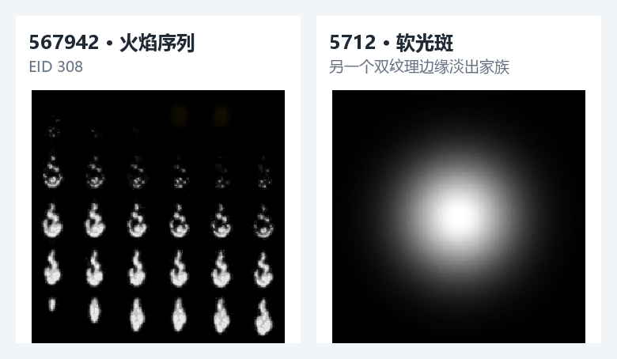

| 位置 | 贴图与用途 | 独立原图 |
| --- | --- | --- |
| 1 | 567942：火焰序列图，EID 308 | [查看原图](images/tex-567942.png) |
| 2 | 5712：软光斑，另一个双纹理边缘淡出家族 | [查看原图](images/tex-5712.png) |

图注：预览按版面等比缩放，保持完整内容；显示大小不代表源纹理的分辨率比例。

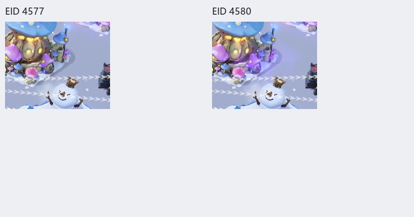

图注：EID 4577 → 4580：同一单贴图特效家族的可见局部贡献，截取变化区域。

EID 308 与上一 draw 的主目标 RGB 逐像素一致。它可能出屏、被裁剪／遮挡、透明或没有通过相关测试；仅凭颜色不变不能证明可以直接删除。这个例子适合列入可见性与存活期排查，而不是当成“GPU 已自动免费剔除”。

<a id="toc-11-2"></a>

### 例二：多纹理扰动、遮罩与裁切

VS 788323 / PS 788324 共 80 次；代表 EID 300、4525。EID 300 绑定 5 张纹理（包括噪声、遮罩与默认白图），反汇编有 6 个静态取样点，其中有条件分支取样；随后处理遮罩、Alpha 阈值并调用 Kill。静态取样点数量不是每个像素必定执行的次数。

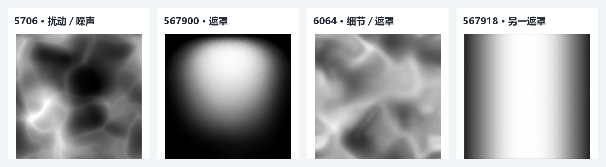

| 位置 | 贴图与用途 | 独立原图 |
| --- | --- | --- |
| 1 | 5706：扰动／噪声输入 | [查看原图](images/tex-569117.png) |
| 2 | 567900：遮罩输入 | [查看原图](images/tex-567900.png) |
| 3 | 6064：细节／遮罩输入 | [查看原图](images/tex-567973.png) |
| 4 | 567918：另一遮罩输入 | [查看原图](images/tex-567918.png) |

图注：预览按版面等比缩放，保持完整内容；显示大小不代表源纹理的分辨率比例。

同类还包括 788158–788159（52 次、4 个静态取样点）、788107–788108（19 次、3 个）、788195–788196（142 次、2 个）；旧式 7876–7877（134 次）有多层滚动与辅助取样。颜色形状主要来自小贴图与 UV 运算的组合，不代表流体或 Compute 粒子模拟。

<a id="toc-11-3"></a>

### 应控制的成本

- 同屏外观数量 × 每个外观的特效层数 × 屏幕覆盖面积，是更有意义的预算。对远处、屏幕下缘密集区域和非选中城堡建立分级。

- 透明边缘很宽的四边形会增加潜在过度绘制；可以缩紧 mesh／有效 UV 区域，减少重复柔光层。这里未测得 overdraw 倍数，不能编造“几倍填充”。

- 检查常量白图与默认噪声参与的分支；确认其运算可等价消除后，考虑轻量变体。贴了白图不等于一定能删除整条逻辑。材质复用与合批还要保持透明对象的正确前后顺序。

证据：788114、788324、788159、788108、788196、7877 的 PS；EID 308/4580、300/4525；example\_differences.json。

<a id="effects-standards"></a>

## 12 · 特效共性、预算与验证

**能反推出比较统一的制作方式，不能由一帧抓取证明他们有怎样的书面规范。** 素材和材质复用比较明确，同屏性能预算、距离分级和团队验收流程则不可见。以下把观察与建议分开。

<a id="toc-12-1"></a>

### 已观察到的共性

| 共性 | 抓帧证据 | 可以借鉴的部分 |
| --- | --- | --- |
| 小纹理组合 | 21 个通用特效家族共用 178 张采样纹理，其中 171 张最大边 ≤256；例：256² 火焰序列图、128² 遮罩 | 共用噪声、渐变、遮罩与序列图，再用材质参数形成外观变化 |
| 固定颜色／透明度流程 | 247 draw 的单贴图家族与 142 draw 的遮罩家族共享大量同形运算：贴图 × 顶点色 × 材质色／强度，RGB 与 Alpha 幂次整形，可选亮度转 Alpha | 统一颜色、透明度和粒子随生命周期变化的参数接口；不能据此命名原始美术参数 |
| 通道与 UV 参数化 | 788196 PS 以 Dot(textureRGBA, uniformVector) 提取或混合遮罩通道；还包含 UV 缩放、偏移；多层家族另有滚动和扰动 | 约定通道用途、UV 规则及默认参数；单份素材支持多种效果。通道点积不证明每张图都实际打满四个遮罩 |
| 有功能层级 | 单贴图 1 个 PS 静态取样点；主图 + mask 2 个；复杂家族 4–6 个，并可含条件取样／Kill | 基础、遮罩、扰动版本分层维护，给高频常驻对象提供精简路径 |
| 采样输入以素材为主 | 这些家族未绑定已识别的主颜色 RT／主深度等目标；本帧没有独立 Bloom 模糊链 | 代表效果的扰动主要改素材 UV，不能据此叫屏幕折射；发光外观可由光斑／颜色叠加实现 |

上述 960 次绘制中，910 次所用 PS 含 Log2／Exp2，137 次所用 PS 含 Kill。它们是 **静态代码特征的绘制覆盖数** ，不表示每个像素都运行所有路径。最简单的贴图版本也保留颜色与 Alpha 整形，说明功能统一并不等于每个常驻效果都已经足够轻。

<a id="toc-12-2"></a>

### 为什么应优先排查特效

通用特效与叠加合计  **960 / 1,591 draw（60.34%）** ，其中没有 instanceCount >1 的 draw；单次 draw 仍可能打包多个粒子，不能据此认定完全没有合批。其局部回放计数合计约  **0.2236 ms，占全部 draw 计数和 47.52%** ，也是较大的分类。

> 这不是“目标设备 GPU 帧时间中 47.52% 属于特效”。原始计时有 758 个零值、明显量化，且不含 CPU 提交和完整帧开销。它与 draw 结构共同支持“优先排查特效”，不能独立确定瓶颈。UI 图集／文字的 469 次绘制也应一起排查。

像素工作量可粗看为：Σ（每层实际触发像素着色的屏幕面积 × 该层 Shader 工作量）。draw 次数影响提交与状态切换，面积和重叠影响采样、计算与混合。透明区域的 Alpha 接近零也可能先执行取样再丢弃；本例复杂 Shader 的 Kill 在若干取样之后，不能把裁切当成完全免费。

<a id="toc-12-3"></a>

### 适合你们建立的规范草案（建议，非对方已有标准）

| 项目 | 建议规则 | 验收方式 |
| --- | --- | --- |
| 材质档位 | 常驻默认 1 次主纹理取样；需要时增加 1 次 mask；多层扰动单列高档。去掉不需要的幂次、亮度转 Alpha 与辅助纹理逻辑，限制可用变体组合 | 以编译后的实际路径与目标设备耗时验收；静态采样数只是复杂度标记 |
| 同屏层数 | 按建筑／角色整体计费，合计其所有子特效；区分选中／关键状态、普通常驻、远处装饰 | 确定目标机型和帧预算后给各档定上限，避免凭空规定“每个效果最多多少粒子” |
| LOD 与可见性 | 随屏幕面积／缩放减少光圈、光点、次要火焰；小到不可辨识时停渲染，并按需要降低或暂停模拟；重要状态保留图标 | 同一地图同一缩放做外观和性能对照，确认被隐藏对象不再提交 |
| 覆盖面积 | 裁紧无效透明边，控制发射范围和寿命，优先合并重复柔光外观；必要时用更贴合轮廓的网格 | 测实际过度绘制与 GPU 时间，权衡新增几何；缩小源贴图不会自动减少屏幕像素着色 |
| 素材约定 | 优先共用小纹理；明确颜色与数据纹理色彩空间、RGBA 通道含义、序列图留边及采样方式；mip 和压缩按缩放与平台验证 | 不照搬统一关 mip 或统一 sRGB；检查边缘、mask 数值与远景稳定性 |
| 批次与参数 | 相同效果尽量共享材质／纹理，变化通过顶点或实例数据表达；在保持排序正确时测试批处理或实例化 | 同 Shader 不等于同批次；记录一个完整 prefab 的总 draw，确认视觉顺序不变 |
| 运行成本 | GPU 填充、CPU 提交／粒子模拟、纹理驻留分别计量；对象池和暂停模拟解决各自的问题 | 目标机固定温度、相机与内容，记录稳定 CPU/GPU 时间和 draw；不能只看编辑器 FPS |

<a id="toc-12-4"></a>

### 最小验证顺序

- A/B 关闭城堡装饰特效，保持地图标牌与其他内容一致，判断总收益；再单独关闭标牌作对照。

- 为分离“绘制”和“模拟”，先只关 renderer 保留模拟，再停模拟；从目标引擎 profiler 分别看 CPU 与 GPU。

- 在开发版本上替换成保持混合／深度／裁切语义的简化 Shader，测试材质计算；再减少层数或收紧覆盖范围，测试叠加成本。

- 降低渲染分辨率可辅助判断像素相关压力，但会影响整个场景，只能与其他对照共同解释。

- 若最终定位为顶点蒙皮瓶颈，再做同质量 BAT / VAT 对照；不要用更换动画格式代替特效可见性和层数管理。

证据：effects\_followup\_metrics.json；全部管线绑定与 texture\_inventory.json；788114\_pixel.txt、788196\_pixel.txt、788324\_pixel.txt；timings.json。

<a id="quality-comparison"></a>

## 13 · 高低配置对照

**低配最明确的变化是主画面分辨率降低，同时样本中的特效绘制显著减少；共用的基础特效与骨骼 Shader 并没有统一换成另一套简化算法。** 两份“大世界”文件的低配标签来自用户说明，不是从未知引擎配置名推断。三份抓帧共检查 4,912 次 draw。

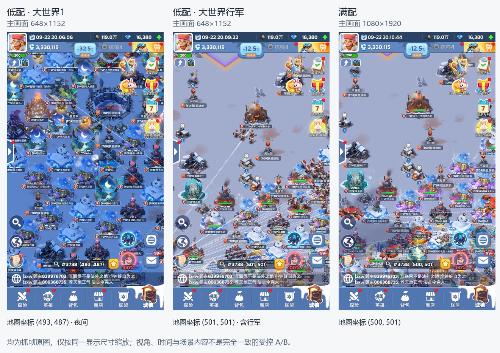

图注：三份主场景最终结果；低配主 RT 已上下翻转为可读方向。图中时间、地图坐标与场景内容不同，属于配置样本对照，不是严格锁定场景的性能 A/B。

| 口径 | 大世界1 · 低配 | 大世界行军 · 低配 | 满配 |
| --- | --- | --- | --- |
| 整份 RDC 的 draw | 2,305 | 1,016 | 1,591 |
| 主场景重绘次数 | 2 | 1 | 1 |
| 每次主场景 draw | 1,147；第二次也是 1,147 | 1,011 | 1,586 |
| 主画面像素 | 648 × 1152 = 746,496 | 648 × 1152 = 746,496 | 1080 × 1920 = 2,073,600 |
| 相对满配的目标像素数 | 36% | 36% | 100% |
| 通用特效与叠加 draw | 488 | 401 | 960 |
| UI 图集／文字 draw | 476 | 467 | 469 |
| 骨骼动画 draw | 23 | 21 | 28 |
| 提交索引引用，含实例 | 167,568；第二次 167,562 | 319,785 | 229,851 |
| 全抓帧 Shader 资源对 | 47 | 42 | 53 |
| 核对纹理数／有效载荷 | 219 项 / 460.95 MiB | 186 项 / 426.07 MiB | 277 项 / 511.02 MiB |

**不能把大世界1 的 2,305 draw 当成一次低配主场景。** 它有两次画入同一 4125 目标的主场景重绘：E271–5748 与 E5849–11326，各 1,147 draw；画面 RGB 有变化、索引引用量也差 6，不能简单当成完全相同的重复记录。本表按一次重绘比较结构，没有把整份抓帧总开销除二当作帧时间。

<a id="toc-13-1"></a>

### 这组对比支持哪些结论

- **分辨率降档很明确。** 低配两轴均为满配的 60%，主目标像素数减少 64%。在相同视角与效果覆盖下，会减少片元着色／混合的工作机会；不能据此承诺整帧 GPU 快 64%。此处 UI 也在同一低分辨率主目标内。

- **样本之间的 draw 差额主要来自特效。** 大世界行军与满配的主场景相差 575 draw，其中通用特效与叠加相差 559，约占差额 97.2%；UI 图集／文字仅相差 2。两者地图位置接近，但行军、战斗状态与抓帧时刻不同，这不是画质开关独立造成 559 draw 的因果证明。

- **低配没有统一降低所有源纹理尺寸。** 大世界1／行军与满配分别有 123／135 个相同 ResourceId 的核对项，其描述尺寸没有变化；火焰／烟雾图集 567942、光斑 5712、噪声 5706 等进一步核对导出像素一致。仅 ID 相同不足以证明内容相同，因此结论以这些像素核对样本为代表。

- **行军的顶点工作不能忽略。** 低配行军 E2676 为 4,134 索引 ×44 实例，一次 draw 就提交 181,896 个索引引用，所以其总引用量高于满配，尽管 draw 更少。这说明低配样本不是所有工作量都更低。

- **GPU Skinning 路径仍保留。** 共同的骨骼矩阵蒙皮 Shader 代码相同；没有证据显示低配切换到了 VAT。纹理载荷 426–461 MiB 与满配 511 MiB 的差别还混有资源驻留、场景和宿主目标变化，不能直接当作纯画质配置节省的显存。

<a id="toc-13-2"></a>

### 按 Shader 代码匹配的特效家族

| 家族（以满配 ID 指代） | 低配大世界1 | 低配行军 | 满配 | PS 静态取样点 |
| --- | --- | --- | --- | --- |
| 单贴图特效／亮度与透明度整形 | 159 | 75 | 247 | 1 |
| 主纹理 + 通道遮罩特效 | 141 | 82 | 142 | 2 |
| 多层滚动／噪声特效 | 55 | 72 | 134 | 4 |
| 光斑／边缘淡出特效 | 19 | 65 | 91 | 2 |
| 双取样扰动／遮罩特效 | 0 | 0 | 52 | 4 |
| 多层遮罩／扰动／裁切特效 | 0 | 0 | 80 | 6 |

跨抓帧 Shader ResourceId 会变化，因此按 VS、PS 反汇编内容的 SHA-256 成对匹配。未出现是指这份主场景没有提交该相同代码家族，不能外推到低配游戏的所有场景。复杂扰动家族在两份低配中缺席，是值得复现验证的分级线索；满配该家族所用 6064／567918 也没有在两份低配中被采样。

证据：comparison/comparison\_analysis.json；两份低配的全部 pipelines、Shader、纹理描述与 pass snapshots；主场景范围见表。低配未采集可用 GPU 耗时，本章不作帧时间加速比结论。

<a id="resolution-scaling"></a>

## 14 · 0.6 渲染比例、DPI 与 UI

> **重点：0.6 倍渲染，UI 也跟着缩小。** 
> 
> 指 UI 的栅格分辨率随世界一起降到 0.6 倍：1080×1920 → 648×1152，总像素数为 0.36 倍。最终放大显示，UI 的布局占比不因此变成六成，清晰度会一起下降。

RDC 能确认实际渲染目标尺寸，但不能直接读出上层设置项叫 renderScale、Fixed DPI、canvas drawing-buffer size，还是其他分辨率策略。

| 项目 | 计算／结论 |
| --- | --- |
| 宽度比例 | 648 ÷ 1080 = 0.6 |
| 高度比例 | 1152 ÷ 1920 = 0.6 |
| 像素总数比例 | (648 × 1152) ÷ (1080 × 1920) = 0.36，减少 64% |
| 显示回原尺寸的线性倍率 | 1 ÷ 0.6 ≈ 1.667 |
| GPU 帧时间 | 不能直接推成 0.36 倍；顶点、CPU、拷贝等工作不会按像素数同比降低 |

<a id="toc-14-1"></a>

### DPI 和 Render Scale 应如何区分

- **普通 DPI／UI 缩放** 主要改变逻辑单位与显示像素的映射，可能改变文字、按钮的布局尺寸；它本身不是这份 RDC 能直接证明的设置。

- **渲染分辨率缩放** 改变绘制到的像素数量，通常维持最终画面占用的显示区域。本抓帧明确出现这种结果。

- **某些引擎的“固定 DPI 分辨率缩放”** 也会间接降低渲染缓冲尺寸，所以不能仅凭 648×1152 排除这种上层入口；也不能据此认定使用了 Unity URP 的某个具体参数。

<a id="toc-14-2"></a>

### UI 是否也跟着缩小？

**本抓帧的游戏 UI 跟着降低了栅格分辨率；最终屏幕上的布局不因此自动缩小。** 低配 UI Shader 3869 / 3870 与世界内容一起写入 648×1152 的目标 4125，主场景读回图已经包含文字、按钮和底部导航。以一个原本显示 100×50 像素的按钮为例：在保持布局的 0.6 倍渲染中，其低分辨率图像约为 60×30 像素，再显示回约 100×50 的区域；细节会变软，而非按钮占屏面积变成 36%。这是缩放示例，不是该按钮的实测尺寸或输入命中范围。

| 直接证据 | 实际资源关系 |
| --- | --- |
| 低配大世界1 · E3485／E5748 | UI draw 输出 4125：648×1152 |
| 低配行军 · E4930 | UI draw 输出 4125：648×1152 |
| 低配大世界1 · E5790 → E11365 | 主场景 4125 → 559843（648×1152），随后 559843 → 304（1080×1920） |
| 低配行军 · E4974／E5016 | E4974 将 559843（648×1152）画到 310（1080×1920）；E5016 另将当前主目标 4125 复制到 559775（648×1152） |

大世界1 的 E5790 与 E11365 之间还有第二次主场景重绘；上面的箭头是资源使用关系，不把它伪装成“第二次主场景立即放大显示”的完整时序。行军的 E4974 输入也不是 E5016 输出，不能串成一条错误的同帧链路。已确认的是：游戏 UI 在低分辨率主画面中，且存在低分辨率画面到 1080×1920 表面的放大。

<a id="toc-14-3"></a>

### 如果希望场景省像素、UI 仍清晰

可以让世界场景先以 0.6 倍分辨率渲染，放大到显示分辨率后，再绘制全分辨率 UI。是否让 UI 跟随，取决于 UI 位于放大之前还是之后；不能只看设置名称里有没有 Render Scale。本抓帧看到的是游戏 UI 已包含在低分辨率主画面里的方案。

证据：comparison/low-world 与 low-march 的 pipelines、details、texture\_inventory.json；E3485、5748、5790、11365、4930、4974、5016。上层 DPI／逻辑分辨率配置与输入系统未包含在这些 GPU 证据中。

<a id="effect-features"></a>

## 15 · 特效功能对比：低配与满配

**低配保留了多数基础功能；满配样本主要多出更复杂的扰动组合变体，并增加了共同家族的绘制量。** 这里的 feature 是从 Shader 数据流识别的功能，不是已恢复的原始 Shader keyword 或引擎配置开关。没有 Shader 源码与完整常量值，不能把“某个变体没提交”写成“该功能全局关闭”。

| 功能／组合 | 低配 · 两份抓帧 | 满配 | 实际差别 |
| --- | --- | --- | --- |
| 基础颜色与透明度整形<br>主图×顶点色／材质色；RGB、Alpha 幂次与亮度转 Alpha | 保留 | 保留 | 两档保留相同代码；满配该家族绘制更多 |
| 独立 Mask 与通道选择<br>RGBA 通道提取、遮罩 UV 缩放／偏移 | 保留 | 保留 | 两档均有独立遮罩能力 |
| 多层 UV 滚动与噪声<br>多纹理滚动、噪声叠加 | 保留 | 保留 | 两档保留；不是低配只剩单贴图 |
| 基础材质 UV 扰动<br>噪声偏移素材 UV | 保留 | 保留 | 低配也有；属于材质扰动，不是屏幕折射 |
| 多 Mask＋Alpha 裁切<br>阈值组合、可选 Kill | 保留 | 保留 | 低配也保留裁切路径；不等于全局关闭溶解 |
| 序列图／单贴图变体<br>图集素材及对应变体 | 保留 | 保留 | 两档均有；播放 FPS 无法从单帧确定 |
| 顶点阶段辅助取样<br>VS 读取辅助纹理 | 保留 | 保留 | 两档均有，不能视为满配专属 |
| 扰动＋Alpha 整形组合<br>无独立 Mask，无 Kill | 未见此组合 | 出现 | 本组合仅见于满配；27 draw |
| 扰动＋独立 Mask 组合<br>噪声同时影响主图／Mask UV | 未见此组合 | 出现 | 本组合仅见于满配；52 draw |
| 扰动＋多 Mask＋裁切<br>5 纹理输入，最多 6 个静态取样点 | 未见此组合 | 出现 | 本组合仅见于满配；80 draw；截图 E4525 |
| 复杂扰动／裁切另一变体<br>另一组 6 取样点、含 Kill 的代码 | 未见此组合 | 出现 | 本组合仅见于满配；11 draw |
| 额外双贴图流动条纹<br>双贴图与流动 UV 的特定组合 | 未见此组合 | 出现 | 该变体仅见于满配；8 draw；基础能力低配仍有 |

“保留”表示实际绘制提交了含该功能的代码路径，不保证每个实例的每个分支都开启；“未见此组合”仅限定于这两份低配样本。共同基础功能与新增组合分开理解，避免把某个高级组合缺席误写成整项能力关闭。

<a id="toc-15-1"></a>

### 展开绘制数量与 Shader 证据（12 项）

| Feature／功能 | 低配大世界1 | 低配行军 | 满配 | 判定与功能说明 |
| --- | --- | --- | --- | --- |
| 主纹理 × 顶点色／材质色／强度；RGB／Alpha 幂次；亮度转 Alpha | 159 | 75 | 247 | 保留；低配和满配提交相同 VS / PS 代码；参数选择分支仍存在，不保证每个粒子打开每个选项。 |
| 独立 Mask、RGBA 通道提取、Mask UV 缩放与偏移 | 141 | 82 | 142 | 保留；主纹理外增加遮罩取样，并用 dot(textureRGBA, 参数向量) 提取或组合通道。 |
| 多层 UV 滚动与噪声叠加 | 55 | 72 | 134 | 保留；旧式多纹理家族在两份低配仍大量绘制，不能概括成“低配只有一张图”。 |
| 噪声驱动的素材 UV 扰动（共用旧式路径） | 21 | 10 | 14 | 保留；PS 先采样噪声，再让噪声结果参与其他素材的 UV；含 4 个静态取样点。不是屏幕画面折射。 |
| 多 Mask 阈值组合与可选 Alpha 裁切（Kill） | 7 | 5 | 23 | 保留；两份低配也提交含 Kill 的相同代码；可用于阈值／溶解外观，但当前参数与完整时间行为未恢复。 |
| 序列图素材／单贴图动画变体 | 36 | 31 | 41 | 保留；共同的单贴图变体仍使用；不能仅凭一帧反推出序列图播放帧率。 |
| 顶点阶段辅助纹理取样 | 4 | 1 | 1 | 保留；两份低配均有该 VS 取样路径，不能把所有顶点纹理功能认作高配专属。 |
| 噪声位移 UV + Alpha 整形（无独立 Mask、无 Kill 的变体） | 0 | 0 | 27 | 只在满配样本出现；2 个纹理输入，3 个静态取样点；其中第二次噪声取样是条件路径。此 Shader 没有 Kill，不能把它列为 Alpha Test。 |
| 噪声位移 UV + 独立通道 Mask 的组合变体 | 0 | 0 | 52 | 只在满配样本出现；3 个纹理输入，4 个静态取样点；噪声偏移可影响主图与 Mask 的 UV，PS 无 Kill。 |
| 噪声位移 UV + 多重 Mask + 阈值裁切的组合变体 | 0 | 0 | 80 | 只在满配样本出现；5 个纹理输入，6 个静态取样点，含条件取样与 Kill；截图代表 E4525。 |
| 复杂扰动／裁切的另一个组合变体 | 0 | 0 | 11 | 只在满配样本出现；同样有 6 个静态取样点与 Kill；它是另一组编译代码，不能与上一行当成同一个实际材质。 |
| 额外双贴图组合／流动条纹变体 | 0 | 0 | 8 | 只在满配样本出现；该相同代码对只出现在满配；双贴图和 UV 滚动能力本身已经在低配其他路径保留。 |

数值为代表代码家族在一次主场景中的 draw 数；同一 Shader 可含多个功能，不能把数字当成彼此独立的功能开销相加。静态取样点不是每个像素必跑的次数。

<a id="toc-15-2"></a>

### 无法从这组数据列成高低配开关的项目

- **Soft Particle 深度相交淡化：** 某些共同 Shader 保留类似深度差淡出的算式，但已检查的通用特效未绑定已识别的主深度目标，常见辅助输入是 16×16 的 3423；不能仅凭公式宣称开启了真实场景深度软粒子。

- **屏幕空间折射、Bloom：** 素材 UV 扰动不等于采样场景颜色的折射；这几份抓帧没有提供“满配独有一串 Bloom 后处理”的证据。

- **发射率、最大粒子数、生命周期、CPU 模拟频率：** RDC 的 draw／索引数不能直接还原这些源引擎参数；看到数量变化不能直接换算成“发射率乘 0.x”。

- **统一降低源纹理分辨率：** 已核对的共同火焰／烟雾、光斑、噪声素材没有相应缩图，最明确的 0.6 倍变化发生在主渲染目标。

因此实现自己的档位时，建议显式规定“保留哪些基础功能、禁用哪些昂贵组合、每个对象最多保留几层”，再用目标设备预算定数值。不要把这份样本直接翻译成“低配关闭所有扰动／溶解”。

证据：comparison/feature\_differences.json；comparison\_analysis.json 中跨捕获成对 SHA-256 匹配；788336、788159、788324、788343、570501、788332 的 PS 数据流。对 788335 / 788336 的旧简称已更正：该 Shader 是噪声 UV 扰动／Alpha 整形，没有 Kill。

<a id="particle-comparison"></a>

## 16 · 粒子与局部截图对照

**只展开两类：低配保留的基础烟雾粒子，以及满配新增提交的多遮罩／扰动家族。** 下方图像均来自实际重放读回。局部裁切与放大方式已标注；变化图只表达本次绘制的 RGB 贡献。

<a id="toc-16-1"></a>

### 例一：基础烟雾粒子仍用相同算法与源图

| 项目 | 低配大世界行军 | 满配 |
| --- | --- | --- |
| 具体绘制 | E289；前一绘制 E288 | E310；前一绘制 E309 |
| Shader 资源对 | 4973 / 4974 | 788113 / 788114 |
| 代码核对 | VS 与 PS 分别同 SHA-256 | VS 与 PS 分别同 SHA-256 |
| 输入贴图 | 567942：256² RGBA8\_SRGB，1 mip | 同尺寸、同格式、相同导出像素 |
| 提交规模 | 6 个索引、1 个实例 | 6 个索引、1 个实例 |
| 主要处理 | 一次 PS 取样，顶点色／材质色、RGB 和 Alpha 整形 | 相同代码路径 |
| 当次 RGB 变化像素 | 711 | 926 |

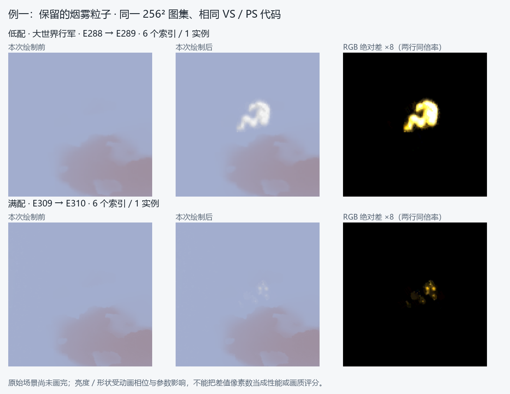

图注：基础烟雾单次绘制前后。两种配置的源图和代码一致，但抓取的动画相位／参数不同；图中满配更淡不构成“满配效果更差”的证据。差值图两行同为 ×8。

这张混合火焰／烟雾素材表在实际选中的 draw 中显示为烟雾状粒子，不能把整张图集统称为“正在画火焰”。同图集每次主场景绘制使用次数为大世界1 14 次、行军 8 次、满配 23 次，均为 6 索引 / 1 实例；这是图集的提交数量，不能等同于一个发射器的粒子预算。部分 draw 没有改变主目标 RGB，仍不能因此认定其 GPU 成本为零。

<a id="toc-16-2"></a>

### 例二：同名蘑菇城堡附近的额外叠加

> **补充：特效分级／LOD 线索。** 满配两侧烟线、光点与柔光更明显，行军低配中这些装饰层减少或未显示。现有证据支持“存在分级／状态裁减线索”，尚未确定是画质、距离还是战斗状态触发。用户标出的檐下亮度差异不能直接归因于 567750；该图已确认在低配中使用。

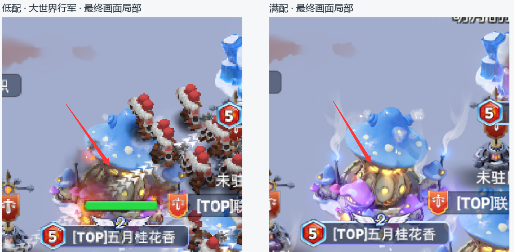

![上排对照同名城堡 \[TOP\]五月桂花香；低配行军同时有部队遮挡、受击效果和血条。下排拆出满配 E4525 的一次局部叠加，白色掩码标出 147 个 RGB 变化像素。](images/mushroom-effect-comparison.png)

图注：上排对照同名城堡 \[TOP\]五月桂花香；低配行军同时有部队遮挡、受击效果和血条。下排拆出满配 E4525 的一次局部叠加，白色掩码标出 147 个 RGB 变化像素。

满配 E4525 使用 788323 / 788324，提交 6 个索引、1 实例。绑定噪声 5706、默认白图 3383、柔遮罩 567900、渐变遮罩 6064、另一遮罩 567918；PS 有 6 个静态取样点（包含条件取样），带扰动、遮罩和 Kill。此相同 Shader 家族在满配主场景提交 80 次，在两份低配主场景均为 0 次；52 次的另一个扰动家族同样在两份低配缺席。

**图上能看见满配城堡周围更多烟线／光点，但不能把这些整体变化都归因于 E4525。** 被拆出的这一 draw 只产生图示的微小局部变化；其他烟线由其他绘制组成。低配未出现相同家族是管线证据；它究竟受画质档位、战斗状态还是对象条件控制，需要在同一相机与同一对象状态下切换配置验证。

<a id="toc-16-3"></a>

### 据此可以借鉴的性能规范

把“渲染比例”和“特效层级”分成两条明确的配置：基础烟雾／状态提示保留，装饰扰动、光点和柔光按档位与屏幕面积减少；关闭层级时停掉对应绘制，而非只把 Alpha 拉成 0。复用小贴图、统一材质参数是制作规范，控制整座建筑的总层数、draw 与覆盖面积才是性能预算。GPU Skinning / VAT 的选择继续按顶点形变需求判断，不能替代这一层管理。

证据：comparison/\*/evidence/particle\_pairs.json、particle\_differences.json；comparison/high/evidence/complex\_pairs.json、complex\_differences.json；figure\_sources.json；具体 EID 的原始管线与 Shader。

<a id="ui"></a>

## 17 · UI、标牌与合批

**最明确的重复提交模式是 UI 图集与字体交替。** 主 UI 资源对 3869–3870 共 449 次，占全帧 28.22%。另一个 UI 资源对 4462–4463 为 20 次。

| 范围 | 图集 42115 | 字体 786448 | 解释 |
| --- | --- | --- | --- |
| 全帧所有 Shader | 219 次 | 219 次 | 同一资源跨 Shader 的总使用 draw 数 |
| 主 UI 资源对 3869–3870 内 | 211 次 | 211 次 | 剩余 27 次读其他图集 |
| EID 5159–6431 连续段 | 160 次 | 159 次 | 319 次 draw，318 次图集／字体切换 |

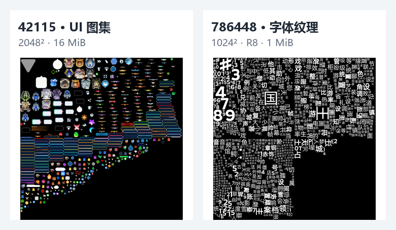

| 位置 | 贴图与用途 | 独立原图 |
| --- | --- | --- |
| 1 | 42115：2048² UI 图集，16 MiB | [查看原图](images/tex-42115.png) |
| 2 | 786448：1024² R8 字体纹理，1 MiB | [查看原图](images/tex-786448.png) |

图注：预览按版面等比缩放，保持完整内容；显示大小不代表源纹理的分辨率比例。

典型顺序是 5159 图集 → 5163 字体 → 5167 图集 → 5171 字体，不断重复。它与“每个地图标牌分别画背景／图标，再画文字”的提交模式相符；具体组件名仍需要源码或引擎 Profiler 对应。

Shader 自身主要是单纹理取样、顶点颜色和禁用态灰度处理。一次把纹理切回去就形成新 draw，即使 Shader 没变，也不能跨不同贴图自然合批。整帧另外有 480 个相邻 draw 边界，其 VS、PS 与已暴露的采样纹理序列均相同，但仍分开提交；未取得全部混合／裁剪／顶点流状态，不能断言这 480 处都能合并。

<a id="toc-17-1"></a>

### 建议按这个次序改

- 先做标牌可见性预算：屏幕外、太小、被 HUD 遮挡的标牌是否仍在提交；屏幕内大量同类标记是否可以降低文字密度。

- 对固定标牌结构尝试专用批绘制：背景／图标与字体在保证覆盖关系的前提下按层组织，或使用兼容运行端能力的多纹理批次。

- 动态文字和静态图案不要互相触发整片界面重建；原始抓帧无法证明是否存在 Canvas rebuild，需 CPU Profiler 验证。

- 不能把所有背景先画完、再画全部文字作为无条件方案：标牌相互覆盖时可能破坏视觉层级，应分区域或保序处理。

抽查 EID 5159、5163 时，分别相对上一 draw 的主目标 RGB 完全不变。这是可见性排查证据，不是所有标牌都不可见的证明；没有读取深度／模板变化，不能断言该 draw 没有任何效果。

证据：全部 449 个 UI draw 的绑定；findings\_metrics.json；EID 5159/5163 与前一 draw 的纹理对比。

<a id="memory"></a>

## 18 · 纹理容量与压缩

按 ResourceId 去重，把 RenderDoc 返回的 byte\_size 相加：已核对 277 / 281 个纹理描述，总有效载荷为  **535,845,360 bytes = 511.02 MiB** 。这是已知纹理数据量的下界，不是进程显存峰值；不含驱动对齐、Buffer、临时资源、内存别名及其他进程分配。

| 格式 | 数量 | 已知有效载荷 |
| --- | --- | --- |
| R8G8B8A8\_SRGB | 250 | 455.19 MiB |
| R8G8B8A8\_UNORM | 8 | 42.03 MiB |
| D24S8 | 1 | 7.91 MiB |
| R16G16B16A16\_FLOAT | 17 | 4.90 MiB |
| R8\_UNORM | 1 | 1.00 MiB |

<a id="toc-18-1"></a>

### 最大头：21 张 2048² 单 mip RGBA8 图集

每张 16 MiB，合计  **336 MiB，占已知纹理载荷 65.75%** 。资源包括 42115、5849、567743、568396、569317 等 UI／场景／特效图集。它们在该 Vulkan 抓帧中确实以未压缩 RGBA8 形式存在；但这不能说明安装包源文件没有压缩，更不能替代手机运行端的格式检查。

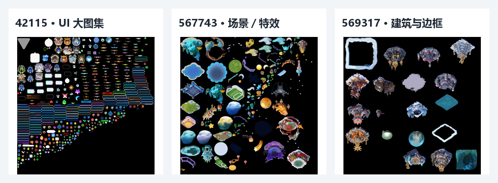

| 位置 | 贴图与用途 | 独立原图 |
| --- | --- | --- |
| 1 | UI 大图集 42115 | [查看原图](images/tex-42115.png) |
| 2 | 场景／特效大图集 567743 | [查看原图](images/tex-567743.png) |
| 3 | 建筑与边框大图集 569317 | [查看原图](images/tex-569317.png) |

图注：预览按版面等比缩放，保持完整内容；显示大小不代表源纹理的分辨率比例。

| 可验证的假设方案 | 这 21 张的理论有效载荷 | 前提 |
| --- | --- | --- |
| 保持现状 | 336 MiB | 抓帧中确认的 2048² RGBA8、单 mip |
| 全数改为 1024² RGBA8 | 84 MiB（理论减少 252 MiB） | 只用于估算；必须检查文字、小图标和近景外观质量 |
| 支持并保持 ASTC 6×6 存储 | 约 37.48 MiB | 2048² 每张 ceil(2048/6)²×16 bytes；需运行端支持、无解压回退，且视觉可接受 |

不建议把这 21 张一次性全部降分辨率。优先按实际驻留、显示尺寸、可见频率拆开：屏幕只用到一小块却把整张大图长期留下的图集更值得查；字体已经是 R8，不应改回 RGBA。对空间缩小明显的场景精灵，mip 缺失可能增加闪烁／采样代价，但加 mip 本身也会增加容量，需分用途处理。

已核对资源没有 BC / ETC / ASTC 格式，17 张 RGBA16F 均用于骨骼相关数据；主颜色目标本身不是 FP16 HDR。不要把“存在浮点纹理”误认为整个游戏走 HDR 渲染。

证据：texture\_inventory.json（277 个描述）、analysis.json（273 个被采样资源）、各资源缩略图；仍有 4 个未列入容量合计的抓帧纹理。

<a id="performance"></a>

## 19 · 性能证据与计时边界

MCP 返回 1,594 条 GPU duration（draw 和 clear），总和 0.470496 ms；其中 draw 的和为 0.470464 ms。 **这些是本机单次回放的事件计数之和，不是手机帧时间，也不包含 CPU 提交、同步与完整 Present 延迟。**

共有 758 条读数为零，非零值有明显量化。零不能当作“免费 draw”，微小差异也不应拿来排序优化。这里只把大面积绘制与聚合家族作为辅助线索；原始计数保留在证据中。

| 事件 | 家族 | 回放计数（μs） |
| --- | --- | --- |
| 136 | 地表 RGB 控制图混色 | 29.888 |
| 148 | 地表混色／额外纹理变体 | 25.248 |
| 144 | 地表混色／额外纹理变体 | 22.016 |
| 7456 | 另一画面源的 RGB 拷贝 | 14.304 |
| 5307 | UI 图集与文字 | 14.208 |
| 7540 | 宿主表面取样／合成 | 13.408 |
| 222 | 地图区域边界／查色带 | 13.024 |
| 4580 | 单贴图特效／亮度与透明度整形 | 12.768 |

地表 136、144、148 三次加起来约 77.15 μs，占本次 draw 计数和的 16.40%，说明小 draw 数不等于小像素成本。UI 主家族聚合约 56.03 μs，单贴图特效家族约 53.73 μs。受计时粒度、缓存和回放设备影响，这些不是可承诺的优化收益。

<a id="toc-19-1"></a>

### 目前能确认与不能确认的瓶颈

- 确认：提交数量偏碎、UI 纹理交替、若干抽样 draw 无 RGB 变化、大图集容量集中。

- 待验证：CPU 是否被渲染提交或 UI rebuild 限制；透明 overdraw 的实际倍数；真实 GPU 带宽与片元瓶颈；驱动是否把多余对象有效剔除。

- 未取得：设备 GPU 名称、真机 CPU/GPU frame time、各通道 overdraw、缓存命中率、完整混合／深度／模板／scissor 状态。

证据：timings.json；全部 draw 聚合；example\_differences.json。

<a id="plan"></a>

## 20 · 优化顺序与验证方法

| 顺序 | 具体动作 | 如何验收 |
| --- | --- | --- |
| P1 · 标牌与 UI | 从 5159–6431 的 319 draw 交替段着手，映射到标牌组件；先剔除不可见内容，再验证保序批绘制。 | 固定相机与城堡数量，比 draw、SetPass／贴图切换、CPU 提交时间；逐项检查文字遮挡顺序。 |
| P1 · 图集容量 | 核对 21 张 16 MiB 图集的驻留理由、实际屏幕尺寸和压缩回退。 | 按相同画质截图比较；在目标设备看 GPU 格式与纹理内存，记录不同缩放下清晰度。 |
| P1 · 特效密度 | 对远处／非选中城堡降低特效层数、粒子密度、动画更新；按屏幕覆盖面积设预算。 | 固定画面测透明 GPU 时间与 overdraw；确保选中城堡和重要状态仍可辨识。 |
| P2 · 大面积背景 | 剖析 136/144/148 的控制图采样和高光，测试低配变体。 | 在移动相机、昼夜／地图变更等条件下比较画面和 GPU 时间。 |
| P2 · 冗余提交 | 抽查无颜色变化样本和 480 个同 Shader 同采样纹理的相邻边界。 | 同时检查 viewport、scissor、depth/stencil、buffer、材质常量，确认真正可跳过／合并的部分。 |
| P3 · 动画微调 | 保留矩阵贴图方案，按远近降低骨骼影响数或动画质量。 | 对比顶点 GPU 时间、动作误差；确保不把 4.90 MiB 的小项优化成更大的 VAT 数据。 |

这里的 P1/P2/P3 表示调查与实施顺序，不是已经证实的故障等级。没有源码映射和真机 A/B，不能给“能提升多少 FPS”或“至少减少多少毫秒”的可靠承诺。

<a id="toc-20-1"></a>

### 建议补采的最小对照集

保持相机、缩放、地图内容一致，依次录：原始满配、关闭地图标牌、关闭城堡装饰特效、降低图集／压缩配置。记录目标设备 CPU/GPU 时间、纹理容量与 draw 数，并做正常缩放及密集区域两组对比。每次只改一个变量，才能分辨主因。

<a id="limits"></a>

## 21 · 覆盖范围与未决项

- 这是一帧，不包含完整时间维度。无法单靠它证明动画帧率、粒子更新成本、资源泄漏或持续抖动。

- Shader 名称与字段已被转译成 res／uniforms／\_child 等，本文名称是根据计算与图像给出的用途标签。个别业务语义标为候选。

- 旧 MCP 与 RenderDoc API 的 GetConstantBuffer 读取接口不兼容。本次已通过独立原生只读回放补齐 28 次骨骼蒙皮的常量、顶点输入和组合纹理采样器；其他 draw 的完整状态仍未全量补采。MCP 的 samplers 空数组不能当作实际没有过滤器。

- 已检查全部 1,591 次 draw 的 Shader 与采样纹理，并核对 28 次蒙皮的引用顶点和正权重骨骼。仍缺少其他 draw 的完整原始常量、mesh 源对象名和动画片段表，不能直接落到某个 Unity Prefab 或源码行。

- 没有测量真实 overdraw 倍数或逐像素历史；颜色不变的样本可能仍对深度／模板有影响。

- 资源容量是已知 277 项的有效载荷，不是全部显存；Buffer 仅取得总数 39，未虚构其容量。

- 最后的 653867 目标读回黑色，且其输入来自独立宿主纹理，不能等同于用户看到的最终游戏屏幕。报告使用可辨识的主场景输出解释画面。

抓帧本身与项目代码未修改。原 RenderDoc 会话保留在 EID 159。本次补采使用隐藏的独立原生回放进程，完成后自动退出；没有修改已安装插件。

<a id="appendix"></a>

## 22 · 完整 Shader 清单与证据

以下为全部 53 个 VS／PS 资源对。重复项仅列前两个代表事件；完整事件列表位于 evidence/analysis.json。取样数是静态反汇编出现的取样点数量，包含分支；骨骼循环会使动态取样次数增加。

| 用途标签 | VS / PS | Draw | 代表 EID | VS / PS 取样点 | 引用量含实例 |
| --- | --- | --- | --- | --- | --- |
| UI 图集与文字 | 3869 / 3870 | 449 | 5159, 5163 | 0 / 1 | 27,576 |
| 单贴图特效／亮度与透明度整形 | 788113 / 788114 | 247 | 308, 309 | 0 / 1 | 5,544 |
| 主纹理 + 通道遮罩特效 | 788195 / 788196 | 142 | 597, 660 | 0 / 2 | 30,618 |
| 多层滚动／噪声特效 | 7876 / 7877 | 134 | 1506, 1507 | 0 / 4 | 4,782 |
| 光斑／边缘淡出特效 | 7869 / 7870 | 91 | 1959, 1960 | 0 / 2 | 1,668 |
| 场景图集／预乘 Alpha 精灵 | 42612 / 42613 | 83 | 214, 230 | 0 / 2 | 10,332 |
| 多层遮罩／扰动／裁切特效 | 788323 / 788324 | 80 | 300, 1820 | 0 / 6 | 1,680 |
| 双取样扰动／遮罩特效 | 788158 / 788159 | 52 | 494, 590 | 0 / 4 | 12,138 |
| 渐变与噪声叠加特效 | 7856 / 7857 | 42 | 1978, 2151 | 0 / 3 | 354 |
| 序列图／单贴图特效变体 | 788663 / 788664 | 41 | 2561, 2562 | 0 / 1 | 8,748 |
| 噪声 UV 扰动／透明度整形（无 Kill） | 788335 / 788336 | 27 | 3934, 3935 | 0 / 3 | 162 |
| 多通道遮罩裁切特效 | 788331 / 788332 | 23 | 1552, 1582 | 0 / 4 | 372 |
| UI 图集另一变体 | 4462 / 4463 | 20 | 7255, 7259 | 0 / 1 | 3,060 |
| 光条／多纹理裁切特效 | 788107 / 788108 | 19 | 349, 921 | 0 / 3 | 3,774 |
| 骨骼矩阵蒙皮 + 单贴图材质 | 42738 / 42739 | 14 | 159, 166 | 6 / 1 | 93,195 |
| 四取样噪声特效变体 | 570500 / 570501 | 14 | 1900, 2355 | 0 / 4 | 2,382 |
| 建筑遮罩／发光叠加 | 47141 / 47142 | 14 | 2580, 4720 | 0 / 3 | 108 |
| 场景发光图／时间闪烁 | 42852 / 42853 | 12 | 1432, 1438 | 0 / 2 | 180 |
| 复杂扰动裁切特效变体 | 788342 / 788343 | 11 | 719, 914 | 0 / 6 | 852 |
| 骨骼蒙皮 + 遮罩裁切 | 788309 / 788310 | 8 | 1630, 1659 | 6 / 3 | 3,195 |
| 双贴图流动条纹 | 788692 / 788693 | 8 | 4406, 4408 | 0 / 2 | 7,920 |
| 小贴图单层叠加 | 571646 / 571647 | 6 | 2589, 2616 | 0 / 1 | 126 |
| UI 特效图集／双纹理 | 6642 / 6643 | 5 | 7165, 7188 | 0 / 2 | 48 |
| UI 渐变特效 | 788391 / 788392 | 5 | 7195, 7200 | 0 / 1 | 30 |
| 多层软遮罩特效 | 788702 / 788703 | 4 | 4464, 4492 | 0 / 4 | 5,070 |
| 地表混色／额外纹理变体 | 788070 / 788071 | 3 | 144, 148 | 0 / 8 | 108 |
| 场景图集精灵变体 | 740861 / 740862 | 3 | 388, 394 | 0 / 2 | 18 |
| 宿主表面取样／合成 | 190 / 520 | 2 | 36, 7540 | 0 / 1 | 6 |
| 软圆形投影／阴影片 | 42745 / 42746 | 2 | 291, 320 | 0 / 1 | 30 |
| 场景装饰图集 | 570597 / 570598 | 2 | 341, 2347 | 0 / 1 | 366 |
| 骨骼蒙皮 + 顶点纹理 + 裁切 | 740142 / 740143 | 2 | 730, 737 | 7 / 2 | 873 |
| 小型场景图块 | 570003 / 570004 | 2 | 1691, 1697 | 0 / 2 | 12 |
| 五取样噪声特效 | 7885 / 7886 | 2 | 1951, 2124 | 0 / 5 | 54 |
| 界面区多纹理扰动特效 | 788377 / 788378 | 2 | 6474, 6478 | 0 / 4 | 12 |
| UI 特效图集单层 | 6670 / 6671 | 2 | 7147, 7318 | 0 / 1 | 12 |
| 小表面显示／颜色转换 | 1463 / 1464 | 1 | 71 | 0 / 1 | 4 |
| 地表 RGB 控制图混色 | 788062 / 788063 | 1 | 136 | 0 / 7 | 6 |
| 地图区域边界／查色带 | 42546 / 42547 | 1 | 222 | 0 / 6 | 6 |
| 植被图集实例化／Alpha 裁切 | 788088 / 788089 | 1 | 240 | 0 / 1 | 132 |
| 顶点纹理驱动的装饰特效 | 570089 / 570090 | 1 | 582 | 1 / 2 | 87 |
| 骨骼蒙皮特效变体 | 788302 / 788303 | 1 | 1598 | 6 / 1 | 51 |
| 五取样复合特效 | 740879 / 740880 | 1 | 4397 | 0 / 5 | 54 |
| 骨骼蒙皮 + 顶点纹理扰动 | 569953 / 569954 | 1 | 4924 | 7 / 1 | 2,778 |
| 场景投影／剪影图集 | 788369 / 788370 | 1 | 4932 | 0 / 1 | 48 |
| 骨骼蒙皮 + 彩色扰动 | 788726 / 788727 | 1 | 5067 | 6 / 3 | 540 |
| 骨骼蒙皮 + 双贴图 | 778796 / 778797 | 1 | 5150 | 6 / 2 | 540 |
| 界面区四取样特效 | 6653 / 6654 | 1 | 6457 | 0 / 4 | 24 |
| 界面区彩色柔光叠加 | 789598 / 789599 | 1 | 7013 | 0 / 1 | 6 |
| 无纹理几何／遮罩候选 | 42383 / 42384 | 1 | 7019 | 0 / 0 | 24 |
| 白色纹理／遮罩候选 | 42389 / 42390 | 1 | 7026 | 0 / 1 | 144 |
| UI 星光特效 | 788385 / 788386 | 1 | 7180 | 0 / 2 | 12 |
| 另一画面源的 RGB 拷贝 | 3595 / 3596 | 1 | 7456 | 0 / 1 | 4 |
| 主场景 RT 拷贝／方向转换 | 3567 / 3568 | 1 | 7498 | 0 / 1 | 3 |

<a id="toc-22-1"></a>

### 证据文件索引

- get\_draw\_calls.json：完整事件树与实际 draw 参数。

- pipelines/：1,591 次绘制的 Shader、采样纹理、常量布局描述。

- shaders/：106 个 Shader 的 JSON 与可直接阅读的 SPIR-V 文本。

- texture\_inventory.json：277 项纹理尺寸、格式、mip、采样数与 byte\_size。

- timings.json：原始回放计时，保留零值。

- example\_differences.json：代表 draw 与前一 draw 的 RGB 差异；assets/ 保存导出的阶段与纹理图。

- analysis.json：完整 53 类分组、每类事件列表、资源复用关系；findings\_metrics.json：重复切换与容量指标。

<a id="mip-inventory"></a>

## 23 · 全部纹理的 Mip 分类清单

**没有统一“全开”或“全关”：特效大部分单层，地形输入混用；建筑主体大图集、UI 与骨骼矩阵图基本都是单层。** 此处“有 Mip”指资源包含多级缩小图；Mip = 1 只包含原尺寸层。模型 LOD 是另一件事，见下一节。

| 截帧 | 全部纹理 | 本帧 draw 采样过 | 多级 Mip | 仅原尺寸层 |
| --- | --- | --- | --- | --- |
| 大世界1.rdc | 223 | 212 | 60 | 163 |
| 大世界行军.rdc | 190 | 182 | 38 | 152 |
| 满配.rdc | 281 | 273 | 72 | 209 |

本轮递归检查 WJDR 文件夹，只发现这三份 RDC。共  **694 条“截帧 × 纹理资源”记录** ；每份捕获内部按资源 ID 去重，跨捕获不按相同 ID 直接合并。满配本轮补齐为 281 项；原“纹理容量与压缩”节的 277 项是旧的已知子集，新增 4 项均为单层，不改变 72 项多级 Mip 的结论。

<a id="toc-23-1"></a>

### 按用途对照：数字为“多级 / 单层（合计）”

| 纹理用途 | 大世界1 · 低配 | 行军 · 低配 | 满配 |
| --- | --- | --- | --- |
| 特效 | 37 / 81（118） | 19 / 82（101） | 44 / 131（175） |
| 地形 | 2 / 1（3） | 2 / 1（3） | 3 / 1（4） |
| 建筑与场景精灵 | 2 / 18（20） | 0 / 15（15） | 0 / 17（17） |
| 建筑发光与遮罩 | 0 / 8（8） | 0 / 6（6） | 0 / 6（6） |
| 角色与骨骼装饰 | 17 / 4（21） | 15 / 3（18） | 23 / 3（26） |
| 骨骼矩阵数据 | 0 / 15（15） | 0 / 12（12） | 0 / 17（17） |
| UI与文字 | 0 / 13（13） | 0 / 13（13） | 0 / 13（13） |
| UI特效 | 2 / 15（17） | 2 / 15（17） | 2 / 17（19） |
| 区域边界 | 0 / 3（3） | 0 / 3（3） | 0 / 3（3） |
| 画面合成 | 0 / 6（6） | 0 / 5（5） | 0 / 5（5） |
| 本帧未见采样 | 0 / 11（11） | 0 / 8（8） | 0 / 8（8） |

**分类行不能相加。** 用途根据实际绘制的 Shader 与绑定纹理打多标签，共用白图、辅助图可能同时出现在多个用途。统计包括主颜色、遮罩、噪声等全部输入。本轮把 570089 / 570090 的建筑遮罩输入单列，因此“特效”为 175 项；旧节的广义“通用特效与叠加”为 178 项，两个口径不同。

<a id="toc-23-2"></a>

### 具体贴图与例外

| 用途 | 代表资源与 Mip | 判断 |
| --- | --- | --- |
| 特效 | 满配 44 项多级、131 项单层；567942：1 级 | 没有所有特效都关 Mip 的统一配置。小图、渐变、噪声也须按实际资源逐项看。 |
| 地形 | 满配 785772：512² / 10 级；785840：512² / 10 级；785912：1024² / 11 级 | 多级图包含辅助与遮罩输入，不能全叫地表颜色贴图。低配对应地形输入 42061、42102 也有多级。 |
| 地形控制图 | 42095：1024² / 1 级 | 三份捕获都只见原尺寸层；不能根据地形有 Mip 就推断控制图也有。 |
| 建筑主体图集 | 42433、42784、42891、567954、568112、569317：单层 | 行军和满配这类输入分别 15 / 17 项，全部单层；包含共享辅助图。 |
| 建筑类别中的例外 | 大世界1 的 569706、637338：多级 | 预览是建筑轮廓／剪影辅助图，不是主体彩色图集。 |
| 本次四通道遮罩 | 567750 与配套 567743：2048² / 1 级 | 每张捕获格式 RGBA8\_SRGB，16 MiB；两张合计 32 MiB。 |
| 骨骼数据与外观 | 满配 17 张骨骼矩阵图：全部单层；角色／骨骼装饰输入 23 多级、3 单层 | 数据图与角色颜色图不能混在一起判断。 |
| UI 与文字 | 每份 13 项，全部单层；UI 特效另列 | UI 特效有少数多级图，不能把它们并入“UI 全关”的说法。 |

采样器也做了交叉核对：抽取覆盖各实际采样资源的代表 draw，检查可见 Mip 范围和 LOD 上限；多级资源中未发现上限被固定到 0～0.25 的样本。 **这说明资源有多级、配置允许选择，不能证明屏幕上每个像素实际读到了低分辨率层。** 显式 LOD、屏幕占比、导数等仍决定具体级别。Mip 的 Point 表示级别间取最近层，不等于关闭 Mip。

<a id="toc-23-3"></a>

### 694 项完整清单

#### 全部纹理清单（可用编辑器搜索）

| 截帧 | 纹理 ID | 全部用途标签 | 尺寸 | 捕获格式 | Mip 级数 | 代表采样器 | 代表事件 |
| --- | --- | --- | --- | --- | --- | --- | --- |
| 大世界1.rdc | 304 | 渲染目标与画面、画面合成 | 1080 × 1920 | R8G8B8A8\_UNORM | 1（单层） | NoFilter<br>LOD 上限 0 | E38、E81、E168 |
| 大世界1.rdc | 310 | 渲染目标与画面、画面合成 | 1080 × 1920 | R8G8B8A8\_UNORM | 1（单层） | NoFilter<br>LOD 上限 0 | E211 |
| 大世界1.rdc | 1257 | 渲染目标与画面、画面合成 | 384 × 216 | R8G8B8A8\_UNORM | 1（单层） | NoFilter<br>LOD 上限 0 | E11489 |
| 大世界1.rdc | 1264 | 本帧未见采样 | 300 × 200 | R8G8B8A8\_UNORM | 1（单层） | 未采样／未采集<br>LOD 上限 — | — |
| 大世界1.rdc | 1265 | 本帧未见采样 | 300 × 200 | R8G8B8A8\_UNORM | 1（单层） | 未采样／未采集<br>LOD 上限 — | — |
| 大世界1.rdc | 1266 | 本帧未见采样 | 300 × 200 | R8G8B8A8\_UNORM | 1（单层） | 未采样／未采集<br>LOD 上限 — | — |
| 大世界1.rdc | 3383 | UI特效、建筑与场景精灵、特效、角色与骨骼装饰 | 4 × 4 | R8G8B8A8\_SRGB | 1（单层） | Point<br>LOD 上限 0.25 | E354、E474、E480 |
| 大世界1.rdc | 3423 | UI特效、特效 | 16 × 16 | R8G8B8A8\_SRGB | 1（单层） | Point<br>LOD 上限 0.25 | E1644、E1647、E1650 |
| 大世界1.rdc | 3690 | UI与文字 | 1024 × 512 | R8G8B8A8\_SRGB | 1（单层） | Point<br>LOD 上限 0.25 | E5390、E5414、E5482 |
| 大世界1.rdc | 3712 | UI与文字 | 2048 × 2048 | R8G8B8A8\_SRGB | 1（单层） | Point<br>LOD 上限 0.25 | E5394、E5418、E5426 |
| 大世界1.rdc | 3723 | UI与文字 | 512 × 512 | R8G8B8A8\_SRGB | 1（单层） | Point<br>LOD 上限 0.25 | E5748、E11326 |
| 大世界1.rdc | 4125 | 渲染目标与画面、画面合成 | 648 × 1152 | R8G8B8A8\_SRGB | 1（单层） | Point<br>LOD 上限 0.25 | E5790、E11407 |
| 大世界1.rdc | 4131 | 本帧未见采样、渲染目标与画面 | 648 × 1152 | D24S8 | 1（单层） | 未采样／未采集<br>LOD 上限 — | — |
| 大世界1.rdc | 4365 | UI与文字 | 2048 × 2048 | R8G8B8A8\_SRGB | 1（单层） | Point<br>LOD 上限 0.25 | E5402、E5438、E10980 |
| 大世界1.rdc | 4490 | 特效 | 128 × 128 | R8G8B8A8\_SRGB | 1（单层） | Point<br>LOD 上限 0.25 | E5709、E11287 |
| 大世界1.rdc | 5633 | UI与文字 | 2048 × 2048 | R8G8B8A8\_SRGB | 1（单层） | Point<br>LOD 上限 0.25 | E5386、E5422、E5448 |
| 大世界1.rdc | 5706 | 特效 | 256 × 256 | R8G8B8A8\_SRGB | 1（单层） | Point<br>LOD 上限 0.25 | E2312、E2346、E2507 |
| 大世界1.rdc | 5712 | 特效 | 128 × 128 | R8G8B8A8\_SRGB | 1（单层） | Point<br>LOD 上限 0.25 | E2232、E2320、E2321 |
| 大世界1.rdc | 5718 | 特效 | 256 × 256 | R8G8B8A8\_SRGB | 1（单层） | Point<br>LOD 上限 0.25 | E2130、E2186、E2435 |
| 大世界1.rdc | 5769 | 特效 | 64 × 64 | R8G8B8A8\_SRGB | 1（单层） | Point<br>LOD 上限 0.25 | E5463、E11041 |
| 大世界1.rdc | 5784 | 特效 | 64 × 64 | R8G8B8A8\_SRGB | 1（单层） | Point<br>LOD 上限 0.25 | E5459、E11037 |
| 大世界1.rdc | 5824 | 特效 | 128 × 128 | R8G8B8A8\_SRGB | 1（单层） | Point<br>LOD 上限 0.25 | E1982、E1983、E1984 |
| 大世界1.rdc | 5830 | 特效 | 128 × 128 | R8G8B8A8\_SRGB | 1（单层） | Point<br>LOD 上限 0.25 | E1819、E1820、E1840 |
| 大世界1.rdc | 5849 | UI特效 | 2048 × 2048 | R8G8B8A8\_SRGB | 1（单层） | Point<br>LOD 上限 0.25 | E5493、E5511、E5534 |
| 大世界1.rdc | 5912 | 特效 | 128 × 128 | R8G8B8A8\_SRGB | 1（单层） | Point<br>LOD 上限 0.25 | E1647、E4775、E4829 |
| 大世界1.rdc | 5919 | UI特效 | 256 × 256 | R8G8B8A8\_SRGB | 1（单层） | Point<br>LOD 上限 0.25 | E5526、E11104 |
| 大世界1.rdc | 5926 | 特效 | 64 × 64 | R8G8B8A8\_SRGB | 1（单层） | Point<br>LOD 上限 0.25 | E3214、E8792 |
| 大世界1.rdc | 5945 | UI特效 | 128 × 128 | R8G8B8A8\_SRGB | 1（单层） | Point<br>LOD 上限 0.25 | E5668、E11246 |
| 大世界1.rdc | 5959 | UI特效、特效 | 256 × 256 | R8G8B8A8\_SRGB | 1（单层） | Point<br>LOD 上限 0.25 | E3012、E3030、E3061 |
| 大世界1.rdc | 6001 | UI特效、特效 | 128 × 128 | R8G8B8A8\_SRGB | 1（单层） | Point<br>LOD 上限 0.25 | E1819、E1820、E1840 |
| 大世界1.rdc | 6008 | 特效 | 128 × 128 | R8G8B8A8\_SRGB | 1（单层） | Point<br>LOD 上限 0.25 | E2130、E2186、E2435 |
| 大世界1.rdc | 6015 | 特效 | 128 × 128 | R8G8B8A8\_SRGB | 1（单层） | Point<br>LOD 上限 0.25 | E1819、E1820、E1840 |
| 大世界1.rdc | 6036 | 特效 | 256 × 256 | R8G8B8A8\_SRGB | 1（单层） | Point<br>LOD 上限 0.25 | E1968、E2249、E2339 |
| 大世界1.rdc | 6043 | 特效 | 256 × 256 | R8G8B8A8\_SRGB | 1（单层） | Point<br>LOD 上限 0.25 | E2312、E2346、E2554 |
| 大世界1.rdc | 6050 | 特效 | 128 × 128 | R8G8B8A8\_SRGB | 1（单层） | Point<br>LOD 上限 0.25 | E1644、E1650、E7222 |
| 大世界1.rdc | 6071 | 特效 | 256 × 256 | R8G8B8A8\_SRGB | 1（单层） | Point<br>LOD 上限 0.25 | E5580、E11158 |
| 大世界1.rdc | 6141 | UI特效 | 64 × 64 | R8G8B8A8\_SRGB | 7（多级） | Point<br>LOD 上限 1000 | E5546、E11124 |
| 大世界1.rdc | 6158 | UI特效 | 64 × 64 | R8G8B8A8\_SRGB | 7（多级） | Point<br>LOD 上限 1000 | E5551、E11129 |
| 大世界1.rdc | 6252 | UI与文字、UI特效 | 1024 × 1024 | R8G8B8A8\_SRGB | 1（单层） | Point<br>LOD 上限 0.25 | E5654、E5661、E11232 |
| 大世界1.rdc | 6291 | 特效 | 64 × 64 | R8G8B8A8\_SRGB | 1（单层） | Point<br>LOD 上限 0.25 | E5675、E11253 |
| 大世界1.rdc | 6296 | UI特效 | 2048 × 2048 | R8G8B8A8\_SRGB | 1（单层） | Point<br>LOD 上限 0.25 | E5668、E11246 |
| 大世界1.rdc | 6310 | UI与文字、UI特效 | 128 × 128 | R8G8B8A8\_SRGB | 1（单层） | Point<br>LOD 上限 0.25 | E5694、E5701、E11272 |
| 大世界1.rdc | 6317 | UI与文字 | 2048 × 1024 | R8G8B8A8\_SRGB | 1（单层） | Point<br>LOD 上限 0.25 | E5625、E11203 |
| 大世界1.rdc | 6328 | UI与文字 | 2048 × 2048 | R8G8B8A8\_SRGB | 1（单层） | Point<br>LOD 上限 0.25 | E5344、E5352、E5478 |
| 大世界1.rdc | 6339 | UI与文字 | 2048 × 2048 | R8G8B8A8\_SRGB | 1（单层） | Point<br>LOD 上限 0.25 | E5434、E11012 |
| 大世界1.rdc | 6357 | UI与文字 | 2048 × 1024 | R8G8B8A8\_SRGB | 1（单层） | Point<br>LOD 上限 0.25 | E5430、E11008 |
| 大世界1.rdc | 6393 | 特效 | 128 × 128 | R8G8B8A8\_SRGB | 1（单层） | Point<br>LOD 上限 0.25 | E2958、E2959、E2960 |
| 大世界1.rdc | 7129 | 特效 | 128 × 128 | R8G8B8A8\_SRGB | 1（单层） | Point<br>LOD 上限 0.25 | E1714、E1997、E1998 |
| 大世界1.rdc | 41961 | UI特效 | 128 × 128 | R8G8B8A8\_SRGB | 1（单层） | Point<br>LOD 上限 0.25 | E5372、E10950 |
| 大世界1.rdc | 42061 | 地形 | 256 × 256 | R8G8B8A8\_SRGB | 9（多级） | Point<br>LOD 上限 1000 | E279、E283、E344 |
| 大世界1.rdc | 42095 | 地形 | 1024 × 1024 | R8G8B8A8\_SRGB | 1（单层） | Point<br>LOD 上限 0.25 | E271、E279、E344 |
| 大世界1.rdc | 42102 | 地形 | 512 × 512 | R8G8B8A8\_SRGB | 10（多级） | Point<br>LOD 上限 1000 | E283、E5861 |
| 大世界1.rdc | 42115 | UI与文字、建筑与场景精灵 | 2048 × 2048 | R8G8B8A8\_SRGB | 1（单层） | Point<br>LOD 上限 0.25 | E532、E870、E981 |
| 大世界1.rdc | 42125 | 区域边界 | 64 × 1 | R8G8B8A8\_SRGB | 1（单层） | Point<br>LOD 上限 0.25 | E362、E5940 |
| 大世界1.rdc | 42136 | 区域边界 | 512 × 512 | R8G8B8A8\_SRGB | 1（单层） | Point<br>LOD 上限 0.25 | E362、E5940 |
| 大世界1.rdc | 42183 | 区域边界 | 512 × 512 | R8G8B8A8\_UNORM | 1（单层） | Point<br>LOD 上限 0.25 | E362、E5940 |
| 大世界1.rdc | 42200 | 建筑与场景精灵 | 1024 × 1024 | R8G8B8A8\_SRGB | 1（单层） | Point<br>LOD 上限 0.25 | E371、E375、E379 |
| 大世界1.rdc | 42433 | 建筑与场景精灵 | 2048 × 2048 | R8G8B8A8\_SRGB | 1（单层） | Point<br>LOD 上限 0.25 | E538、E550、E574 |
| 大世界1.rdc | 42479 | 建筑与场景精灵 | 512 × 512 | R8G8B8A8\_SRGB | 1（单层） | Point<br>LOD 上限 0.25 | E417、E440、E458 |
| 大世界1.rdc | 42485 | 建筑发光与遮罩、角色与骨骼装饰 | 512 × 512 | R8G8B8A8\_SRGB | 1（单层） | Point<br>LOD 上限 0.25 | E330、E334、E581 |
| 大世界1.rdc | 42505 | 建筑发光与遮罩 | 2048 × 2048 | R8G8B8A8\_SRGB | 1（单层） | Point<br>LOD 上限 0.25 | E1516、E1540、E1552 |
| 大世界1.rdc | 42692 | 角色与骨骼装饰 | 128 × 128 | R8G8B8A8\_SRGB | 8（多级） | Point<br>LOD 上限 1000 | E394、E5972 |
| 大世界1.rdc | 42698 | 角色与骨骼装饰 | 128 × 128 | R8G8B8A8\_SRGB | 8（多级） | Point<br>LOD 上限 1000 | E322、E5900 |
| 大世界1.rdc | 42728 | 骨骼矩阵数据 | 174 × 272 | R16G16B16A16\_FLOAT | 1（单层） | Point<br>LOD 上限 0.25 | E394、E5972 |
| 大世界1.rdc | 42731 | 骨骼矩阵数据 | 69 × 375 | R16G16B16A16\_FLOAT | 1（单层） | Point<br>LOD 上限 0.25 | E322、E5900 |
| 大世界1.rdc | 42760 | UI特效、特效 | 256 × 256 | R8G8B8A8\_SRGB | 1（单层） | Point<br>LOD 上限 0.25 | E2130、E2186、E2435 |
| 大世界1.rdc | 42766 | 特效 | 128 × 128 | R8G8B8A8\_SRGB | 1（单层） | Point<br>LOD 上限 0.25 | E2130、E2186、E2435 |
| 大世界1.rdc | 42778 | 特效 | 128 × 128 | R8G8B8A8\_SRGB | 1（单层） | Point<br>LOD 上限 0.25 | E1714、E1997、E1998 |
| 大世界1.rdc | 42784 | 建筑与场景精灵 | 2048 × 2048 | R8G8B8A8\_SRGB | 1（单层） | Point<br>LOD 上限 0.25 | E486、E568、E688 |
| 大世界1.rdc | 42791 | 建筑发光与遮罩 | 2048 × 2048 | R8G8B8A8\_SRGB | 1（单层） | Point<br>LOD 上限 0.25 | E1522、E1528、E1534 |
| 大世界1.rdc | 42891 | 建筑与场景精灵 | 2048 × 2048 | R8G8B8A8\_SRGB | 1（单层） | Point<br>LOD 上限 0.25 | E526、E864、E876 |
| 大世界1.rdc | 47437 | 特效 | 128 × 128 | R8G8B8A8\_SRGB | 1（单层） | Point<br>LOD 上限 0.25 | E3454、E9032 |
| 大世界1.rdc | 48348 | 角色与骨骼装饰 | 128 × 128 | R8G8B8A8\_SRGB | 8（多级） | Point<br>LOD 上限 1000 | E387、E5965 |
| 大世界1.rdc | 48369 | 骨骼矩阵数据 | 45 × 292 | R16G16B16A16\_FLOAT | 1（单层） | Point<br>LOD 上限 0.25 | E387、E5965 |
| 大世界1.rdc | 559775 | 本帧未见采样 | 648 × 1152 | R8G8B8A8\_UNORM | 1（单层） | 未采样／未采集<br>LOD 上限 — | — |
| 大世界1.rdc | 559843 | 渲染目标与画面、画面合成 | 648 × 1152 | R8G8B8A8\_UNORM | 1（单层） | Point<br>LOD 上限 0.25 | E11365 |
| 大世界1.rdc | 559860 | 渲染目标与画面、画面合成 | 648 × 1152 | R8G8B8A8\_UNORM | 1（单层） | Point<br>LOD 上限 0.25 | E126 |
| 大世界1.rdc | 566809 | 建筑与场景精灵 | 2048 × 1024 | R8G8B8A8\_SRGB | 1（单层） | Point<br>LOD 上限 0.25 | E354、E5932 |
| 大世界1.rdc | 566944 | 特效 | 256 × 256 | R8G8B8A8\_SRGB | 1（单层） | Point<br>LOD 上限 0.25 | E1968、E2249、E2339 |
| 大世界1.rdc | 566950 | 特效 | 256 × 256 | R8G8B8A8\_SRGB | 1（单层） | Point<br>LOD 上限 0.25 | E1957、E1958、E1959 |
| 大世界1.rdc | 566956 | 特效 | 128 × 128 | R8G8B8A8\_SRGB | 1（单层） | Point<br>LOD 上限 0.25 | E2480、E8058 |
| 大世界1.rdc | 566968 | 建筑与场景精灵 | 114 × 101 | R8G8B8A8\_SRGB | 1（单层） | Point<br>LOD 上限 0.25 | E1799、E7377 |
| 大世界1.rdc | 567047 | 建筑与场景精灵 | 55 × 58 | R8G8B8A8\_SRGB | 1（单层） | Point<br>LOD 上限 0.25 | E1793、E7371 |
| 大世界1.rdc | 567052 | 建筑与场景精灵 | 74 × 53 | R8G8B8A8\_SRGB | 1（单层） | Point<br>LOD 上限 0.25 | E1787、E1811、E7365 |
| 大世界1.rdc | 567097 | 建筑与场景精灵 | 61 × 45 | R8G8B8A8\_SRGB | 1（单层） | Point<br>LOD 上限 0.25 | E1805、E7383 |
| 大世界1.rdc | 567374 | 特效 | 32 × 32 | R8G8B8A8\_SRGB | 6（多级） | Point<br>LOD 上限 1000 | E1393、E1412、E1470 |
| 大世界1.rdc | 567384 | 特效 | 64 × 64 | R8G8B8A8\_SRGB | 7（多级） | Point<br>LOD 上限 1000 | E1473、E7051 |
| 大世界1.rdc | 567481 | 特效 | 64 × 64 | R8G8B8A8\_SRGB | 7（多级） | Point<br>LOD 上限 1000 | E1480、E7058 |
| 大世界1.rdc | 567589 | 特效 | 16 × 16 | R8G8B8A8\_SRGB | 5（多级） | Point<br>LOD 上限 1000 | E506、E1368、E1384 |
| 大世界1.rdc | 567605 | 特效 | 128 × 128 | R8G8B8A8\_SRGB | 1（单层） | Point<br>LOD 上限 0.25 | E1480、E7058 |
| 大世界1.rdc | 567711 | 角色与骨骼装饰 | 64 × 64 | R8G8B8A8\_SRGB | 7（多级） | Point<br>LOD 上限 1000 | E330、E334、E5908 |
| 大世界1.rdc | 567716 | 建筑与场景精灵 | 128 × 128 | R8G8B8A8\_SRGB | 1（单层） | Point<br>LOD 上限 0.25 | E1428、E1451、E7006 |
| 大世界1.rdc | 567722 | 建筑发光与遮罩 | 512 × 512 | R8G8B8A8\_SRGB | 1（单层） | Point<br>LOD 上限 0.25 | E1459、E7037 |
| 大世界1.rdc | 567743 | 建筑与场景精灵、建筑发光与遮罩 | 2048 × 2048 | R8G8B8A8\_SRGB | 1（单层） | Point<br>LOD 上限 0.25 | E480、E492、E514 |
| 大世界1.rdc | 567750 | 建筑发光与遮罩 | 2048 × 2048 | R8G8B8A8\_SRGB | 1（单层） | Point<br>LOD 上限 0.25 | E581、E1443、E1502 |
| 大世界1.rdc | 567757 | 建筑发光与遮罩 | 512 × 512 | R8G8B8A8\_SRGB | 1（单层） | Point<br>LOD 上限 0.25 | E1459、E7037 |
| 大世界1.rdc | 567769 | 骨骼矩阵数据 | 105 × 506 | R16G16B16A16\_FLOAT | 1（单层） | Point<br>LOD 上限 0.25 | E330、E334、E5908 |
| 大世界1.rdc | 567870 | 特效 | 128 × 128 | R8G8B8A8\_SRGB | 1（单层） | Point<br>LOD 上限 0.25 | E3229、E3231、E3233 |
| 大世界1.rdc | 567876 | 特效 | 256 × 128 | R8G8B8A8\_SRGB | 1（单层） | Point<br>LOD 上限 0.25 | E3229、E3231、E3233 |
| 大世界1.rdc | 567882 | 特效 | 128 × 128 | R8G8B8A8\_SRGB | 1（单层） | Point<br>LOD 上限 0.25 | E3432、E9010 |
| 大世界1.rdc | 567900 | 特效 | 128 × 128 | R8G8B8A8\_SRGB | 1（单层） | Point<br>LOD 上限 0.25 | E4726、E4807、E4869 |
| 大世界1.rdc | 567906 | 特效 | 256 × 256 | R8G8B8A8\_SRGB | 1（单层） | Point<br>LOD 上限 0.25 | E2977、E2978、E2979 |
| 大世界1.rdc | 567924 | 特效 | 256 × 256 | R8G8B8A8\_SRGB | 1（单层） | Point<br>LOD 上限 0.25 | E2049、E2079、E2087 |
| 大世界1.rdc | 567936 | 特效 | 128 × 64 | R8G8B8A8\_SRGB | 1（单层） | Point<br>LOD 上限 0.25 | E2045、E2083、E2092 |
| 大世界1.rdc | 567942 | 特效 | 256 × 256 | R8G8B8A8\_SRGB | 1（单层） | Point<br>LOD 上限 0.25 | E403、E404、E405 |
| 大世界1.rdc | 567954 | 建筑与场景精灵 | 2048 × 2048 | R8G8B8A8\_SRGB | 1（单层） | Point<br>LOD 上限 0.25 | E474、E498、E520 |
| 大世界1.rdc | 567973 | 特效 | 128 × 128 | R8G8B8A8\_SRGB | 1（单层） | Point<br>LOD 上限 0.25 | E3172、E3200、E8750 |
| 大世界1.rdc | 567997 | 特效 | 265 × 265 | R8G8B8A8\_SRGB | 1（单层） | Point<br>LOD 上限 0.25 | E3221、E3222、E8799 |
| 大世界1.rdc | 568003 | 特效 | 128 × 128 | R8G8B8A8\_SRGB | 1（单层） | Point<br>LOD 上限 0.25 | E2780、E2781、E2782 |
| 大世界1.rdc | 568015 | 特效 | 128 × 128 | R8G8B8A8\_SRGB | 1（单层） | Point<br>LOD 上限 0.25 | E3439、E9017 |
| 大世界1.rdc | 568027 | 特效 | 64 × 64 | R8G8B8A8\_SRGB | 7（多级） | Point<br>LOD 上限 1000 | E3446、E3450、E9024 |
| 大世界1.rdc | 568038 | 特效 | 128 × 128 | R8G8B8A8\_SRGB | 1（单层） | Point<br>LOD 上限 0.25 | E3172、E3200、E8750 |
| 大世界1.rdc | 568050 | 特效 | 256 × 256 | R8G8B8A8\_SRGB | 1（单层） | Point<br>LOD 上限 0.25 | E2829、E2830、E2850 |
| 大世界1.rdc | 568074 | 特效 | 128 × 128 | R8G8B8A8\_SRGB | 1（单层） | Point<br>LOD 上限 0.25 | E3172、E3200、E8750 |
| 大世界1.rdc | 568086 | 特效 | 128 × 128 | R8G8B8A8\_SRGB | 8（多级） | Point<br>LOD 上限 1000 | E3155、E3156、E8733 |
| 大世界1.rdc | 568098 | 角色与骨骼装饰 | 256 × 256 | R8G8B8A8\_SRGB | 9（多级） | Point<br>LOD 上限 1000 | E301、E5879 |
| 大世界1.rdc | 568112 | 建筑与场景精灵 | 2048 × 2048 | R8G8B8A8\_SRGB | 1（单层） | Point<br>LOD 上限 0.25 | E562、E616、E676 |
| 大世界1.rdc | 568125 | 建筑发光与遮罩 | 2048 × 2048 | R8G8B8A8\_SRGB | 1（单层） | Point<br>LOD 上限 0.25 | E1570、E1582、E1594 |
| 大世界1.rdc | 568175 | 骨骼矩阵数据 | 105 × 411 | R16G16B16A16\_FLOAT | 1（单层） | Point<br>LOD 上限 0.25 | E301、E5879 |
| 大世界1.rdc | 568345 | 角色与骨骼装饰 | 256 × 256 | R8G8B8A8\_SRGB | 9（多级） | Point<br>LOD 上限 1000 | E308、E5886 |
| 大世界1.rdc | 568358 | 骨骼矩阵数据 | 162 × 357 | R16G16B16A16\_FLOAT | 1（单层） | Point<br>LOD 上限 0.25 | E308、E5886 |
| 大世界1.rdc | 568361 | 特效 | 128 × 128 | R8G8B8A8\_SRGB | 1（单层） | Point<br>LOD 上限 0.25 | E2602、E2632、E2633 |
| 大世界1.rdc | 568367 | 特效 | 128 × 128 | R8G8B8A8\_SRGB | 1（单层） | Point<br>LOD 上限 0.25 | E2507、E2508、E2605 |
| 大世界1.rdc | 568373 | 特效 | 64 × 64 | R8G8B8A8\_SRGB | 1（单层） | Point<br>LOD 上限 0.25 | E2602、E2632、E2633 |
| 大世界1.rdc | 568384 | 特效 | 128 × 128 | R8G8B8A8\_SRGB | 1（单层） | Point<br>LOD 上限 0.25 | E2312、E2346、E2554 |
| 大世界1.rdc | 568390 | 特效 | 128 × 128 | R8G8B8A8\_SRGB | 1（单层） | Point<br>LOD 上限 0.25 | E2070、E2241、E2331 |
| 大世界1.rdc | 568396 | 建筑与场景精灵 | 2048 × 2048 | R8G8B8A8\_SRGB | 1（单层） | Point<br>LOD 上限 0.25 | E467、E2676、E2765 |
| 大世界1.rdc | 568468 | 特效 | 512 × 256 | R8G8B8A8\_SRGB | 1（单层） | Point<br>LOD 上限 0.25 | E1352、E6930 |
| 大世界1.rdc | 568481 | 特效 | 128 × 128 | R8G8B8A8\_SRGB | 1（单层） | Point<br>LOD 上限 0.25 | E2483、E8061 |
| 大世界1.rdc | 568686 | 角色与骨骼装饰 | 256 × 256 | R8G8B8A8\_SRGB | 9（多级） | Point<br>LOD 上限 1000 | E1724、E1919、E7302 |
| 大世界1.rdc | 568693 | 角色与骨骼装饰 | 256 × 256 | R8G8B8A8\_SRGB | 9（多级） | Point<br>LOD 上限 1000 | E1669、E1749、E1778 |
| 大世界1.rdc | 568705 | 特效 | 64 × 64 | R8G8B8A8\_SRGB | 7（多级） | Point<br>LOD 上限 1000 | E630、E696、E786 |
| 大世界1.rdc | 568710 | 特效 | 128 × 64 | R8G8B8A8\_SRGB | 8（多级） | Point<br>LOD 上限 1000 | E596、E744、E6174 |
| 大世界1.rdc | 568726 | 特效 | 32 × 32 | R8G8B8A8\_SRGB | 6（多级） | Point<br>LOD 上限 1000 | E1677、E1698、E1757 |
| 大世界1.rdc | 568741 | 特效 | 32 × 32 | R8G8B8A8\_SRGB | 6（多级） | Point<br>LOD 上限 1000 | E3050、E3051、E3052 |
| 大世界1.rdc | 568746 | 特效 | 128 × 128 | R8G8B8A8\_SRGB | 8（多级） | Point<br>LOD 上限 1000 | E1660、E1740、E1853 |
| 大世界1.rdc | 568762 | 特效 | 128 × 128 | R8G8B8A8\_SRGB | 8（多级） | Point<br>LOD 上限 1000 | E2156、E2194、E2212 |
| 大世界1.rdc | 568768 | 角色与骨骼装饰 | 256 × 256 | R8G8B8A8\_SRGB | 1（单层） | Point<br>LOD 上限 0.25 | E1669、E1749、E1778 |
| 大世界1.rdc | 568791 | 特效 | 32 × 32 | R8G8B8A8\_SRGB | 6（多级） | Point<br>LOD 上限 1000 | E2623、E2655、E2658 |
| 大世界1.rdc | 568796 | 特效 | 32 × 16 | R8G8B8A8\_SRGB | 6（多级） | Point<br>LOD 上限 1000 | E602、E656、E750 |
| 大世界1.rdc | 568801 | 特效 | 64 × 32 | R8G8B8A8\_SRGB | 7（多级） | Point<br>LOD 上限 1000 | E599、E747、E914 |
| 大世界1.rdc | 568806 | 特效 | 32 × 32 | R8G8B8A8\_SRGB | 6（多级） | Point<br>LOD 上限 1000 | E2008、E2026、E2057 |
| 大世界1.rdc | 568812 | 特效 | 64 × 64 | R8G8B8A8\_SRGB | 7（多级） | Point<br>LOD 上限 1000 | E2623、E2655、E2658 |
| 大世界1.rdc | 568822 | 特效 | 64 × 64 | R8G8B8A8\_SRGB | 7（多级） | Point<br>LOD 上限 1000 | E1684、E1705、E1767 |
| 大世界1.rdc | 568828 | 特效 | 32 × 32 | R8G8B8A8\_SRGB | 6（多级） | Point<br>LOD 上限 1000 | E1691、E1732、E1883 |
| 大世界1.rdc | 568833 | 特效 | 64 × 64 | R8G8B8A8\_SRGB | 7（多级） | Point<br>LOD 上限 1000 | E769、E770、E6347 |
| 大世界1.rdc | 568854 | 特效 | 128 × 128 | R8G8B8A8\_SRGB | 8（多级） | Point<br>LOD 上限 1000 | E1684、E1705、E1767 |
| 大世界1.rdc | 568860 | 角色与骨骼装饰 | 128 × 128 | R8G8B8A8\_SRGB | 8（多级） | Point<br>LOD 上限 1000 | E1724、E1919、E7302 |
| 大世界1.rdc | 568896 | 特效 | 32 × 32 | R8G8B8A8\_SRGB | 1（单层） | Point<br>LOD 上限 0.25 | E1660、E1740、E1853 |
| 大世界1.rdc | 568911 | 特效 | 64 × 64 | R8G8B8A8\_SRGB | 1（单层） | Point<br>LOD 上限 0.25 | E599、E747、E914 |
| 大世界1.rdc | 568921 | 特效 | 64 × 64 | R8G8B8A8\_SRGB | 1（单层） | Point<br>LOD 上限 0.25 | E630、E634、E696 |
| 大世界1.rdc | 568931 | 特效 | 32 × 32 | R8G8B8A8\_SRGB | 1（单层） | Point<br>LOD 上限 0.25 | E596、E602、E656 |
| 大世界1.rdc | 568936 | 特效 | 32 × 32 | R8G8B8A8\_SRGB | 1（单层） | Point<br>LOD 上限 0.25 | E640、E706、E814 |
| 大世界1.rdc | 568941 | 特效 | 64 × 64 | R8G8B8A8\_SRGB | 1（单层） | Point<br>LOD 上限 0.25 | E2822、E2870、E2892 |
| 大世界1.rdc | 568951 | 特效 | 16 × 16 | R8G8B8A8\_SRGB | 5（多级） | Point<br>LOD 上限 1000 | E1677、E1698、E1757 |
| 大世界1.rdc | 568956 | 特效 | 32 × 32 | R8G8B8A8\_SRGB | 1（单层） | Point<br>LOD 上限 0.25 | E2008、E2026、E2057 |
| 大世界1.rdc | 568976 | 特效 | 64 × 64 | R8G8B8A8\_SRGB | 1（单层） | Point<br>LOD 上限 0.25 | E640、E706、E814 |
| 大世界1.rdc | 568987 | 骨骼矩阵数据 | 33 × 185 | R16G16B16A16\_FLOAT | 1（单层） | Point<br>LOD 上限 0.25 | E1778、E1949、E7356 |
| 大世界1.rdc | 568990 | 骨骼矩阵数据 | 75 × 215 | R16G16B16A16\_FLOAT | 1（单层） | Point<br>LOD 上限 0.25 | E1830、E1875、E7408 |
| 大世界1.rdc | 568993 | 骨骼矩阵数据 | 102 × 250 | R16G16B16A16\_FLOAT | 1（单层） | Point<br>LOD 上限 0.25 | E1669、E1749、E7247 |
| 大世界1.rdc | 568999 | 骨骼矩阵数据 | 405 × 122 | R16G16B16A16\_FLOAT | 1（单层） | Point<br>LOD 上限 0.25 | E1724、E1919、E7302 |
| 大世界1.rdc | 569011 | UI与文字 | 512 × 1024 | R8\_UNORM | 1（单层） | Point<br>LOD 上限 0.25 | E3489、E3497、E3505 |
| 大世界1.rdc | 569105 | 特效 | 256 × 256 | R8G8B8A8\_SRGB | 1（单层） | Point<br>LOD 上限 0.25 | E849、E1126、E6427 |
| 大世界1.rdc | 569111 | 特效 | 128 × 128 | R8G8B8A8\_SRGB | 8（多级） | Point<br>LOD 上限 1000 | E728、E1084、E6306 |
| 大世界1.rdc | 569117 | 特效 | 256 × 256 | R8G8B8A8\_SRGB | 1（单层） | Point<br>LOD 上限 0.25 | E833、E1106、E6411 |
| 大世界1.rdc | 569141 | 特效 | 128 × 128 | R8G8B8A8\_SRGB | 8（多级） | Point<br>LOD 上限 1000 | E856、E1114、E6434 |
| 大世界1.rdc | 569147 | 特效 | 128 × 128 | R8G8B8A8\_SRGB | 8（多级） | Point<br>LOD 上限 1000 | E844、E849、E1121 |
| 大世界1.rdc | 569159 | 特效 | 128 × 128 | R8G8B8A8\_SRGB | 8（多级） | Point<br>LOD 上限 1000 | E728、E844、E1084 |
| 大世界1.rdc | 569172 | 特效 | 128 × 128 | R8G8B8A8\_SRGB | 8（多级） | Point<br>LOD 上限 1000 | E837、E856、E1110 |
| 大世界1.rdc | 569209 | 特效 | 128 × 128 | R8G8B8A8\_SRGB | 8（多级） | Point<br>LOD 上限 1000 | E833、E1106、E6411 |
| 大世界1.rdc | 569215 | 角色与骨骼装饰 | 256 × 256 | R8G8B8A8\_SRGB | 9（多级） | Point<br>LOD 上限 1000 | E294、E5872 |
| 大世界1.rdc | 569228 | 特效 | 256 × 256 | R8G8B8A8\_SRGB | 1（单层） | Point<br>LOD 上限 0.25 | E4825、E4887、E5005 |
| 大世界1.rdc | 569234 | 特效 | 512 × 256 | R8G8B8A8\_SRGB | 1（单层） | Point<br>LOD 上限 0.25 | E4763、E10341 |
| 大世界1.rdc | 569240 | 特效 | 128 × 128 | R8G8B8A8\_SRGB | 1（单层） | Point<br>LOD 上限 0.25 | E4721、E4802、E4864 |
| 大世界1.rdc | 569246 | 特效 | 256 × 256 | R8G8B8A8\_SRGB | 1（单层） | Point<br>LOD 上限 0.25 | E4716、E4771、E4797 |
| 大世界1.rdc | 569252 | UI特效 | 256 × 256 | R8G8B8A8\_SRGB | 1（单层） | Point<br>LOD 上限 0.25 | E4735、E10313 |
| 大世界1.rdc | 569258 | UI特效 | 256 × 256 | R8G8B8A8\_SRGB | 1（单层） | Point<br>LOD 上限 0.25 | E4756、E10334 |
| 大世界1.rdc | 569264 | UI特效 | 256 × 256 | R8G8B8A8\_SRGB | 1（单层） | Point<br>LOD 上限 0.25 | E4752、E10330 |
| 大世界1.rdc | 569270 | 特效 | 256 × 256 | R8G8B8A8\_SRGB | 1（单层） | Point<br>LOD 上限 0.25 | E4763、E10341 |
| 大世界1.rdc | 569288 | 特效 | 64 × 64 | R8G8B8A8\_SRGB | 1（单层） | Point<br>LOD 上限 0.25 | E2256、E7834 |
| 大世界1.rdc | 569299 | 特效 | 128 × 128 | R8G8B8A8\_SRGB | 1（单层） | Point<br>LOD 上限 0.25 | E2888、E8466 |
| 大世界1.rdc | 569305 | 特效 | 128 × 128 | R8G8B8A8\_SRGB | 1（单层） | Point<br>LOD 上限 0.25 | E2793、E8371 |
| 大世界1.rdc | 569311 | 特效 | 256 × 256 | R8G8B8A8\_SRGB | 1（单层） | Point<br>LOD 上限 0.25 | E2773、E8351 |
| 大世界1.rdc | 569317 | 建筑与场景精灵 | 2048 × 2048 | R8G8B8A8\_SRGB | 1（单层） | Point<br>LOD 上限 0.25 | E888、E937、E6466 |
| 大世界1.rdc | 569346 | 骨骼矩阵数据 | 78 × 391 | R16G16B16A16\_FLOAT | 1（单层） | Point<br>LOD 上限 0.25 | E294、E5872 |
| 大世界1.rdc | 569477 | 角色与骨骼装饰 | 256 × 256 | R8G8B8A8\_SRGB | 9（多级） | Point<br>LOD 上限 1000 | E315、E5893 |
| 大世界1.rdc | 569486 | 骨骼矩阵数据 | 75 × 193 | R16G16B16A16\_FLOAT | 1（单层） | Point<br>LOD 上限 0.25 | E315、E5893 |
| 大世界1.rdc | 569495 | 特效 | 64 × 128 | R8G8B8A8\_SRGB | 1（单层） | Point<br>LOD 上限 0.25 | E2944、E2946、E2948 |
| 大世界1.rdc | 569501 | 特效 | 128 × 128 | R8G8B8A8\_SRGB | 1（单层） | Point<br>LOD 上限 0.25 | E3262、E3264、E3266 |
| 大世界1.rdc | 569507 | 特效 | 256 × 256 | R8G8B8A8\_SRGB | 1（单层） | Point<br>LOD 上限 0.25 | E3262、E3264、E3266 |
| 大世界1.rdc | 569513 | 特效 | 128 × 128 | R8G8B8A8\_SRGB | 1（单层） | Point<br>LOD 上限 0.25 | E2944、E2946、E2948 |
| 大世界1.rdc | 569578 | 特效 | 10 × 13 | R8G8B8A8\_SRGB | 1（单层） | Point<br>LOD 上限 0.25 | E2812、E2840、E2860 |
| 大世界1.rdc | 569601 | 角色与骨骼装饰 | 128 × 128 | R8G8B8A8\_SRGB | 1（单层） | Point<br>LOD 上限 0.25 | E3387、E3394、E3400 |
| 大世界1.rdc | 569706 | 建筑与场景精灵 | 512 × 512 | R8G8B8A8\_SRGB | 10（多级） | Point<br>LOD 上限 1000 | E3366、E3378、E8944 |
| 大世界1.rdc | 610174 | 特效 | 128 × 32 | R8G8B8A8\_SRGB | 1（单层） | Point<br>LOD 上限 0.25 | E3454、E9032 |
| 大世界1.rdc | 637290 | 特效 | 128 × 128 | R8G8B8A8\_SRGB | 8（多级） | Point<br>LOD 上限 1000 | E3407、E8985 |
| 大世界1.rdc | 637302 | 特效 | 128 × 64 | R8G8B8A8\_SRGB | 1（单层） | Point<br>LOD 上限 0.25 | E3407、E8985 |
| 大世界1.rdc | 637338 | 建筑与场景精灵 | 512 × 512 | R8G8B8A8\_SRGB | 10（多级） | Point<br>LOD 上限 1000 | E3372、E8950 |
| 大世界1.rdc | 637358 | 骨骼矩阵数据 | 120 × 291 | R16G16B16A16\_FLOAT | 1（单层） | Point<br>LOD 上限 0.25 | E3358、E8936 |
| 大世界1.rdc | 637361 | 角色与骨骼装饰 | 128 × 128 | R8G8B8A8\_SRGB | 8（多级） | Point<br>LOD 上限 1000 | E3358、E8936 |
| 大世界1.rdc | 650008 | 特效 | 256 × 256 | R8G8B8A8\_SRGB | 1（单层） | Point<br>LOD 上限 0.25 | E3425、E9003 |
| 大世界1.rdc | 650032 | 特效 | 128 × 64 | R8G8B8A8\_SRGB | 8（多级） | Point<br>LOD 上限 1000 | E3446、E3450、E9024 |
| 大世界1.rdc | 650038 | 特效 | 64 × 64 | R8G8B8A8\_SRGB | 7（多级） | Point<br>LOD 上限 1000 | E3425、E9003 |
| 大世界1.rdc | 650061 | 特效 | 128 × 128 | R8G8B8A8\_SRGB | 8（多级） | Point<br>LOD 上限 1000 | E3461、E3465、E9039 |
| 大世界1.rdc | 650085 | 特效 | 256 × 256 | R8G8B8A8\_SRGB | 9（多级） | Point<br>LOD 上限 1000 | E3432、E9010 |
| 大世界1.rdc | 650092 | 骨骼矩阵数据 | 222 × 603 | R16G16B16A16\_FLOAT | 1（单层） | Point<br>LOD 上限 0.25 | E3343、E3387、E3394 |
| 大世界1.rdc | 650095 | 角色与骨骼装饰 | 256 × 256 | R8G8B8A8\_SRGB | 9（多级） | Point<br>LOD 上限 1000 | E3343、E8921 |
| 大世界1.rdc | 650102 | 角色与骨骼装饰 | 256 × 256 | R8G8B8A8\_SRGB | 9（多级） | Point<br>LOD 上限 1000 | E3387、E3394、E3400 |
| 大世界1.rdc | 650115 | 角色与骨骼装饰 | 256 × 256 | R8G8B8A8\_SRGB | 9（多级） | Point<br>LOD 上限 1000 | E3343、E8921 |
| 大世界1.rdc | 650122 | 角色与骨骼装饰 | 256 × 256 | R8G8B8A8\_SRGB | 9（多级） | Point<br>LOD 上限 1000 | E3343、E8921 |
| 大世界1.rdc | 653381 | 特效 | 128 × 128 | R8G8B8A8\_SRGB | 8（多级） | Point<br>LOD 上限 1000 | E3474、E3478、E9052 |
| 大世界1.rdc | 653387 | 特效 | 128 × 128 | R8G8B8A8\_SRGB | 8（多级） | Point<br>LOD 上限 1000 | E3478、E9056 |
| 大世界1.rdc | 653419 | 特效 | 64 × 32 | R8G8B8A8\_SRGB | 7（多级） | Point<br>LOD 上限 1000 | E3474、E3478、E9052 |
| 大世界1.rdc | 653435 | 特效 | 128 × 128 | R8G8B8A8\_SRGB | 1（单层） | Point<br>LOD 上限 0.25 | E3474、E3478、E9052 |
| 大世界1.rdc | 653451 | 特效 | 128 × 128 | R8G8B8A8\_SRGB | 8（多级） | Point<br>LOD 上限 1000 | E3474、E9052 |
| 大世界1.rdc | 653465 | 骨骼矩阵数据 | 168 × 210 | R16G16B16A16\_FLOAT | 1（单层） | Point<br>LOD 上限 0.25 | E3351、E8929 |
| 大世界1.rdc | 653468 | 角色与骨骼装饰 | 128 × 128 | R8G8B8A8\_SRGB | 8（多级） | Point<br>LOD 上限 1000 | E3351、E8929 |
| 大世界1.rdc | 653583 | 本帧未见采样 | 1181 × 2100 | R8G8B8A8\_UNORM | 1（单层） | 未采样／未采集<br>LOD 上限 — | — |
| 大世界1.rdc | 653584 | 本帧未见采样 | 1181 × 2100 | R8G8B8A8\_UNORM | 1（单层） | 未采样／未采集<br>LOD 上限 — | — |
| 大世界1.rdc | 653585 | 本帧未见采样 | 1181 × 2100 | R8G8B8A8\_UNORM | 1（单层） | 未采样／未采集<br>LOD 上限 — | — |
| 大世界1.rdc | 653603 | 本帧未见采样 | 1215 × 2160 | R8G8B8A8\_UNORM | 1（单层） | 未采样／未采集<br>LOD 上限 — | — |
| 大世界1.rdc | 653604 | 本帧未见采样 | 1215 × 2160 | R8G8B8A8\_UNORM | 1（单层） | 未采样／未采集<br>LOD 上限 — | — |
| 大世界1.rdc | 653605 | 本帧未见采样 | 1215 × 2160 | R8G8B8A8\_UNORM | 1（单层） | 未采样／未采集<br>LOD 上限 — | — |
| 大世界行军.rdc | 304 | 渲染目标与画面、画面合成 | 1080 × 1920 | R8G8B8A8\_UNORM | 1（单层） | Point<br>LOD 上限 0.25 | E71 |
| 大世界行军.rdc | 310 | 渲染目标与画面、画面合成 | 1080 × 1920 | R8G8B8A8\_UNORM | 1（单层） | NoFilter<br>LOD 上限 0 | E5058 |
| 大世界行军.rdc | 1257 | 渲染目标与画面、画面合成 | 384 × 216 | R8G8B8A8\_UNORM | 1（单层） | NoFilter<br>LOD 上限 0 | E36 |
| 大世界行军.rdc | 1264 | 本帧未见采样 | 300 × 200 | R8G8B8A8\_UNORM | 1（单层） | 未采样／未采集<br>LOD 上限 — | — |
| 大世界行军.rdc | 1265 | 本帧未见采样 | 300 × 200 | R8G8B8A8\_UNORM | 1（单层） | 未采样／未采集<br>LOD 上限 — | — |
| 大世界行军.rdc | 1266 | 本帧未见采样 | 300 × 200 | R8G8B8A8\_UNORM | 1（单层） | 未采样／未采集<br>LOD 上限 — | — |
| 大世界行军.rdc | 3383 | UI特效、建筑与场景精灵、特效、角色与骨骼装饰 | 4 × 4 | R8G8B8A8\_SRGB | 1（单层） | Point<br>LOD 上限 0.25 | E203、E341、E347 |
| 大世界行军.rdc | 3423 | UI特效、特效 | 16 × 16 | R8G8B8A8\_SRGB | 1（单层） | Point<br>LOD 上限 0.25 | E1124、E1125、E1129 |
| 大世界行军.rdc | 3690 | UI与文字 | 1024 × 512 | R8G8B8A8\_SRGB | 1（单层） | Point<br>LOD 上限 0.25 | E4562、E4586、E4654 |
| 大世界行军.rdc | 3712 | UI与文字 | 2048 × 2048 | R8G8B8A8\_SRGB | 1（单层） | Point<br>LOD 上限 0.25 | E4566、E4590、E4598 |
| 大世界行军.rdc | 3723 | UI与文字 | 512 × 512 | R8G8B8A8\_SRGB | 1（单层） | Point<br>LOD 上限 0.25 | E4930 |
| 大世界行军.rdc | 4125 | 渲染目标与画面、画面合成 | 648 × 1152 | R8G8B8A8\_SRGB | 1（单层） | Point<br>LOD 上限 0.25 | E5016 |
| 大世界行军.rdc | 4131 | 本帧未见采样、渲染目标与画面 | 648 × 1152 | D24S8 | 1（单层） | 未采样／未采集<br>LOD 上限 — | — |
| 大世界行军.rdc | 4365 | UI与文字 | 2048 × 2048 | R8G8B8A8\_SRGB | 1（单层） | Point<br>LOD 上限 0.25 | E4574、E4610 |
| 大世界行军.rdc | 4490 | 特效 | 128 × 128 | R8G8B8A8\_SRGB | 1（单层） | Point<br>LOD 上限 0.25 | E4891 |
| 大世界行军.rdc | 5633 | UI与文字 | 2048 × 2048 | R8G8B8A8\_SRGB | 1（单层） | Point<br>LOD 上限 0.25 | E4558、E4594、E4620 |
| 大世界行军.rdc | 5706 | 特效 | 256 × 256 | R8G8B8A8\_SRGB | 1（单层） | Point<br>LOD 上限 0.25 | E1374、E1381、E1408 |
| 大世界行军.rdc | 5712 | 特效 | 128 × 128 | R8G8B8A8\_SRGB | 1（单层） | Point<br>LOD 上限 0.25 | E1416、E1417、E1418 |
| 大世界行军.rdc | 5718 | 特效 | 256 × 256 | R8G8B8A8\_SRGB | 1（单层） | Point<br>LOD 上限 0.25 | E1487、E1509、E1510 |
| 大世界行军.rdc | 5769 | 特效 | 64 × 64 | R8G8B8A8\_SRGB | 1（单层） | Point<br>LOD 上限 0.25 | E4635 |
| 大世界行军.rdc | 5784 | 特效 | 64 × 64 | R8G8B8A8\_SRGB | 1（单层） | Point<br>LOD 上限 0.25 | E4631 |
| 大世界行军.rdc | 5824 | 特效 | 128 × 128 | R8G8B8A8\_SRGB | 1（单层） | Point<br>LOD 上限 0.25 | E1325、E2498、E2499 |
| 大世界行军.rdc | 5830 | 特效 | 128 × 128 | R8G8B8A8\_SRGB | 1（单层） | Point<br>LOD 上限 0.25 | E1435、E1554、E1888 |
| 大世界行军.rdc | 5849 | UI特效 | 2048 × 2048 | R8G8B8A8\_SRGB | 1（单层） | Point<br>LOD 上限 0.25 | E4665、E4683、E4706 |
| 大世界行军.rdc | 5912 | 特效 | 128 × 128 | R8G8B8A8\_SRGB | 1（单层） | Point<br>LOD 上限 0.25 | E1132、E4031、E4085 |
| 大世界行军.rdc | 5919 | UI特效 | 256 × 256 | R8G8B8A8\_SRGB | 1（单层） | Point<br>LOD 上限 0.25 | E4698 |
| 大世界行军.rdc | 5945 | UI特效 | 128 × 128 | R8G8B8A8\_SRGB | 1（单层） | Point<br>LOD 上限 0.25 | E4850 |
| 大世界行军.rdc | 5959 | UI特效、特效 | 256 × 256 | R8G8B8A8\_SRGB | 1（单层） | Point<br>LOD 上限 0.25 | E2059、E2293、E2297 |
| 大世界行军.rdc | 6001 | 特效 | 128 × 128 | R8G8B8A8\_SRGB | 1（单层） | Point<br>LOD 上限 0.25 | E1888、E2529 |
| 大世界行军.rdc | 6008 | 特效 | 128 × 128 | R8G8B8A8\_SRGB | 1（单层） | Point<br>LOD 上限 0.25 | E1487、E1509、E1510 |
| 大世界行军.rdc | 6015 | 特效 | 128 × 128 | R8G8B8A8\_SRGB | 1（单层） | Point<br>LOD 上限 0.25 | E1888、E2529、E2579 |
| 大世界行军.rdc | 6036 | 特效 | 256 × 256 | R8G8B8A8\_SRGB | 1（单层） | Point<br>LOD 上限 0.25 | E1435、E1554、E1757 |
| 大世界行军.rdc | 6043 | 特效 | 256 × 256 | R8G8B8A8\_SRGB | 1（单层） | Point<br>LOD 上限 0.25 | E1408、E1527 |
| 大世界行军.rdc | 6050 | 特效 | 128 × 128 | R8G8B8A8\_SRGB | 1（单层） | Point<br>LOD 上限 0.25 | E1129、E1135、E1963 |
| 大世界行军.rdc | 6071 | 特效 | 256 × 256 | R8G8B8A8\_SRGB | 1（单层） | Point<br>LOD 上限 0.25 | E4762 |
| 大世界行军.rdc | 6141 | UI特效 | 64 × 64 | R8G8B8A8\_SRGB | 7（多级） | Point<br>LOD 上限 1000 | E4718 |
| 大世界行军.rdc | 6151 | UI特效 | 128 × 128 | R8G8B8A8\_SRGB | 1（单层） | Point<br>LOD 上限 0.25 | E4728、E4733 |
| 大世界行军.rdc | 6158 | UI特效 | 64 × 64 | R8G8B8A8\_SRGB | 7（多级） | Point<br>LOD 上限 1000 | E4723 |
| 大世界行军.rdc | 6252 | UI与文字、UI特效 | 1024 × 1024 | R8G8B8A8\_SRGB | 1（单层） | Point<br>LOD 上限 0.25 | E4836、E4843 |
| 大世界行军.rdc | 6291 | 特效 | 64 × 64 | R8G8B8A8\_SRGB | 1（单层） | Point<br>LOD 上限 0.25 | E4857 |
| 大世界行军.rdc | 6296 | UI特效 | 2048 × 2048 | R8G8B8A8\_SRGB | 1（单层） | Point<br>LOD 上限 0.25 | E4850 |
| 大世界行军.rdc | 6310 | UI与文字、UI特效 | 128 × 128 | R8G8B8A8\_SRGB | 1（单层） | Point<br>LOD 上限 0.25 | E4876、E4883 |
| 大世界行军.rdc | 6317 | UI与文字 | 2048 × 1024 | R8G8B8A8\_SRGB | 1（单层） | Point<br>LOD 上限 0.25 | E4807 |
| 大世界行军.rdc | 6328 | UI与文字 | 2048 × 2048 | R8G8B8A8\_SRGB | 1（单层） | Point<br>LOD 上限 0.25 | E4512、E4524、E4650 |
| 大世界行军.rdc | 6339 | UI与文字 | 2048 × 2048 | R8G8B8A8\_SRGB | 1（单层） | Point<br>LOD 上限 0.25 | E4606 |
| 大世界行军.rdc | 6357 | UI与文字 | 2048 × 1024 | R8G8B8A8\_SRGB | 1（单层） | Point<br>LOD 上限 0.25 | E4602 |
| 大世界行军.rdc | 6393 | 特效 | 128 × 128 | R8G8B8A8\_SRGB | 1（单层） | Point<br>LOD 上限 0.25 | E1945、E1946、E1947 |
| 大世界行军.rdc | 6416 | 特效 | 256 × 256 | R8G8B8A8\_SRGB | 1（单层） | Point<br>LOD 上限 0.25 | E1374 |
| 大世界行军.rdc | 7129 | 特效 | 128 × 128 | R8G8B8A8\_SRGB | 1（单层） | Point<br>LOD 上限 0.25 | E1124、E1125、E1334 |
| 大世界行军.rdc | 41961 | UI特效 | 128 × 128 | R8G8B8A8\_SRGB | 1（单层） | Point<br>LOD 上限 0.25 | E4544 |
| 大世界行军.rdc | 42061 | 地形 | 256 × 256 | R8G8B8A8\_SRGB | 9（多级） | Point<br>LOD 上限 1000 | E140、E144、E193 |
| 大世界行军.rdc | 42095 | 地形 | 1024 × 1024 | R8G8B8A8\_SRGB | 1（单层） | Point<br>LOD 上限 0.25 | E132、E140、E193 |
| 大世界行军.rdc | 42102 | 地形 | 512 × 512 | R8G8B8A8\_SRGB | 10（多级） | Point<br>LOD 上限 1000 | E144 |
| 大世界行军.rdc | 42115 | UI与文字、建筑与场景精灵 | 2048 × 2048 | R8G8B8A8\_SRGB | 1（单层） | Point<br>LOD 上限 0.25 | E353、E371、E415 |
| 大世界行军.rdc | 42125 | 区域边界 | 64 × 1 | R8G8B8A8\_SRGB | 1（单层） | Point<br>LOD 上限 0.25 | E211 |
| 大世界行军.rdc | 42136 | 区域边界 | 512 × 512 | R8G8B8A8\_SRGB | 1（单层） | Point<br>LOD 上限 0.25 | E211 |
| 大世界行军.rdc | 42183 | 区域边界 | 512 × 512 | R8G8B8A8\_UNORM | 1（单层） | Point<br>LOD 上限 0.25 | E211 |
| 大世界行军.rdc | 42200 | 建筑与场景精灵 | 1024 × 1024 | R8G8B8A8\_SRGB | 1（单层） | Point<br>LOD 上限 0.25 | E220 |
| 大世界行军.rdc | 42433 | 建筑与场景精灵 | 2048 × 2048 | R8G8B8A8\_SRGB | 1（单层） | Point<br>LOD 上限 0.25 | E341、E359、E397 |
| 大世界行军.rdc | 42479 | 建筑与场景精灵 | 512 × 512 | R8G8B8A8\_SRGB | 1（单层） | Point<br>LOD 上限 0.25 | E271、E279、E298 |
| 大世界行军.rdc | 42485 | 建筑发光与遮罩、角色与骨骼装饰 | 512 × 512 | R8G8B8A8\_SRGB | 1（单层） | Point<br>LOD 上限 0.25 | E590、E679、E686 |
| 大世界行军.rdc | 42505 | 建筑发光与遮罩 | 2048 × 2048 | R8G8B8A8\_SRGB | 1（单层） | Point<br>LOD 上限 0.25 | E1050、E1062、E1074 |
| 大世界行军.rdc | 42692 | 角色与骨骼装饰 | 128 × 128 | R8G8B8A8\_SRGB | 8（多级） | Point<br>LOD 上限 1000 | E242 |
| 大世界行军.rdc | 42698 | 角色与骨骼装饰 | 128 × 128 | R8G8B8A8\_SRGB | 8（多级） | Point<br>LOD 上限 1000 | E183 |
| 大世界行军.rdc | 42728 | 骨骼矩阵数据 | 174 × 272 | R16G16B16A16\_FLOAT | 1（单层） | Point<br>LOD 上限 0.25 | E242 |
| 大世界行军.rdc | 42731 | 骨骼矩阵数据 | 69 × 375 | R16G16B16A16\_FLOAT | 1（单层） | Point<br>LOD 上限 0.25 | E183 |
| 大世界行军.rdc | 42760 | UI特效、特效 | 256 × 256 | R8G8B8A8\_SRGB | 1（单层） | Point<br>LOD 上限 0.25 | E1144、E1487、E1509 |
| 大世界行军.rdc | 42766 | 特效 | 128 × 128 | R8G8B8A8\_SRGB | 1（单层） | Point<br>LOD 上限 0.25 | E1487、E1509、E1510 |
| 大世界行军.rdc | 42778 | 特效 | 128 × 128 | R8G8B8A8\_SRGB | 1（单层） | Point<br>LOD 上限 0.25 | E1334、E1335、E1336 |
| 大世界行军.rdc | 42784 | 建筑与场景精灵 | 2048 × 2048 | R8G8B8A8\_SRGB | 1（单层） | Point<br>LOD 上限 0.25 | E517、E577、E643 |
| 大世界行军.rdc | 42791 | 建筑发光与遮罩 | 2048 × 2048 | R8G8B8A8\_SRGB | 1（单层） | Point<br>LOD 上限 0.25 | E1056、E1068、E1080 |
| 大世界行军.rdc | 42891 | 建筑与场景精灵 | 2048 × 2048 | R8G8B8A8\_SRGB | 1（单层） | Point<br>LOD 上限 0.25 | E347、E365、E409 |
| 大世界行军.rdc | 48328 | 角色与骨骼装饰 | 512 × 512 | R8G8B8A8\_SRGB | 10（多级） | Point<br>LOD 上限 1000 | E235 |
| 大世界行军.rdc | 48362 | 骨骼矩阵数据 | 48 × 436 | R16G16B16A16\_FLOAT | 1（单层） | Point<br>LOD 上限 0.25 | E235 |
| 大世界行军.rdc | 559775 | 本帧未见采样 | 648 × 1152 | R8G8B8A8\_UNORM | 1（单层） | 未采样／未采集<br>LOD 上限 — | — |
| 大世界行军.rdc | 559843 | 渲染目标与画面、画面合成 | 648 × 1152 | R8G8B8A8\_UNORM | 1（单层） | Point<br>LOD 上限 0.25 | E4974 |
| 大世界行军.rdc | 566809 | 建筑与场景精灵 | 2048 × 1024 | R8G8B8A8\_SRGB | 1（单层） | Point<br>LOD 上限 0.25 | E203 |
| 大世界行军.rdc | 566944 | 特效 | 256 × 256 | R8G8B8A8\_SRGB | 1（单层） | Point<br>LOD 上限 0.25 | E1435、E1554、E2069 |
| 大世界行军.rdc | 566950 | 特效 | 256 × 256 | R8G8B8A8\_SRGB | 1（单层） | Point<br>LOD 上限 0.25 | E1151、E1165、E1181 |
| 大世界行军.rdc | 567107 | 建筑与场景精灵 | 75 × 54 | R8G8B8A8\_SRGB | 1（单层） | Point<br>LOD 上限 0.25 | E1244 |
| 大世界行军.rdc | 567327 | 特效 | 128 × 128 | R8G8B8A8\_SRGB | 1（单层） | Point<br>LOD 上限 0.25 | E2569、E2570 |
| 大世界行军.rdc | 567743 | 建筑与场景精灵、建筑发光与遮罩 | 2048 × 2048 | R8G8B8A8\_SRGB | 1（单层） | Point<br>LOD 上限 0.25 | E590、E603、E625 |
| 大世界行军.rdc | 567750 | 建筑发光与遮罩 | 2048 × 2048 | R8G8B8A8\_SRGB | 1（单层） | Point<br>LOD 上限 0.25 | E590 |
| 大世界行军.rdc | 567870 | 特效 | 128 × 128 | R8G8B8A8\_SRGB | 1（单层） | Point<br>LOD 上限 0.25 | E2606、E2608、E2610 |
| 大世界行军.rdc | 567876 | 特效 | 256 × 128 | R8G8B8A8\_SRGB | 1（单层） | Point<br>LOD 上限 0.25 | E2606、E2608、E2610 |
| 大世界行军.rdc | 567900 | 特效 | 128 × 128 | R8G8B8A8\_SRGB | 1（单层） | Point<br>LOD 上限 0.25 | E3982、E4063、E4117 |
| 大世界行军.rdc | 567906 | 特效 | 256 × 256 | R8G8B8A8\_SRGB | 1（单层） | Point<br>LOD 上限 0.25 | E1124、E1125、E1967 |
| 大世界行军.rdc | 567924 | 特效 | 256 × 256 | R8G8B8A8\_SRGB | 1（单层） | Point<br>LOD 上限 0.25 | E1348、E1357、E1445 |
| 大世界行军.rdc | 567936 | 特效 | 128 × 64 | R8G8B8A8\_SRGB | 1（单层） | Point<br>LOD 上限 0.25 | E1352、E1353、E1391 |
| 大世界行军.rdc | 567942 | 特效 | 256 × 256 | R8G8B8A8\_SRGB | 1（单层） | Point<br>LOD 上限 0.25 | E288、E289、E290 |
| 大世界行军.rdc | 567954 | 建筑与场景精灵 | 2048 × 2048 | R8G8B8A8\_SRGB | 1（单层） | Point<br>LOD 上限 0.25 | E463、E511、E523 |
| 大世界行军.rdc | 567961 | 特效 | 128 × 128 | R8G8B8A8\_SRGB | 1（单层） | Point<br>LOD 上限 0.25 | E2561、E2562 |
| 大世界行军.rdc | 568003 | 特效 | 128 × 128 | R8G8B8A8\_SRGB | 1（单层） | Point<br>LOD 上限 0.25 | E1721、E1722、E1723 |
| 大世界行军.rdc | 568050 | 特效 | 256 × 256 | R8G8B8A8\_SRGB | 1（单层） | Point<br>LOD 上限 0.25 | E1777、E1797、E1798 |
| 大世界行军.rdc | 568098 | 角色与骨骼装饰 | 256 × 256 | R8G8B8A8\_SRGB | 9（多级） | Point<br>LOD 上限 1000 | E169 |
| 大世界行军.rdc | 568112 | 建筑与场景精灵 | 2048 × 2048 | R8G8B8A8\_SRGB | 1（单层） | Point<br>LOD 上限 0.25 | E403、E421、E565 |
| 大世界行军.rdc | 568125 | 建筑发光与遮罩 | 2048 × 2048 | R8G8B8A8\_SRGB | 1（单层） | Point<br>LOD 上限 0.25 | E1086、E1098、E1110 |
| 大世界行军.rdc | 568175 | 骨骼矩阵数据 | 105 × 411 | R16G16B16A16\_FLOAT | 1（单层） | Point<br>LOD 上限 0.25 | E169 |
| 大世界行军.rdc | 568361 | 特效 | 128 × 128 | R8G8B8A8\_SRGB | 1（单层） | Point<br>LOD 上限 0.25 | E1656、E1676、E1677 |
| 大世界行军.rdc | 568367 | 特效 | 128 × 128 | R8G8B8A8\_SRGB | 1（单层） | Point<br>LOD 上限 0.25 | E1659、E1660、E1680 |
| 大世界行军.rdc | 568373 | 特效 | 64 × 64 | R8G8B8A8\_SRGB | 1（单层） | Point<br>LOD 上限 0.25 | E1656、E1676、E1677 |
| 大世界行军.rdc | 568384 | 特效 | 128 × 128 | R8G8B8A8\_SRGB | 1（单层） | Point<br>LOD 上限 0.25 | E1408、E1527 |
| 大世界行军.rdc | 568390 | 特效 | 128 × 128 | R8G8B8A8\_SRGB | 1（单层） | Point<br>LOD 上限 0.25 | E1427、E1546 |
| 大世界行军.rdc | 568396 | 建筑与场景精灵 | 2048 × 2048 | R8G8B8A8\_SRGB | 1（单层） | Point<br>LOD 上限 0.25 | E334、E1648 |
| 大世界行军.rdc | 568487 | 特效 | 256 × 256 | R8G8B8A8\_SRGB | 1（单层） | Point<br>LOD 上限 0.25 | E1374 |
| 大世界行军.rdc | 568493 | 特效 | 256 × 256 | R8G8B8A8\_SRGB | 1（单层） | Point<br>LOD 上限 0.25 | E1381 |
| 大世界行军.rdc | 568499 | 特效 | 128 × 128 | R8G8B8A8\_SRGB | 1（单层） | Point<br>LOD 上限 0.25 | E1381 |
| 大世界行军.rdc | 568628 | 角色与骨骼装饰 | 512 × 512 | R8G8B8A8\_SRGB | 10（多级） | Point<br>LOD 上限 1000 | E679 |
| 大世界行军.rdc | 568636 | 角色与骨骼装饰 | 512 × 512 | R8G8B8A8\_SRGB | 10（多级） | Point<br>LOD 上限 1000 | E686 |
| 大世界行军.rdc | 568644 | 角色与骨骼装饰 | 256 × 256 | R8G8B8A8\_SRGB | 9（多级） | Point<br>LOD 上限 1000 | E686 |
| 大世界行军.rdc | 568651 | 角色与骨骼装饰 | 256 × 256 | R8G8B8A8\_SRGB | 9（多级） | Point<br>LOD 上限 1000 | E679 |
| 大世界行军.rdc | 568658 | 角色与骨骼装饰 | 256 × 256 | R8G8B8A8\_SRGB | 9（多级） | Point<br>LOD 上限 1000 | E249、E256、E263 |
| 大世界行军.rdc | 568665 | 骨骼矩阵数据 | 393 × 565 | R16G16B16A16\_FLOAT | 1（单层） | Point<br>LOD 上限 0.25 | E249、E256、E263 |
| 大世界行军.rdc | 568693 | 角色与骨骼装饰 | 256 × 256 | R8G8B8A8\_SRGB | 9（多级） | Point<br>LOD 上限 1000 | E1190、E1213、E1253 |
| 大世界行军.rdc | 568705 | 特效 | 64 × 64 | R8G8B8A8\_SRGB | 7（多级） | Point<br>LOD 上限 1000 | E651、E753、E903 |
| 大世界行军.rdc | 568710 | 特效 | 128 × 64 | R8G8B8A8\_SRGB | 8（多级） | Point<br>LOD 上限 1000 | E611、E860、E965 |
| 大世界行军.rdc | 568726 | 特效 | 32 × 32 | R8G8B8A8\_SRGB | 6（多级） | Point<br>LOD 上限 1000 | E1198、E1229、E1261 |
| 大世界行军.rdc | 568746 | 特效 | 128 × 128 | R8G8B8A8\_SRGB | 8（多级） | Point<br>LOD 上限 1000 | E1173、E1222、E1285 |
| 大世界行军.rdc | 568762 | 特效 | 128 × 128 | R8G8B8A8\_SRGB | 8（多级） | Point<br>LOD 上限 1000 | E1518、E1563、E1590 |
| 大世界行军.rdc | 568768 | 角色与骨骼装饰 | 256 × 256 | R8G8B8A8\_SRGB | 1（单层） | Point<br>LOD 上限 0.25 | E1190、E1213、E1253 |
| 大世界行军.rdc | 568791 | 特效 | 32 × 32 | R8G8B8A8\_SRGB | 6（多级） | Point<br>LOD 上限 1000 | E1701、E1704、E1707 |
| 大世界行军.rdc | 568796 | 特效 | 32 × 16 | R8G8B8A8\_SRGB | 6（多级） | Point<br>LOD 上限 1000 | E617、E725、E863 |
| 大世界行军.rdc | 568801 | 特效 | 64 × 32 | R8G8B8A8\_SRGB | 7（多级） | Point<br>LOD 上限 1000 | E614、E719、E722 |
| 大世界行军.rdc | 568806 | 特效 | 32 × 32 | R8G8B8A8\_SRGB | 6（多级） | Point<br>LOD 上限 1000 | E1365、E1399、E1495 |
| 大世界行军.rdc | 568812 | 特效 | 64 × 64 | R8G8B8A8\_SRGB | 7（多级） | Point<br>LOD 上限 1000 | E1701、E1704、E1707 |
| 大世界行军.rdc | 568822 | 特效 | 64 × 64 | R8G8B8A8\_SRGB | 7（多级） | Point<br>LOD 上限 1000 | E1205、E1236、E1268 |
| 大世界行军.rdc | 568854 | 特效 | 128 × 128 | R8G8B8A8\_SRGB | 8（多级） | Point<br>LOD 上限 1000 | E1205、E1236、E1268 |
| 大世界行军.rdc | 568896 | 特效 | 32 × 32 | R8G8B8A8\_SRGB | 1（单层） | Point<br>LOD 上限 0.25 | E1173、E1222、E1285 |
| 大世界行军.rdc | 568911 | 特效 | 64 × 64 | R8G8B8A8\_SRGB | 1（单层） | Point<br>LOD 上限 0.25 | E614、E719、E722 |
| 大世界行军.rdc | 568921 | 特效 | 64 × 64 | R8G8B8A8\_SRGB | 1（单层） | Point<br>LOD 上限 0.25 | E651、E655、E753 |
| 大世界行军.rdc | 568931 | 特效 | 32 × 32 | R8G8B8A8\_SRGB | 1（单层） | Point<br>LOD 上限 0.25 | E611、E617、E725 |
| 大世界行军.rdc | 568936 | 特效 | 32 × 32 | R8G8B8A8\_SRGB | 1（单层） | Point<br>LOD 上限 0.25 | E661、E775、E925 |
| 大世界行军.rdc | 568941 | 特效 | 64 × 64 | R8G8B8A8\_SRGB | 1（单层） | Point<br>LOD 上限 0.25 | E1838、E1858、E1917 |
| 大世界行军.rdc | 568951 | 特效 | 16 × 16 | R8G8B8A8\_SRGB | 5（多级） | Point<br>LOD 上限 1000 | E1198、E1229、E1261 |
| 大世界行军.rdc | 568956 | 特效 | 32 × 32 | R8G8B8A8\_SRGB | 1（单层） | Point<br>LOD 上限 0.25 | E1365、E1399、E1495 |
| 大世界行军.rdc | 568976 | 特效 | 64 × 64 | R8G8B8A8\_SRGB | 1（单层） | Point<br>LOD 上限 0.25 | E661、E775、E925 |
| 大世界行军.rdc | 568990 | 骨骼矩阵数据 | 75 × 215 | R16G16B16A16\_FLOAT | 1（单层） | Point<br>LOD 上限 0.25 | E1213、E1276 |
| 大世界行军.rdc | 568993 | 骨骼矩阵数据 | 102 × 250 | R16G16B16A16\_FLOAT | 1（单层） | Point<br>LOD 上限 0.25 | E1190、E1253、E1294 |
| 大世界行军.rdc | 569105 | 特效 | 256 × 256 | R8G8B8A8\_SRGB | 1（单层） | Point<br>LOD 上限 0.25 | E807 |
| 大世界行军.rdc | 569111 | 特效 | 128 × 128 | R8G8B8A8\_SRGB | 8（多级） | Point<br>LOD 上限 1000 | E703 |
| 大世界行军.rdc | 569117 | 特效 | 256 × 256 | R8G8B8A8\_SRGB | 1（单层） | Point<br>LOD 上限 0.25 | E791 |
| 大世界行军.rdc | 569141 | 特效 | 128 × 128 | R8G8B8A8\_SRGB | 8（多级） | Point<br>LOD 上限 1000 | E814 |
| 大世界行军.rdc | 569147 | 特效 | 128 × 128 | R8G8B8A8\_SRGB | 8（多级） | Point<br>LOD 上限 1000 | E802、E807 |
| 大世界行军.rdc | 569159 | 特效 | 128 × 128 | R8G8B8A8\_SRGB | 8（多级） | Point<br>LOD 上限 1000 | E703、E802 |
| 大世界行军.rdc | 569172 | 特效 | 128 × 128 | R8G8B8A8\_SRGB | 8（多级） | Point<br>LOD 上限 1000 | E795、E814 |
| 大世界行军.rdc | 569209 | 特效 | 128 × 128 | R8G8B8A8\_SRGB | 8（多级） | Point<br>LOD 上限 1000 | E791 |
| 大世界行军.rdc | 569215 | 角色与骨骼装饰 | 256 × 256 | R8G8B8A8\_SRGB | 9（多级） | Point<br>LOD 上限 1000 | E162 |
| 大世界行军.rdc | 569228 | 特效 | 256 × 256 | R8G8B8A8\_SRGB | 1（单层） | Point<br>LOD 上限 0.25 | E4081、E4135、E4249 |
| 大世界行军.rdc | 569234 | 特效 | 512 × 256 | R8G8B8A8\_SRGB | 1（单层） | Point<br>LOD 上限 0.25 | E4019 |
| 大世界行军.rdc | 569240 | 特效 | 128 × 128 | R8G8B8A8\_SRGB | 1（单层） | Point<br>LOD 上限 0.25 | E3977、E4058、E4112 |
| 大世界行军.rdc | 569246 | 特效 | 256 × 256 | R8G8B8A8\_SRGB | 1（单层） | Point<br>LOD 上限 0.25 | E3972、E4027、E4053 |
| 大世界行军.rdc | 569252 | UI特效 | 256 × 256 | R8G8B8A8\_SRGB | 1（单层） | Point<br>LOD 上限 0.25 | E3991 |
| 大世界行军.rdc | 569258 | UI特效 | 256 × 256 | R8G8B8A8\_SRGB | 1（单层） | Point<br>LOD 上限 0.25 | E4012 |
| 大世界行军.rdc | 569264 | UI特效 | 256 × 256 | R8G8B8A8\_SRGB | 1（单层） | Point<br>LOD 上限 0.25 | E4008 |
| 大世界行军.rdc | 569270 | 特效 | 256 × 256 | R8G8B8A8\_SRGB | 1（单层） | Point<br>LOD 上限 0.25 | E4019 |
| 大世界行军.rdc | 569288 | 特效 | 64 × 64 | R8G8B8A8\_SRGB | 1（单层） | Point<br>LOD 上限 0.25 | E1572、E2093、E2094 |
| 大世界行军.rdc | 569299 | 特效 | 128 × 128 | R8G8B8A8\_SRGB | 1（单层） | Point<br>LOD 上限 0.25 | E1897 |
| 大世界行军.rdc | 569305 | 特效 | 128 × 128 | R8G8B8A8\_SRGB | 1（单层） | Point<br>LOD 上限 0.25 | E1738 |
| 大世界行军.rdc | 569311 | 特效 | 256 × 256 | R8G8B8A8\_SRGB | 1（单层） | Point<br>LOD 上限 0.25 | E1714 |
| 大世界行军.rdc | 569317 | 建筑与场景精灵 | 2048 × 2048 | R8G8B8A8\_SRGB | 1（单层） | Point<br>LOD 上限 0.25 | E378、E390、E481 |
| 大世界行军.rdc | 569326 | 建筑与场景精灵 | 512 × 256 | R8G8B8A8\_SRGB | 1（单层） | Point<br>LOD 上限 0.25 | E384 |
| 大世界行军.rdc | 569346 | 骨骼矩阵数据 | 78 × 391 | R16G16B16A16\_FLOAT | 1（单层） | Point<br>LOD 上限 0.25 | E162 |
| 大世界行军.rdc | 569376 | 特效 | 128 × 128 | R8G8B8A8\_SRGB | 1（单层） | Point<br>LOD 上限 0.25 | E490 |
| 大世界行军.rdc | 569388 | 特效 | 512 × 512 | R8G8B8A8\_SRGB | 1（单层） | Point<br>LOD 上限 0.25 | E1144 |
| 大世界行军.rdc | 569400 | 特效 | 256 × 256 | R8G8B8A8\_SRGB | 1（单层） | Point<br>LOD 上限 0.25 | E2588 |
| 大世界行军.rdc | 569412 | 特效 | 128 × 128 | R8G8B8A8\_SRGB | 1（单层） | Point<br>LOD 上限 0.25 | E490 |
| 大世界行军.rdc | 569418 | 角色与骨骼装饰 | 128 × 128 | R8G8B8A8\_SRGB | 8（多级） | Point<br>LOD 上限 1000 | E176 |
| 大世界行军.rdc | 569495 | 特效 | 64 × 128 | R8G8B8A8\_SRGB | 1（单层） | Point<br>LOD 上限 0.25 | E1937 |
| 大世界行军.rdc | 569501 | 特效 | 128 × 128 | R8G8B8A8\_SRGB | 1（单层） | Point<br>LOD 上限 0.25 | E2643、E2645 |
| 大世界行军.rdc | 569507 | 特效 | 256 × 256 | R8G8B8A8\_SRGB | 1（单层） | Point<br>LOD 上限 0.25 | E2643、E2645 |
| 大世界行军.rdc | 569513 | 特效 | 128 × 128 | R8G8B8A8\_SRGB | 1（单层） | Point<br>LOD 上限 0.25 | E1937 |
| 大世界行军.rdc | 569539 | 骨骼矩阵数据 | 54 × 73 | R16G16B16A16\_FLOAT | 1（单层） | Point<br>LOD 上限 0.25 | E176 |
| 大世界行军.rdc | 569578 | 特效 | 10 × 13 | R8G8B8A8\_SRGB | 1（单层） | Point<br>LOD 上限 0.25 | E1747、E1767、E1787 |
| 大世界行军.rdc | 600938 | 特效 | 256 × 256 | R8G8B8A8\_SRGB | 1（单层） | Point<br>LOD 上限 0.25 | E2069、E2086、E2119 |
| 大世界行军.rdc | 610138 | 特效 | 256 × 256 | R8G8B8A8\_SRGB | 1（单层） | Point<br>LOD 上限 0.25 | E2508 |
| 大世界行军.rdc | 653865 | 本帧未见采样 | 1142 × 2030 | R8G8B8A8\_UNORM | 1（单层） | 未采样／未采集<br>LOD 上限 — | — |
| 大世界行军.rdc | 653866 | 本帧未见采样 | 1142 × 2030 | R8G8B8A8\_UNORM | 1（单层） | 未采样／未采集<br>LOD 上限 — | — |
| 大世界行军.rdc | 653867 | 本帧未见采样 | 1142 × 2030 | R8G8B8A8\_UNORM | 1（单层） | 未采样／未采集<br>LOD 上限 — | — |
| 大世界行军.rdc | 658255 | 特效 | 256 × 256 | R8G8B8A8\_SRGB | 1（单层） | Point<br>LOD 上限 0.25 | E2561、E2562 |
| 大世界行军.rdc | 658261 | 特效 | 128 × 128 | R8G8B8A8\_SRGB | 1（单层） | Point<br>LOD 上限 0.25 | E2561、E2562 |
| 大世界行军.rdc | 658267 | 特效 | 256 × 256 | R8G8B8A8\_SRGB | 1（单层） | Point<br>LOD 上限 0.25 | E2561、E2562 |
| 大世界行军.rdc | 666346 | 角色与骨骼装饰 | 256 × 256 | R8G8B8A8\_SRGB | 9（多级） | Point<br>LOD 上限 1000 | E2676 |
| 大世界行军.rdc | 666435 | 骨骼矩阵数据 | 78 × 339 | R16G16B16A16\_FLOAT | 1（单层） | Point<br>LOD 上限 0.25 | E2676 |
| 大世界行军.rdc | 740789 | 特效 | 256 × 128 | R8G8B8A8\_SRGB | 1（单层） | Point<br>LOD 上限 0.25 | E2579 |
| 大世界行军.rdc | 740795 | 特效 | 128 × 128 | R8G8B8A8\_SRGB | 1（单层） | Point<br>LOD 上限 0.25 | E2597 |
| 大世界行军.rdc | 740801 | 角色与骨骼装饰 | 128 × 128 | R8G8B8A8\_SRGB | 8（多级） | Point<br>LOD 上限 1000 | E155 |
| 大世界行军.rdc | 740825 | 骨骼矩阵数据 | 24 × 81 | R16G16B16A16\_FLOAT | 1（单层） | Point<br>LOD 上限 0.25 | E155 |
| 大世界行军.rdc | 741295 | 角色与骨骼装饰 | 128 × 128 | R8G8B8A8\_SRGB | 8（多级） | Point<br>LOD 上限 1000 | E228 |
| 大世界行军.rdc | 741336 | 骨骼矩阵数据 | 45 × 292 | R16G16B16A16\_FLOAT | 1（单层） | Point<br>LOD 上限 0.25 | E228 |
| 大世界行军.rdc | 747541 | UI与文字 | 512 × 1024 | R8\_UNORM | 1（单层） | Point<br>LOD 上限 0.25 | E2697、E2705、E2713 |
| 满配.rdc | 304 | 渲染目标与画面、画面合成 | 1080 × 1920 | R8G8B8A8\_UNORM | 1（单层） | Point<br>LOD 上限 0.25 | E71 |
| 满配.rdc | 310 | 渲染目标与画面、画面合成 | 1080 × 1920 | R8G8B8A8\_UNORM | 1（单层） | NoFilter<br>LOD 上限 0 | E7540 |
| 满配.rdc | 1257 | 渲染目标与画面、画面合成 | 384 × 216 | R8G8B8A8\_UNORM | 1（单层） | NoFilter<br>LOD 上限 0 | E36 |
| 满配.rdc | 1264 | 本帧未见采样 | 300 × 200 | R8G8B8A8\_UNORM | 1（单层） | 未采样／未采集<br>LOD 上限 — | — |
| 满配.rdc | 1265 | 本帧未见采样 | 300 × 200 | R8G8B8A8\_UNORM | 1（单层） | 未采样／未采集<br>LOD 上限 — | — |
| 满配.rdc | 1266 | 本帧未见采样 | 300 × 200 | R8G8B8A8\_UNORM | 1（单层） | 未采样／未采集<br>LOD 上限 — | — |
| 满配.rdc | 3383 | UI特效、建筑与场景精灵、特效、角色与骨骼装饰 | 4 × 4 | R8G8B8A8\_SRGB | 1（单层） | Point<br>LOD 上限 0.25 | E214、E230、E300 |
| 满配.rdc | 3423 | UI特效、特效 | 16 × 16 | R8G8B8A8\_SRGB | 1（单层） | Point<br>LOD 上限 0.25 | E1506、E1507、E1508 |
| 满配.rdc | 3690 | UI与文字 | 1024 × 512 | R8G8B8A8\_SRGB | 1（单层） | Point<br>LOD 上限 0.25 | E7044、E7068、E7136 |
| 满配.rdc | 3712 | UI与文字 | 2048 × 2048 | R8G8B8A8\_SRGB | 1（单层） | Point<br>LOD 上限 0.25 | E7048、E7072、E7080 |
| 满配.rdc | 3723 | UI与文字 | 512 × 512 | R8G8B8A8\_SRGB | 1（单层） | Point<br>LOD 上限 0.25 | E7412 |
| 满配.rdc | 4365 | UI与文字 | 2048 × 2048 | R8G8B8A8\_SRGB | 1（单层） | Point<br>LOD 上限 0.25 | E7056、E7092 |
| 满配.rdc | 4381 | 特效 | 256 × 256 | R8G8B8A8\_SRGB | 1（单层） | Point<br>LOD 上限 0.25 | E754、E928、E933 |
| 满配.rdc | 4490 | 特效 | 128 × 128 | R8G8B8A8\_SRGB | 1（单层） | Point<br>LOD 上限 0.25 | E7373 |
| 满配.rdc | 5633 | UI与文字 | 2048 × 2048 | R8G8B8A8\_SRGB | 1（单层） | Point<br>LOD 上限 0.25 | E7040、E7076、E7102 |
| 满配.rdc | 5706 | 特效 | 256 × 256 | R8G8B8A8\_SRGB | 1（单层） | Point<br>LOD 上限 0.25 | E300、E1820、E1821 |
| 满配.rdc | 5712 | 特效 | 128 × 128 | R8G8B8A8\_SRGB | 1（单层） | Point<br>LOD 上限 0.25 | E1959、E1960、E1961 |
| 满配.rdc | 5718 | 特效 | 256 × 256 | R8G8B8A8\_SRGB | 1（单层） | Point<br>LOD 上限 0.25 | E2084、E2106、E2107 |
| 满配.rdc | 5769 | 特效 | 64 × 64 | R8G8B8A8\_SRGB | 1（单层） | Point<br>LOD 上限 0.25 | E7117 |
| 满配.rdc | 5784 | 特效 | 64 × 64 | R8G8B8A8\_SRGB | 1（单层） | Point<br>LOD 上限 0.25 | E7113 |
| 满配.rdc | 5824 | 特效 | 128 × 128 | R8G8B8A8\_SRGB | 1（单层） | Point<br>LOD 上限 0.25 | E4365、E4366 |
| 满配.rdc | 5830 | 特效 | 128 × 128 | R8G8B8A8\_SRGB | 1（单层） | Point<br>LOD 上限 0.25 | E1978、E2151、E2657 |
| 满配.rdc | 5849 | UI特效 | 2048 × 2048 | R8G8B8A8\_SRGB | 1（单层） | Point<br>LOD 上限 0.25 | E7147、E7165、E7188 |
| 满配.rdc | 5882 | 特效 | 128 × 128 | R8G8B8A8\_SRGB | 1（单层） | Point<br>LOD 上限 0.25 | E5041、E5042、E5043 |
| 满配.rdc | 5912 | 特效 | 128 × 128 | R8G8B8A8\_SRGB | 1（单层） | Point<br>LOD 上限 0.25 | E1530、E6497、E6551 |
| 满配.rdc | 5919 | UI特效 | 256 × 256 | R8G8B8A8\_SRGB | 1（单层） | Point<br>LOD 上限 0.25 | E7180 |
| 满配.rdc | 5926 | 特效 | 64 × 64 | R8G8B8A8\_SRGB | 1（单层） | Point<br>LOD 上限 0.25 | E4666 |
| 满配.rdc | 5945 | UI特效 | 128 × 128 | R8G8B8A8\_SRGB | 1（单层） | Point<br>LOD 上限 0.25 | E7332 |
| 满配.rdc | 5959 | UI特效、特效 | 256 × 256 | R8G8B8A8\_SRGB | 1（单层） | Point<br>LOD 上限 0.25 | E3512、E3861、E3865 |
| 满配.rdc | 6001 | 特效 | 128 × 128 | R8G8B8A8\_SRGB | 1（单层） | Point<br>LOD 上限 0.25 | E2657、E4455 |
| 满配.rdc | 6008 | 特效 | 128 × 128 | R8G8B8A8\_SRGB | 1（单层） | Point<br>LOD 上限 0.25 | E2084、E2106、E2107 |
| 满配.rdc | 6015 | 特效 | 128 × 128 | R8G8B8A8\_SRGB | 1（单层） | Point<br>LOD 上限 0.25 | E2657、E2742、E4455 |
| 满配.rdc | 6036 | 特效 | 256 × 256 | R8G8B8A8\_SRGB | 1（单层） | Point<br>LOD 上限 0.25 | E1978、E2151、E2599 |
| 满配.rdc | 6043 | 特效 | 256 × 256 | R8G8B8A8\_SRGB | 1（单层） | Point<br>LOD 上限 0.25 | E1951、E2124 |
| 满配.rdc | 6050 | 特效 | 128 × 128 | R8G8B8A8\_SRGB | 1（单层） | Point<br>LOD 上限 0.25 | E1506、E1507、E1508 |
| 满配.rdc | 6064 | 特效 | 128 × 128 | R8G8B8A8\_SRGB | 1（单层） | Point<br>LOD 上限 0.25 | E300、E1820、E1821 |
| 满配.rdc | 6071 | 特效 | 256 × 256 | R8G8B8A8\_SRGB | 1（单层） | Point<br>LOD 上限 0.25 | E7244 |
| 满配.rdc | 6151 | UI特效 | 128 × 128 | R8G8B8A8\_SRGB | 1（单层） | Point<br>LOD 上限 0.25 | E7210、E7215 |
| 满配.rdc | 6252 | UI与文字、UI特效 | 1024 × 1024 | R8G8B8A8\_SRGB | 1（单层） | Point<br>LOD 上限 0.25 | E7318、E7325 |
| 满配.rdc | 6291 | 特效 | 64 × 64 | R8G8B8A8\_SRGB | 1（单层） | Point<br>LOD 上限 0.25 | E7339 |
| 满配.rdc | 6296 | UI特效 | 2048 × 2048 | R8G8B8A8\_SRGB | 1（单层） | Point<br>LOD 上限 0.25 | E7332 |
| 满配.rdc | 6310 | UI与文字、UI特效 | 128 × 128 | R8G8B8A8\_SRGB | 1（单层） | Point<br>LOD 上限 0.25 | E7358、E7365 |
| 满配.rdc | 6317 | UI与文字 | 2048 × 1024 | R8G8B8A8\_SRGB | 1（单层） | Point<br>LOD 上限 0.25 | E7289 |
| 满配.rdc | 6328 | UI与文字 | 2048 × 2048 | R8G8B8A8\_SRGB | 1（单层） | Point<br>LOD 上限 0.25 | E6986、E6998、E7132 |
| 满配.rdc | 6339 | UI与文字 | 2048 × 2048 | R8G8B8A8\_SRGB | 1（单层） | Point<br>LOD 上限 0.25 | E7088 |
| 满配.rdc | 6357 | UI与文字 | 2048 × 1024 | R8G8B8A8\_SRGB | 1（单层） | Point<br>LOD 上限 0.25 | E7084 |
| 满配.rdc | 6393 | 特效 | 128 × 128 | R8G8B8A8\_SRGB | 1（单层） | Point<br>LOD 上限 0.25 | E2750、E2751、E2752 |
| 满配.rdc | 6416 | 特效 | 256 × 256 | R8G8B8A8\_SRGB | 1（单层） | Point<br>LOD 上限 0.25 | E1900 |
| 满配.rdc | 7129 | 特效 | 128 × 128 | R8G8B8A8\_SRGB | 1（单层） | Point<br>LOD 上限 0.25 | E1522、E1523、E1830 |
| 满配.rdc | 41961 | UI特效 | 128 × 128 | R8G8B8A8\_SRGB | 1（单层） | Point<br>LOD 上限 0.25 | E7026 |
| 满配.rdc | 42095 | 地形 | 1024 × 1024 | R8G8B8A8\_SRGB | 1（单层） | Point<br>LOD 上限 0.25 | E136、E144、E204 |
| 满配.rdc | 42115 | UI与文字、建筑与场景精灵 | 2048 × 2048 | R8G8B8A8\_SRGB | 1（单层） | Point<br>LOD 上限 0.25 | E363、E381、E425 |
| 满配.rdc | 42125 | 区域边界 | 64 × 1 | R8G8B8A8\_SRGB | 1（单层） | Point<br>LOD 上限 0.25 | E222 |
| 满配.rdc | 42136 | 区域边界 | 512 × 512 | R8G8B8A8\_SRGB | 1（单层） | Point<br>LOD 上限 0.25 | E222 |
| 满配.rdc | 42183 | 区域边界 | 512 × 512 | R8G8B8A8\_UNORM | 1（单层） | Point<br>LOD 上限 0.25 | E222 |
| 满配.rdc | 42200 | 建筑与场景精灵 | 1024 × 1024 | R8G8B8A8\_SRGB | 1（单层） | Point<br>LOD 上限 0.25 | E240 |
| 满配.rdc | 42433 | 建筑与场景精灵 | 2048 × 2048 | R8G8B8A8\_SRGB | 1（单层） | Point<br>LOD 上限 0.25 | E369、E407、E437 |
| 满配.rdc | 42479 | 建筑与场景精灵 | 512 × 512 | R8G8B8A8\_SRGB | 1（单层） | Point<br>LOD 上限 0.25 | E291、E320 |
| 满配.rdc | 42485 | 建筑发光与遮罩、角色与骨骼装饰 | 512 × 512 | R8G8B8A8\_SRGB | 1（单层） | Point<br>LOD 上限 0.25 | E582、E730、E737 |
| 满配.rdc | 42505 | 建筑发光与遮罩 | 2048 × 2048 | R8G8B8A8\_SRGB | 1（单层） | Point<br>LOD 上限 0.25 | E1432、E1444、E1456 |
| 满配.rdc | 42728 | 骨骼矩阵数据 | 174 × 272 | R16G16B16A16\_FLOAT | 1（单层） | Point<br>LOD 上限 0.25 | E262 |
| 满配.rdc | 42731 | 骨骼矩阵数据 | 69 × 375 | R16G16B16A16\_FLOAT | 1（单层） | Point<br>LOD 上限 0.25 | E194 |
| 满配.rdc | 42760 | UI特效、特效 | 256 × 256 | R8G8B8A8\_SRGB | 1（单层） | Point<br>LOD 上限 0.25 | E1559、E2084、E2106 |
| 满配.rdc | 42766 | 特效 | 128 × 128 | R8G8B8A8\_SRGB | 1（单层） | Point<br>LOD 上限 0.25 | E2084、E2106、E2107 |
| 满配.rdc | 42778 | 特效 | 128 × 128 | R8G8B8A8\_SRGB | 1（单层） | Point<br>LOD 上限 0.25 | E1830、E1831、E1832 |
| 满配.rdc | 42784 | 建筑与场景精灵 | 2048 × 2048 | R8G8B8A8\_SRGB | 1（单层） | Point<br>LOD 上限 0.25 | E521、E569、E681 |
| 满配.rdc | 42791 | 建筑发光与遮罩 | 2048 × 2048 | R8G8B8A8\_SRGB | 1（单层） | Point<br>LOD 上限 0.25 | E1438、E1450、E1462 |
| 满配.rdc | 42891 | 建筑与场景精灵 | 2048 × 2048 | R8G8B8A8\_SRGB | 1（单层） | Point<br>LOD 上限 0.25 | E357、E375、E419 |
| 满配.rdc | 48362 | 骨骼矩阵数据 | 48 × 436 | R16G16B16A16\_FLOAT | 1（单层） | Point<br>LOD 上限 0.25 | E255 |
| 满配.rdc | 566809 | 建筑与场景精灵 | 2048 × 1024 | R8G8B8A8\_SRGB | 1（单层） | Point<br>LOD 上限 0.25 | E214 |
| 满配.rdc | 566816 | 建筑与场景精灵 | 2048 × 2048 | R8G8B8A8\_SRGB | 1（单层） | Point<br>LOD 上限 0.25 | E230 |
| 满配.rdc | 566944 | UI特效、特效 | 256 × 256 | R8G8B8A8\_SRGB | 1（单层） | Point<br>LOD 上限 0.25 | E1978、E2151、E3288 |
| 满配.rdc | 567032 | 建筑与场景精灵 | 59 × 46 | R8G8B8A8\_SRGB | 1（单层） | Point<br>LOD 上限 0.25 | E1697 |
| 满配.rdc | 567052 | 建筑与场景精灵 | 74 × 53 | R8G8B8A8\_SRGB | 1（单层） | Point<br>LOD 上限 0.25 | E1691 |
| 满配.rdc | 567743 | 建筑与场景精灵、建筑发光与遮罩 | 2048 × 2048 | R8G8B8A8\_SRGB | 1（单层） | Point<br>LOD 上限 0.25 | E582、E611、E630 |
| 满配.rdc | 567750 | 建筑发光与遮罩 | 2048 × 2048 | R8G8B8A8\_SRGB | 1（单层） | Point<br>LOD 上限 0.25 | E582 |
| 满配.rdc | 567865 | 特效 | 64 × 64 | R8G8B8A8\_SRGB | 1（单层） | Point<br>LOD 上限 0.25 | E4514、E4515、E4516 |
| 满配.rdc | 567870 | 特效 | 128 × 128 | R8G8B8A8\_SRGB | 1（单层） | Point<br>LOD 上限 0.25 | E4743、E4745、E4747 |
| 满配.rdc | 567876 | 特效 | 256 × 128 | R8G8B8A8\_SRGB | 1（单层） | Point<br>LOD 上限 0.25 | E4743、E4745、E4747 |
| 满配.rdc | 567882 | 特效 | 128 × 128 | R8G8B8A8\_SRGB | 1（单层） | Point<br>LOD 上限 0.25 | E1867、E1868、E1927 |
| 满配.rdc | 567894 | 特效 | 256 × 256 | R8G8B8A8\_SRGB | 1（单层） | Point<br>LOD 上限 0.25 | E4533、E4534、E4535 |
| 满配.rdc | 567900 | 特效 | 128 × 128 | R8G8B8A8\_SRGB | 1（单层） | Point<br>LOD 上限 0.25 | E300、E1820、E1821 |
| 满配.rdc | 567906 | 特效 | 256 × 256 | R8G8B8A8\_SRGB | 1（单层） | Point<br>LOD 上限 0.25 | E1522、E1523、E2768 |
| 满配.rdc | 567912 | 特效 | 256 × 256 | R8G8B8A8\_SRGB | 1（单层） | Point<br>LOD 上限 0.25 | E2829、E2844、E2910 |
| 满配.rdc | 567918 | 特效 | 128 × 128 | R8G8B8A8\_SRGB | 1（单层） | Point<br>LOD 上限 0.25 | E300、E1820、E1821 |
| 满配.rdc | 567924 | 特效 | 256 × 256 | R8G8B8A8\_SRGB | 1（单层） | Point<br>LOD 上限 0.25 | E1853、E1854、E1855 |
| 满配.rdc | 567930 | 特效 | 128 × 64 | R8G8B8A8\_SRGB | 1（单层） | Point<br>LOD 上限 0.25 | E1867、E1868、E1927 |
| 满配.rdc | 567936 | 特效 | 128 × 64 | R8G8B8A8\_SRGB | 1（单层） | Point<br>LOD 上限 0.25 | E1875、E1876、E1934 |
| 满配.rdc | 567942 | 特效 | 256 × 256 | R8G8B8A8\_SRGB | 1（单层） | Point<br>LOD 上限 0.25 | E308、E309、E310 |
| 满配.rdc | 567948 | 特效 | 128 × 128 | R8G8B8A8\_SRGB | 1（单层） | Point<br>LOD 上限 0.25 | E2829、E2844、E2910 |
| 满配.rdc | 567954 | 建筑与场景精灵 | 2048 × 2048 | R8G8B8A8\_SRGB | 1（单层） | Point<br>LOD 上限 0.25 | E467、E515、E527 |
| 满配.rdc | 567961 | 特效 | 128 × 128 | R8G8B8A8\_SRGB | 1（单层） | Point<br>LOD 上限 0.25 | E4373、E4376、E4379 |
| 满配.rdc | 567967 | 特效 | 128 × 128 | R8G8B8A8\_SRGB | 1（单层） | Point<br>LOD 上限 0.25 | E4406、E4408、E4412 |
| 满配.rdc | 567973 | 特效 | 128 × 128 | R8G8B8A8\_SRGB | 1（单层） | Point<br>LOD 上限 0.25 | E4464、E4492 |
| 满配.rdc | 567985 | 特效 | 256 × 256 | R8G8B8A8\_SRGB | 1（单层） | Point<br>LOD 上限 0.25 | E4690、E4692 |
| 满配.rdc | 568003 | 特效 | 128 × 128 | R8G8B8A8\_SRGB | 1（单层） | Point<br>LOD 上限 0.25 | E2561、E2562、E2563 |
| 满配.rdc | 568021 | 特效 | 256 × 256 | R8G8B8A8\_SRGB | 1（单层） | Point<br>LOD 上限 0.25 | E4406、E4408、E4412 |
| 满配.rdc | 568038 | 特效 | 128 × 128 | R8G8B8A8\_SRGB | 1（单层） | Point<br>LOD 上限 0.25 | E4464、E4492 |
| 满配.rdc | 568050 | 特效 | 256 × 256 | R8G8B8A8\_SRGB | 1（单层） | Point<br>LOD 上限 0.25 | E2606、E2626、E2646 |
| 满配.rdc | 568074 | 特效 | 128 × 128 | R8G8B8A8\_SRGB | 1（单层） | Point<br>LOD 上限 0.25 | E4464、E4492 |
| 满配.rdc | 568080 | 特效 | 128 × 128 | R8G8B8A8\_SRGB | 1（单层） | Point<br>LOD 上限 0.25 | E4499 |
| 满配.rdc | 568112 | 建筑与场景精灵 | 2048 × 2048 | R8G8B8A8\_SRGB | 1（单层） | Point<br>LOD 上限 0.25 | E413、E431、E557 |
| 满配.rdc | 568125 | 建筑发光与遮罩 | 2048 × 2048 | R8G8B8A8\_SRGB | 1（单层） | Point<br>LOD 上限 0.25 | E1468、E1480、E1492 |
| 满配.rdc | 568175 | 骨骼矩阵数据 | 105 × 411 | R16G16B16A16\_FLOAT | 1（单层） | Point<br>LOD 上限 0.25 | E173 |
| 满配.rdc | 568361 | 特效 | 128 × 128 | R8G8B8A8\_SRGB | 1（单层） | Point<br>LOD 上限 0.25 | E2355、E2385、E2386 |
| 满配.rdc | 568367 | 特效 | 128 × 128 | R8G8B8A8\_SRGB | 1（单层） | Point<br>LOD 上限 0.25 | E2358、E2359、E2389 |
| 满配.rdc | 568373 | 特效 | 64 × 64 | R8G8B8A8\_SRGB | 1（单层） | Point<br>LOD 上限 0.25 | E2355、E2385、E2386 |
| 满配.rdc | 568384 | 特效 | 128 × 128 | R8G8B8A8\_SRGB | 1（单层） | Point<br>LOD 上限 0.25 | E1951、E2124 |
| 满配.rdc | 568390 | 特效 | 128 × 128 | R8G8B8A8\_SRGB | 1（单层） | Point<br>LOD 上限 0.25 | E1970、E2143 |
| 满配.rdc | 568396 | 建筑与场景精灵 | 2048 × 2048 | R8G8B8A8\_SRGB | 1（单层） | Point<br>LOD 上限 0.25 | E341、E2347 |
| 满配.rdc | 568487 | 特效 | 256 × 256 | R8G8B8A8\_SRGB | 1（单层） | Point<br>LOD 上限 0.25 | E1900 |
| 满配.rdc | 568493 | 特效 | 256 × 256 | R8G8B8A8\_SRGB | 1（单层） | Point<br>LOD 上限 0.25 | E1907 |
| 满配.rdc | 568499 | 特效 | 128 × 128 | R8G8B8A8\_SRGB | 1（单层） | Point<br>LOD 上限 0.25 | E1907 |
| 满配.rdc | 568569 | 特效 | 256 × 256 | R8G8B8A8\_SRGB | 1（单层） | Point<br>LOD 上限 0.25 | E2447 |
| 满配.rdc | 568665 | 骨骼矩阵数据 | 393 × 565 | R16G16B16A16\_FLOAT | 1（单层） | Point<br>LOD 上限 0.25 | E269、E276、E283 |
| 满配.rdc | 568721 | 特效 | 32 × 32 | R8G8B8A8\_SRGB | 1（单层） | Point<br>LOD 上限 0.25 | E2492、E2542、E4172 |
| 满配.rdc | 568736 | 特效 | 64 × 64 | R8G8B8A8\_SRGB | 1（单层） | Point<br>LOD 上限 0.25 | E1552、E1582、E1585 |
| 满配.rdc | 568768 | 角色与骨骼装饰 | 256 × 256 | R8G8B8A8\_SRGB | 1（单层） | Point<br>LOD 上限 0.25 | E1630、E1659、E1682 |
| 满配.rdc | 568786 | 特效 | 64 × 64 | R8G8B8A8\_SRGB | 1（单层） | Point<br>LOD 上限 0.25 | E638、E801、E1016 |
| 满配.rdc | 568849 | 特效 | 32 × 16 | R8G8B8A8\_SRGB | 1（单层） | Point<br>LOD 上限 0.25 | E719、E914、E1128 |
| 满配.rdc | 568876 | 特效 | 64 × 64 | R8G8B8A8\_SRGB | 1（单层） | Point<br>LOD 上限 0.25 | E2401、E2420、E2421 |
| 满配.rdc | 568881 | 特效 | 32 × 32 | R8G8B8A8\_SRGB | 1（单层） | Point<br>LOD 上限 0.25 | E619、E770、E986 |
| 满配.rdc | 568886 | 特效 | 32 × 32 | R8G8B8A8\_SRGB | 1（单层） | Point<br>LOD 上限 0.25 | E719、E914、E1128 |
| 满配.rdc | 568891 | 特效 | 64 × 64 | R8G8B8A8\_SRGB | 1（单层） | Point<br>LOD 上限 0.25 | E1552、E1582、E1585 |
| 满配.rdc | 568896 | 特效 | 32 × 32 | R8G8B8A8\_SRGB | 1（单层） | Point<br>LOD 上限 0.25 | E1725、E1778、E3934 |
| 满配.rdc | 568901 | 特效 | 64 × 64 | R8G8B8A8\_SRGB | 1（单层） | Point<br>LOD 上限 0.25 | E1605、E1645、E1714 |
| 满配.rdc | 568906 | 特效 | 32 × 32 | R8G8B8A8\_SRGB | 1（单层） | Point<br>LOD 上限 0.25 | E660、E817、E1038 |
| 满配.rdc | 568911 | 特效 | 64 × 64 | R8G8B8A8\_SRGB | 1（单层） | Point<br>LOD 上限 0.25 | E597、E993、E1179 |
| 满配.rdc | 568916 | 特效 | 64 × 64 | R8G8B8A8\_SRGB | 1（单层） | Point<br>LOD 上限 0.25 | E667、E824、E840 |
| 满配.rdc | 568921 | 特效 | 64 × 64 | R8G8B8A8\_SRGB | 1（单层） | Point<br>LOD 上限 0.25 | E619、E689、E693 |
| 满配.rdc | 568926 | 特效 | 64 × 64 | R8G8B8A8\_SRGB | 1（单层） | Point<br>LOD 上限 0.25 | E1552、E1582、E1585 |
| 满配.rdc | 568931 | 特效 | 32 × 32 | R8G8B8A8\_SRGB | 1（单层） | Point<br>LOD 上限 0.25 | E590、E622、E773 |
| 满配.rdc | 568936 | 特效 | 32 × 32 | R8G8B8A8\_SRGB | 1（单层） | Point<br>LOD 上限 0.25 | E700、E703、E879 |
| 满配.rdc | 568941 | 特效 | 64 × 64 | R8G8B8A8\_SRGB | 1（单层） | Point<br>LOD 上限 0.25 | E2694、E2714 |
| 满配.rdc | 568946 | 特效 | 32 × 32 | R8G8B8A8\_SRGB | 1（单层） | Point<br>LOD 上限 0.25 | E590、E622、E773 |
| 满配.rdc | 568956 | 特效 | 32 × 32 | R8G8B8A8\_SRGB | 1（单层） | Point<br>LOD 上限 0.25 | E1891、E1942、E2092 |
| 满配.rdc | 568961 | 特效 | 64 × 64 | R8G8B8A8\_SRGB | 1（单层） | Point<br>LOD 上限 0.25 | E2432、E2461、E2499 |
| 满配.rdc | 568966 | 特效 | 64 × 64 | R8G8B8A8\_SRGB | 1（单层） | Point<br>LOD 上限 0.25 | E1651 |
| 满配.rdc | 568971 | 特效 | 32 × 32 | R8G8B8A8\_SRGB | 1（单层） | Point<br>LOD 上限 0.25 | E660、E817、E1038 |
| 满配.rdc | 568976 | 特效 | 64 × 64 | R8G8B8A8\_SRGB | 1（单层） | Point<br>LOD 上限 0.25 | E700、E703、E879 |
| 满配.rdc | 568987 | 骨骼矩阵数据 | 33 × 185 | R16G16B16A16\_FLOAT | 1（单层） | Point<br>LOD 上限 0.25 | E1630、E1682、E1806 |
| 满配.rdc | 568990 | 骨骼矩阵数据 | 75 × 215 | R16G16B16A16\_FLOAT | 1（单层） | Point<br>LOD 上限 0.25 | E1706、E1753 |
| 满配.rdc | 568996 | 骨骼矩阵数据 | 102 × 58 | R16G16B16A16\_FLOAT | 1（单层） | Point<br>LOD 上限 0.25 | E1659 |
| 满配.rdc | 568999 | 骨骼矩阵数据 | 405 × 122 | R16G16B16A16\_FLOAT | 1（单层） | Point<br>LOD 上限 0.25 | E1747、E1812 |
| 满配.rdc | 569105 | 特效 | 256 × 256 | R8G8B8A8\_SRGB | 1（单层） | Point<br>LOD 上限 0.25 | E933、E1410 |
| 满配.rdc | 569117 | 特效 | 256 × 256 | R8G8B8A8\_SRGB | 1（单层） | Point<br>LOD 上限 0.25 | E921、E1394、E4729 |
| 满配.rdc | 569228 | 特效 | 256 × 256 | R8G8B8A8\_SRGB | 1（单层） | Point<br>LOD 上限 0.25 | E6547、E6601、E6715 |
| 满配.rdc | 569234 | 特效 | 512 × 256 | R8G8B8A8\_SRGB | 1（单层） | Point<br>LOD 上限 0.25 | E6485 |
| 满配.rdc | 569240 | 特效 | 128 × 128 | R8G8B8A8\_SRGB | 1（单层） | Point<br>LOD 上限 0.25 | E6443、E6524、E6578 |
| 满配.rdc | 569246 | 特效 | 256 × 256 | R8G8B8A8\_SRGB | 1（单层） | Point<br>LOD 上限 0.25 | E6438、E6493、E6519 |
| 满配.rdc | 569252 | UI特效 | 256 × 256 | R8G8B8A8\_SRGB | 1（单层） | Point<br>LOD 上限 0.25 | E6457 |
| 满配.rdc | 569258 | UI特效 | 256 × 256 | R8G8B8A8\_SRGB | 1（单层） | Point<br>LOD 上限 0.25 | E6478 |
| 满配.rdc | 569264 | UI特效 | 256 × 256 | R8G8B8A8\_SRGB | 1（单层） | Point<br>LOD 上限 0.25 | E6474 |
| 满配.rdc | 569270 | 特效 | 256 × 256 | R8G8B8A8\_SRGB | 1（单层） | Point<br>LOD 上限 0.25 | E6485 |
| 满配.rdc | 569288 | 特效 | 64 × 64 | R8G8B8A8\_SRGB | 1（单层） | Point<br>LOD 上限 0.25 | E2176、E3312、E3313 |
| 满配.rdc | 569299 | 特效 | 128 × 128 | R8G8B8A8\_SRGB | 1（单层） | Point<br>LOD 上限 0.25 | E2666 |
| 满配.rdc | 569305 | 特效 | 128 × 128 | R8G8B8A8\_SRGB | 1（单层） | Point<br>LOD 上限 0.25 | E2580 |
| 满配.rdc | 569311 | 特效 | 256 × 256 | R8G8B8A8\_SRGB | 1（单层） | Point<br>LOD 上限 0.25 | E2554 |
| 满配.rdc | 569317 | 建筑与场景精灵 | 2048 × 2048 | R8G8B8A8\_SRGB | 1（单层） | Point<br>LOD 上限 0.25 | E388、E400、E485 |
| 满配.rdc | 569326 | 建筑与场景精灵 | 512 × 256 | R8G8B8A8\_SRGB | 1（单层） | Point<br>LOD 上限 0.25 | E394 |
| 满配.rdc | 569346 | 骨骼矩阵数据 | 78 × 391 | R16G16B16A16\_FLOAT | 1（单层） | Point<br>LOD 上限 0.25 | E166 |
| 满配.rdc | 569370 | 特效 | 256 × 256 | R8G8B8A8\_SRGB | 1（单层） | Point<br>LOD 上限 0.25 | E494 |
| 满配.rdc | 569376 | 特效 | 128 × 128 | R8G8B8A8\_SRGB | 1（单层） | Point<br>LOD 上限 0.25 | E494 |
| 满配.rdc | 569382 | 特效 | 256 × 256 | R8G8B8A8\_SRGB | 1（单层） | Point<br>LOD 上限 0.25 | E4710、E4711 |
| 满配.rdc | 569388 | 特效 | 512 × 512 | R8G8B8A8\_SRGB | 1（单层） | Point<br>LOD 上限 0.25 | E1559 |
| 满配.rdc | 569406 | 特效 | 256 × 256 | R8G8B8A8\_SRGB | 1（单层） | Point<br>LOD 上限 0.25 | E4710、E4711 |
| 满配.rdc | 569412 | 特效 | 128 × 128 | R8G8B8A8\_SRGB | 1（单层） | Point<br>LOD 上限 0.25 | E494 |
| 满配.rdc | 569486 | 骨骼矩阵数据 | 75 × 193 | R16G16B16A16\_FLOAT | 1（单层） | Point<br>LOD 上限 0.25 | E187 |
| 满配.rdc | 569495 | 特效 | 64 × 128 | R8G8B8A8\_SRGB | 1（单层） | Point<br>LOD 上限 0.25 | E2742 |
| 满配.rdc | 569501 | 特效 | 128 × 128 | R8G8B8A8\_SRGB | 1（单层） | Point<br>LOD 上限 0.25 | E4828、E4830 |
| 满配.rdc | 569507 | 特效 | 256 × 256 | R8G8B8A8\_SRGB | 1（单层） | Point<br>LOD 上限 0.25 | E4828、E4830 |
| 满配.rdc | 569513 | 特效 | 128 × 128 | R8G8B8A8\_SRGB | 1（单层） | Point<br>LOD 上限 0.25 | E2742 |
| 满配.rdc | 569539 | 骨骼矩阵数据 | 54 × 73 | R16G16B16A16\_FLOAT | 1（单层） | Point<br>LOD 上限 0.25 | E180 |
| 满配.rdc | 569578 | 特效 | 10 × 13 | R8G8B8A8\_SRGB | 1（单层） | Point<br>LOD 上限 0.25 | E2589、E2616、E2636 |
| 满配.rdc | 600938 | 特效 | 256 × 256 | R8G8B8A8\_SRGB | 1（单层） | Point<br>LOD 上限 0.25 | E3288、E3305、E3340 |
| 满配.rdc | 606061 | 特效 | 128 × 128 | R8G8B8A8\_SRGB | 1（单层） | Point<br>LOD 上限 0.25 | E5051、E5052、E5053 |
| 满配.rdc | 610138 | 特效 | 256 × 256 | R8G8B8A8\_SRGB | 1（单层） | Point<br>LOD 上限 0.25 | E4397 |
| 满配.rdc | 610162 | 特效 | 256 × 256 | R8G8B8A8\_SRGB | 1（单层） | Point<br>LOD 上限 0.25 | E5113、E5114、E5115 |
| 满配.rdc | 637242 | 特效 | 128 × 128 | R8G8B8A8\_SRGB | 1（单层） | Point<br>LOD 上限 0.25 | E5113、E5114、E5115 |
| 满配.rdc | 653865 | 本帧未见采样 | 1142 × 2030 | R8G8B8A8\_UNORM | 1（单层） | 未采样／未采集<br>LOD 上限 — | — |
| 满配.rdc | 653866 | 本帧未见采样 | 1142 × 2030 | R8G8B8A8\_UNORM | 1（单层） | 未采样／未采集<br>LOD 上限 — | — |
| 满配.rdc | 653867 | 本帧未见采样 | 1142 × 2030 | R8G8B8A8\_UNORM | 1（单层） | 未采样／未采集<br>LOD 上限 — | — |
| 满配.rdc | 658249 | 特效 | 128 × 128 | R8G8B8A8\_SRGB | 1（单层） | Point<br>LOD 上限 0.25 | E4506、E4525、E4548 |
| 满配.rdc | 658255 | 特效 | 256 × 256 | R8G8B8A8\_SRGB | 1（单层） | Point<br>LOD 上限 0.25 | E4506、E4525、E4548 |
| 满配.rdc | 658261 | 特效 | 128 × 128 | R8G8B8A8\_SRGB | 1（单层） | Point<br>LOD 上限 0.25 | E4506、E4525、E4548 |
| 满配.rdc | 658267 | 特效 | 256 × 256 | R8G8B8A8\_SRGB | 1（单层） | Point<br>LOD 上限 0.25 | E4506、E4525、E4548 |
| 满配.rdc | 658371 | 特效 | 256 × 256 | R8G8B8A8\_SRGB | 1（单层） | Point<br>LOD 上限 0.25 | E2779、E2780 |
| 满配.rdc | 740789 | 特效 | 256 × 128 | R8G8B8A8\_SRGB | 1（单层） | Point<br>LOD 上限 0.25 | E4701 |
| 满配.rdc | 740795 | 特效 | 128 × 128 | R8G8B8A8\_SRGB | 1（单层） | Point<br>LOD 上限 0.25 | E4720 |
| 满配.rdc | 740825 | 骨骼矩阵数据 | 24 × 81 | R16G16B16A16\_FLOAT | 1（单层） | Point<br>LOD 上限 0.25 | E159 |
| 满配.rdc | 741336 | 骨骼矩阵数据 | 45 × 292 | R16G16B16A16\_FLOAT | 1（单层） | Point<br>LOD 上限 0.25 | E248 |
| 满配.rdc | 773301 | 骨骼矩阵数据 | 51 × 121 | R16G16B16A16\_FLOAT | 1（单层） | Point<br>LOD 上限 0.25 | E4909 |
| 满配.rdc | 775905 | 骨骼矩阵数据 | 183 × 474 | R16G16B16A16\_FLOAT | 1（单层） | Point<br>LOD 上限 0.25 | E4924、E5067、E5150 |
| 满配.rdc | 784236 | 特效 | 64 × 32 | R8G8B8A8\_SRGB | 7（多级） | Point<br>LOD 上限 1000 | E719、E914、E1128 |
| 满配.rdc | 784256 | 角色与骨骼装饰 | 512 × 512 | R8G8B8A8\_SRGB | 10（多级） | Point<br>LOD 上限 1000 | E173 |
| 满配.rdc | 784297 | UI特效 | 128 × 128 | R8G8B8A8\_SRGB | 8（多级） | Point<br>LOD 上限 1000 | E7205 |
| 满配.rdc | 784325 | 特效 | 128 × 64 | R8G8B8A8\_SRGB | 8（多级） | Point<br>LOD 上限 1000 | E597、E993、E1179 |
| 满配.rdc | 784331 | 角色与骨骼装饰 | 256 × 256 | R8G8B8A8\_SRGB | 9（多级） | Point<br>LOD 上限 1000 | E180 |
| 满配.rdc | 784338 | 特效 | 64 × 64 | R8G8B8A8\_SRGB | 7（多级） | Point<br>LOD 上限 1000 | E1552、E1582、E1585 |
| 满配.rdc | 784357 | 特效 | 256 × 256 | R8G8B8A8\_SRGB | 9（多级） | Point<br>LOD 上限 1000 | E4690、E4692 |
| 满配.rdc | 784364 | 特效 | 64 × 64 | R8G8B8A8\_SRGB | 7（多级） | Point<br>LOD 上限 1000 | E619、E770、E986 |
| 满配.rdc | 784369 | 特效 | 256 × 256 | R8G8B8A8\_SRGB | 9（多级） | Point<br>LOD 上限 1000 | E4690、E4692 |
| 满配.rdc | 784390 | 特效 | 256 × 256 | R8G8B8A8\_SRGB | 9（多级） | Point<br>LOD 上限 1000 | E1725、E1778 |
| 满配.rdc | 784404 | 角色与骨骼装饰 | 128 × 128 | R8G8B8A8\_SRGB | 8（多级） | Point<br>LOD 上限 1000 | E5067 |
| 满配.rdc | 784417 | 角色与骨骼装饰 | 512 × 512 | R8G8B8A8\_SRGB | 10（多级） | Point<br>LOD 上限 1000 | E166 |
| 满配.rdc | 784436 | 特效 | 256 × 128 | R8G8B8A8\_SRGB | 9（多级） | Point<br>LOD 上限 1000 | E349 |
| 满配.rdc | 784512 | 特效 | 256 × 256 | R8G8B8A8\_SRGB | 9（多级） | Point<br>LOD 上限 1000 | E754、E928、E1360 |
| 满配.rdc | 784531 | 特效 | 32 × 32 | R8G8B8A8\_SRGB | 6（多级） | Point<br>LOD 上限 1000 | E1615、E1667、E1732 |
| 满配.rdc | 784543 | 角色与骨骼装饰 | 512 × 512 | R8G8B8A8\_SRGB | 10（多级） | Point<br>LOD 上限 1000 | E1630、E1659、E1682 |
| 满配.rdc | 784577 | 角色与骨骼装饰 | 256 × 128 | R8G8B8A8\_SRGB | 9（多级） | Point<br>LOD 上限 1000 | E4909 |
| 满配.rdc | 784591 | 特效 | 64 × 64 | R8G8B8A8\_SRGB | 7（多级） | Point<br>LOD 上限 1000 | E1615、E1667、E1732 |
| 满配.rdc | 784603 | 特效 | 256 × 256 | R8G8B8A8\_SRGB | 9（多级） | Point<br>LOD 上限 1000 | E898 |
| 满配.rdc | 784689 | 特效 | 256 × 256 | R8G8B8A8\_SRGB | 9（多级） | Point<br>LOD 上限 1000 | E754、E1360 |
| 满配.rdc | 784707 | 特效 | 32 × 32 | R8G8B8A8\_SRGB | 6（多级） | Point<br>LOD 上限 1000 | E4129、E4182 |
| 满配.rdc | 784770 | 特效 | 64 × 64 | R8G8B8A8\_SRGB | 7（多级） | Point<br>LOD 上限 1000 | E3934、E3935、E3936 |
| 满配.rdc | 784782 | 特效 | 64 × 64 | R8G8B8A8\_SRGB | 7（多级） | Point<br>LOD 上限 1000 | E1608、E1648、E1717 |
| 满配.rdc | 784853 | 特效 | 64 × 64 | R8G8B8A8\_SRGB | 7（多级） | Point<br>LOD 上限 1000 | E2492、E2542、E4175 |
| 满配.rdc | 784869 | 角色与骨骼装饰 | 1024 × 1024 | R8G8B8A8\_SRGB | 11（多级） | Point<br>LOD 上限 1000 | E737 |
| 满配.rdc | 784883 | 特效 | 256 × 256 | R8G8B8A8\_SRGB | 9（多级） | Point<br>LOD 上限 1000 | E1135、E1344 |
| 满配.rdc | 784901 | 特效 | 256 × 256 | R8G8B8A8\_SRGB | 9（多级） | Point<br>LOD 上限 1000 | E2115、E2167、E2211 |
| 满配.rdc | 785008 | 角色与骨骼装饰 | 256 × 256 | R8G8B8A8\_SRGB | 9（多级） | Point<br>LOD 上限 1000 | E4924、E5150 |
| 满配.rdc | 785017 | 角色与骨骼装饰 | 512 × 512 | R8G8B8A8\_SRGB | 10（多级） | Point<br>LOD 上限 1000 | E730 |
| 满配.rdc | 785106 | 特效 | 128 × 128 | R8G8B8A8\_SRGB | 8（多级） | Point<br>LOD 上限 1000 | E840 |
| 满配.rdc | 785216 | 角色与骨骼装饰 | 128 × 128 | R8G8B8A8\_SRGB | 8（多级） | Point<br>LOD 上限 1000 | E5150 |
| 满配.rdc | 785255 | 特效 | 32 × 32 | R8G8B8A8\_SRGB | 6（多级） | Point<br>LOD 上限 1000 | E719、E914、E1128 |
| 满配.rdc | 785260 | 特效 | 256 × 128 | R8G8B8A8\_SRGB | 9（多级） | Point<br>LOD 上限 1000 | E4172、E4280 |
| 满配.rdc | 785285 | 特效 | 64 × 64 | R8G8B8A8\_SRGB | 7（多级） | Point<br>LOD 上限 1000 | E1891、E1942、E2092 |
| 满配.rdc | 785306 | 特效 | 128 × 128 | R8G8B8A8\_SRGB | 8（多级） | Point<br>LOD 上限 1000 | E2428、E2457、E2485 |
| 满配.rdc | 785360 | 特效 | 256 × 128 | R8G8B8A8\_SRGB | 9（多级） | Point<br>LOD 上限 1000 | E1638 |
| 满配.rdc | 785378 | 角色与骨骼装饰 | 1024 × 1024 | R8G8B8A8\_SRGB | 11（多级） | Point<br>LOD 上限 1000 | E730 |
| 满配.rdc | 785449 | 特效 | 256 × 256 | R8G8B8A8\_SRGB | 9（多级） | Point<br>LOD 上限 1000 | E921、E1394、E4729 |
| 满配.rdc | 785472 | 角色与骨骼装饰 | 128 × 128 | R8G8B8A8\_SRGB | 8（多级） | Point<br>LOD 上限 1000 | E5067 |
| 满配.rdc | 785590 | 特效 | 256 × 256 | R8G8B8A8\_SRGB | 9（多级） | Point<br>LOD 上限 1000 | E928、E933、E1405 |
| 满配.rdc | 785644 | 特效 | 256 × 256 | R8G8B8A8\_SRGB | 9（多级） | Point<br>LOD 上限 1000 | E2160 |
| 满配.rdc | 785660 | 特效 | 256 × 128 | R8G8B8A8\_SRGB | 9（多级） | Point<br>LOD 上限 1000 | E590、E773、E776 |
| 满配.rdc | 785685 | 特效 | 256 × 256 | R8G8B8A8\_SRGB | 9（多级） | Point<br>LOD 上限 1000 | E1622、E1674、E1739 |
| 满配.rdc | 785694 | 角色与骨骼装饰 | 512 × 512 | R8G8B8A8\_SRGB | 10（多级） | Point<br>LOD 上限 1000 | E187 |
| 满配.rdc | 785705 | 角色与骨骼装饰 | 256 × 256 | R8G8B8A8\_SRGB | 9（多级） | Point<br>LOD 上限 1000 | E1747、E1812 |
| 满配.rdc | 785723 | 角色与骨骼装饰 | 512 × 512 | R8G8B8A8\_SRGB | 10（多级） | Point<br>LOD 上限 1000 | E1747、E1812 |
| 满配.rdc | 785736 | 特效 | 256 × 256 | R8G8B8A8\_SRGB | 9（多级） | Point<br>LOD 上限 1000 | E940、E1398、E1417 |
| 满配.rdc | 785752 | 特效 | 256 × 256 | R8G8B8A8\_SRGB | 9（多级） | Point<br>LOD 上限 1000 | E1417 |
| 满配.rdc | 785761 | 角色与骨骼装饰 | 512 × 512 | R8G8B8A8\_SRGB | 10（多级） | Point<br>LOD 上限 1000 | E737 |
| 满配.rdc | 785772 | 地形 | 512 × 512 | R8G8B8A8\_SRGB | 10（多级） | Point<br>LOD 上限 1000 | E136、E144、E148 |
| 满配.rdc | 785840 | 地形 | 512 × 512 | R8G8B8A8\_SRGB | 10（多级） | Point<br>LOD 上限 1000 | E144、E148、E204 |
| 满配.rdc | 785864 | 角色与骨骼装饰 | 256 × 256 | R8G8B8A8\_SRGB | 9（多级） | Point<br>LOD 上限 1000 | E159 |
| 满配.rdc | 785873 | 角色与骨骼装饰 | 256 × 256 | R8G8B8A8\_SRGB | 9（多级） | Point<br>LOD 上限 1000 | E194 |
| 满配.rdc | 785912 | 地形 | 1024 × 1024 | R8G8B8A8\_SRGB | 11（多级） | Point<br>LOD 上限 1000 | E148 |
| 满配.rdc | 785929 | UI特效 | 128 × 128 | R8G8B8A8\_SRGB | 8（多级） | Point<br>LOD 上限 1000 | E7200 |
| 满配.rdc | 785971 | 角色与骨骼装饰 | 1024 × 1024 | R8G8B8A8\_SRGB | 11（多级） | Point<br>LOD 上限 1000 | E255 |
| 满配.rdc | 786015 | 特效 | 1024 × 1024 | R8G8B8A8\_SRGB | 11（多级） | Point<br>LOD 上限 1000 | E4932 |
| 满配.rdc | 786029 | 角色与骨骼装饰 | 256 × 256 | R8G8B8A8\_SRGB | 9（多级） | Point<br>LOD 上限 1000 | E262 |
| 满配.rdc | 786061 | 角色与骨骼装饰 | 512 × 512 | R8G8B8A8\_SRGB | 10（多级） | Point<br>LOD 上限 1000 | E269、E276、E283 |
| 满配.rdc | 786119 | 特效 | 128 × 128 | R8G8B8A8\_SRGB | 8（多级） | Point<br>LOD 上限 1000 | E1622、E1674、E1739 |
| 满配.rdc | 786166 | 特效 | 32 × 32 | R8G8B8A8\_SRGB | 6（多级） | Point<br>LOD 上限 1000 | E700、E703、E879 |
| 满配.rdc | 786196 | 特效 | 64 × 64 | R8G8B8A8\_SRGB | 7（多级） | Point<br>LOD 上限 1000 | E2428、E2457、E2485 |
| 满配.rdc | 786210 | 特效 | 128 × 128 | R8G8B8A8\_SRGB | 8（多级） | Point<br>LOD 上限 1000 | E689、E856、E1086 |
| 满配.rdc | 786217 | 特效 | 256 × 256 | R8G8B8A8\_SRGB | 9（多级） | Point<br>LOD 上限 1000 | E4690、E4692 |
| 满配.rdc | 786254 | 特效 | 256 × 512 | R8G8B8A8\_SRGB | 10（多级） | Point<br>LOD 上限 1000 | E4736 |
| 满配.rdc | 786296 | 特效 | 256 × 128 | R8G8B8A8\_SRGB | 9（多级） | Point<br>LOD 上限 1000 | E349 |
| 满配.rdc | 786394 | 角色与骨骼装饰 | 256 × 256 | R8G8B8A8\_SRGB | 9（多级） | Point<br>LOD 上限 1000 | E248 |
| 满配.rdc | 786410 | 特效 | 64 × 32 | R8G8B8A8\_SRGB | 7（多级） | Point<br>LOD 上限 1000 | E622、E779、E1000 |
| 满配.rdc | 786428 | 渲染目标与画面、画面合成 | 1080 × 1920 | R8G8B8A8\_UNORM | 1（单层） | Point<br>LOD 上限 0.25 | E7456 |
| 满配.rdc | 786448 | UI与文字 | 1024 × 1024 | R8\_UNORM | 1（单层） | Point<br>LOD 上限 0.25 | E5163、E5171、E5179 |
| 满配.rdc | 786473 | 渲染目标与画面、画面合成 | 1080 × 1920 | R8G8B8A8\_SRGB | 1（单层） | Point<br>LOD 上限 0.25 | E7498 |
| 满配.rdc | 786479 | 本帧未见采样、渲染目标与画面 | 1080 × 1920 | D24S8 | 1（单层） | 未采样／未采集<br>LOD 上限 — | — |
| 满配.rdc | 786481 | 特效 | 128 × 64 | R8G8B8A8\_SRGB | 1（单层） | Point<br>LOD 上限 0.25 | E5021、E5022、E5023 |
| 满配.rdc | 786488 | 特效 | 128 × 128 | R8G8B8A8\_SRGB | 1（单层） | Point<br>LOD 上限 0.25 | E5031、E5032、E5033 |
| 满配.rdc | 786495 | 特效 | 128 × 128 | R8G8B8A8\_SRGB | 1（单层） | Point<br>LOD 上限 0.25 | E5021、E5022、E5023 |
| 满配.rdc | 786659 | 本帧未见采样 | 1080 × 1920 | R8G8B8A8\_UNORM | 1（单层） | 未采样／未采集<br>LOD 上限 — | — |
| 满配.rdc | 789581 | UI特效 | 512 × 512 | R8G8B8A8\_SRGB | 1（单层） | Point<br>LOD 上限 0.25 | E7013 |
| 满配.rdc | 799366 | 特效 | 256 × 256 | R8G8B8A8\_SRGB | 1（单层） | Point<br>LOD 上限 0.25 | E5075、E5076、E5077 |
| 满配.rdc | 799394 | 特效 | 128 × 128 | R8G8B8A8\_SRGB | 8（多级） | Point<br>LOD 上限 1000 | E5140 |
| 满配.rdc | 799401 | 特效 | 256 × 256 | R8G8B8A8\_SRGB | 1（单层） | Point<br>LOD 上限 0.25 | E5103、E5104、E5105 |
| 满配.rdc | 799408 | 特效 | 256 × 256 | R8G8B8A8\_SRGB | 1（单层） | Point<br>LOD 上限 0.25 | E4940、E4956、E4972 |
| 满配.rdc | 799415 | 特效 | 128 × 128 | R8G8B8A8\_SRGB | 1（单层） | Point<br>LOD 上限 0.25 | E5075、E5076、E5077 |
| 满配.rdc | 799422 | 特效 | 128 × 128 | R8G8B8A8\_SRGB | 8（多级） | Point<br>LOD 上限 1000 | E5140 |
| 满配.rdc | 799429 | 特效 | 128 × 128 | R8G8B8A8\_SRGB | 8（多级） | Point<br>LOD 上限 1000 | E5087、E5089、E5091 |
| 满配.rdc | 799436 | 特效 | 256 × 256 | R8G8B8A8\_SRGB | 1（单层） | Point<br>LOD 上限 0.25 | E4940、E4956、E4972 |
| 满配.rdc | 799443 | 特效 | 256 × 256 | R8G8B8A8\_SRGB | 1（单层） | Point<br>LOD 上限 0.25 | E5124、E5125、E5126 |
| 满配.rdc | 799464 | 角色与骨骼装饰 | 256 × 256 | R8G8B8A8\_SRGB | 9（多级） | Point<br>LOD 上限 1000 | E4916 |
| 满配.rdc | 799499 | 骨骼矩阵数据 | 132 × 363 | R16G16B16A16\_FLOAT | 1（单层） | Point<br>LOD 上限 0.25 | E4916 |

证据：2026-09-24 独立原生只读回放；evidence/mip-lod/analysis\_all.json 与三份 texture\_inventory\_all.json、uses.json、samplers.json。

<a id="lod-distance"></a>

## 24 · 跨截帧距离与模型 LOD 核对

**当前样本没有证实模型 LOD 切换，也不能据此判定游戏完全没有 LOD。** 三份捕获中可对应的静态建筑资源，在大世界1中的占屏尺寸约大 10.94%；行军与满配的归一化占屏尺寸基本一致。这个变化范围内，两组建筑的网格没有减面。

检查了 507 次建筑／骨骼绘制（包含大世界1重复主场景 pass），通过引用顶点位置、UV 与索引量筛出 62 组跨捕获候选；再对下列两组可见静态建筑验证完整索引拓扑指纹。507 次绘制不是 507 个独立模型，62 组候选也不是已证明的 62 组距离 LOD。

<a id="toc-24-1"></a>

### 例一：雪地平台底座

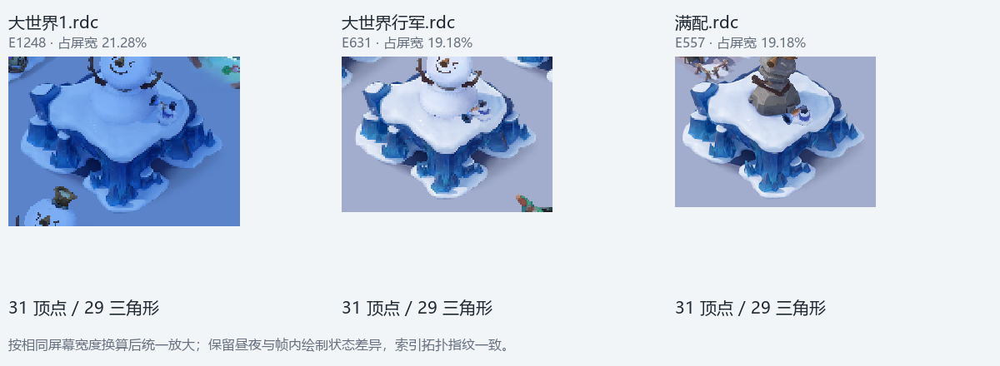

图注：同一建筑资源的不同实例；按相同屏幕宽度归一化后统一放大。截图取各目标绘制刚结束时，昼夜、上层装饰及遮挡不同。

| 截帧 / 绘制 | 占屏宽度 | 引用顶点 | 三角形 | 拓扑 |
| --- | --- | --- | --- | --- |
| 大世界1.rdc / E1248 | 21.282% | 31 | 29 | 三份相同 |
| 大世界行军.rdc / E631 | 19.184% | 31 | 29 | 三份相同 |
| 满配.rdc / E557 | 19.184% | 31 | 29 | 三份相同 |

<a id="toc-24-2"></a>

### 例二：另一组建筑底座

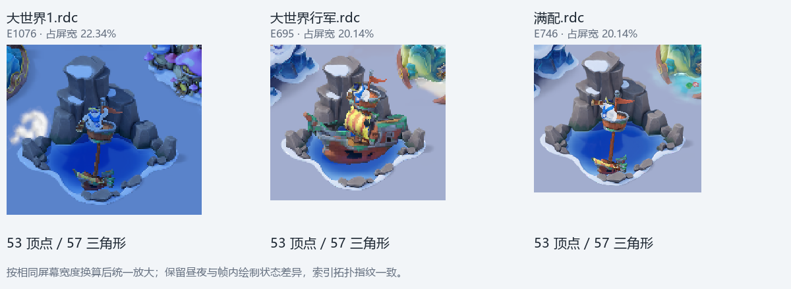

图注：同一建筑资源的不同实例；按相同屏幕宽度归一化后统一放大。截图取各目标绘制刚结束时，昼夜、上层装饰及遮挡不同。

| 截帧 / 绘制 | 占屏宽度 | 引用顶点 | 三角形 | 拓扑 |
| --- | --- | --- | --- | --- |
| 大世界1.rdc / E1076 | 22.338% | 53 | 57 | 三份相同 |
| 大世界行军.rdc / E695 | 20.136% | 53 | 57 | 三份相同 |
| 满配.rdc / E746 | 20.136% | 53 | 57 | 三份相同 |

**这里匹配的是建筑资源，不是已确认同一坐标的城堡实例。** 地图中心分别约为 (493,487)、(501,501)、(500,501)。占屏变化可能来自相机缩放等因素，不能直接换算世界距离；动画姿态造成的包围盒变化也没有被当成相机距离。

满配比低配多出的特效绘制属于前文的配置／对象状态差异，不能当作距离 LOD 证据。要确认完整 LOD 规则，还需要同一建筑、同一配置，从近到远跨更大缩放范围的连续抓帧；本轮已有文件中没有这种严格对照。

证据：evidence/mip-lod/lod\_summary.json；三份 geometry.json；两组引用位置、UV 与重编号后的索引拓扑 SHA-256。

<a id="texture-567750"></a>

## 25 · 纹理 567750：RGBA 与前后对比

> **配置核对：并非满配专用。** 满配 E582 与行军低配 E590 均采样 567743＋567750，Shader 相同；低配大世界1 E581 的真实回放确认 R 通道产生 1,698 个 RGB 像素变化。例二的亮度差异尚未归因到这张图，不能据此将其写成仅高配启用。

**567750 是与彩色图集 567743 配套的 RGBA 分区遮罩图。** 每个通道定义一组“哪些位置加多少颜色”，Shader 为四组分别配颜色和强度，再叠到基础颜色上。它不是骨骼矩阵图，也不是 VAT。

| 属性 | 捕获证据 |
| --- | --- |
| 纹理 | 567750 · 2048 × 2048 · RGBA8\_SRGB · 1 级 Mip · 16 MiB |
| 配套颜色图 | 567743 · 同样 2048²、RGBA8\_SRGB、单层；两图使用相同 UV |
| Shader 资源对 | 570089 / 570090；顶点阶段计算四路强度，片元阶段采样并叠加 |
| 使用事件 | 满配 E582；行军 E590；大世界1 E581、E1443、E1502，及其第二遍主场景对应事件 |
| 最终透明度 | 来自基础图采样 × 顶点颜色的 Alpha；不是遮罩 567750 的 A |

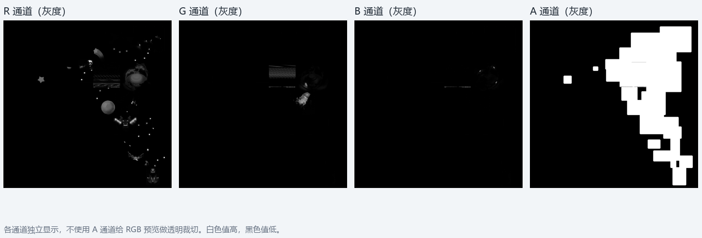

图注：四个通道单独以灰度显示，白色值大、黑色为零；RGB 预览不使用 A 做透明裁切。

<a id="toc-25-1"></a>

### RGBA 四个通道分别在做什么

| 通道 | 图里存的区域 | Shader 的使用方式 | 满配 E582 / 大世界1 E581 参数 |
| --- | --- | --- | --- |
| R | 分散光点、局部表面、纹理细线等；非零 texel 397,233 | 第 1 组附加颜色：mask.r × 顶点阶段强度.r × 颜色1.rgb × 颜色1.a | 暖色 \[0.21586, 0.07421, 0.01229\]，颜色强度 = 1；还要乘时间／顶点强度 |
| G | 另一组局部纹样和条纹；非零 texel 177,772 | 第 2 组附加颜色，独立颜色与强度 | 颜色强度 = 0，因此这两个 draw 的 G 颜色项关闭 |
| B | 更少、更暗的细节区域；非零 texel 117,533 | 第 3 组附加颜色，独立颜色与强度 | 颜色强度 = 0，因此这两个 draw 的 B 颜色项关闭 |
| A | 大片接近二值的区域；非零 texel 1,032,340 | 第 4 组附加颜色；不写最终透明度 | 颜色强度 = 0；不是“透明度为零”，而是第 4 组颜色项关闭 |

“R/G/B/A”是存储槽位，并不要求最终效果分别呈红、绿、蓝、透明。比如 R 也能驱动金色灯光，G 也能驱动橙色纹样；具体颜色由材质参数控制。上表区域描述来自图像，不能据此虚构源工程里诸如“灯光遮罩”一类原始字段名。

<a id="toc-25-2"></a>

### 实际计算关系

```text
M = 遮罩 RGBA × 顶点阶段四路强度
输出 RGB = 基础 RGB × 基础 Alpha + Σ（M通道 × 对应颜色.rgb × 对应颜色.a）
输出 Alpha = 基础 Alpha
```

这里“基础 RGB”已包含顶点颜色和全局颜色乘数，“基础 Alpha”包含基础图与顶点颜色 Alpha。顶点阶段使用正弦与另一张曲线纹理形成时间强度；567750 负责空间分区。动画曲线控制何时变亮，遮罩控制哪里变亮，颜色参数控制变成什么颜色。

本捕获以 sRGB 格式读取这张图：RGB 经 sRGB 解码，A 保持线性。不能只看通道预览就假设四路都按同一线性数值解释；是否沿用这种资源配置需结合项目原始制作约定。

<a id="toc-25-3"></a>

### 加入前后对比：真实截帧独立回放

> **567750 在此样本中主要让建筑局部灯点变亮。** 
> 
> 大世界1 E581：仅关闭四路遮罩附加颜色后，有  **1,698 个 RGB 像素** 变化；颜色目标的 Alpha 逐像素完全一致。仅保留 R 能重现原始效果；G/B/A 在当前参数下均无可见贡献。

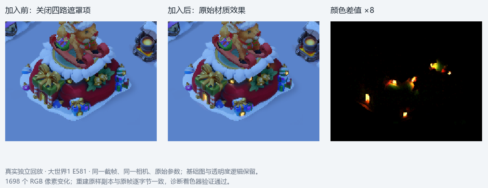

图注：同一截帧 E581：关闭遮罩颜色贡献 → 原始效果 → 颜色差值 ×8。左右使用相同裁切和放大比例，保留原始相机、基础贴图、时间与材质参数。

对照通过修改独立截帧副本中 570090 的四个颜色项生成，原始 RDC 未修改。先验证“原样重建副本”与原始回放逐字节一致，再用强制输出诊断确认代码改动确实生效，最后分别关闭／保留四个通道。关闭的是遮罩的颜色贡献，纹理绑定和采样仍保留，因此这组对照不能用于估计省掉该纹理的性能收益。

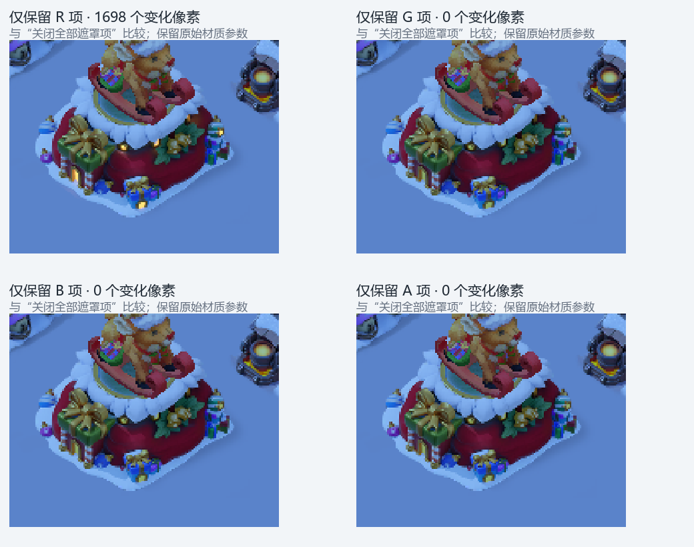

图注：真实回放逐通道隔离：变化像素数都相对于“关闭全部遮罩项”。R 为 1698，G/B/A 均为 0；后三张保留的是基础画面，并非没有绘制。

G/B/A 的 0 差异只描述这一帧的材质参数，不能推出通道没有数据或其他动画时刻永远不用。另核对到 E1443、E1502 及主场景末段 E5748，单独保留 R 也都能重现原图；后续 EID 的比较包含此前累计绘制，不把它们的变化像素当成单次 draw 的独立贡献。

<a id="toc-25-4"></a>

### 人为开启 G/B/A 时会怎样（原贴图材质示意）

下面是离线材质复原，帮助理解原帧未启用的通道；使用捕获中的完整贴图和已确认公式，并明确固定参数，不作为原游戏实测结果。

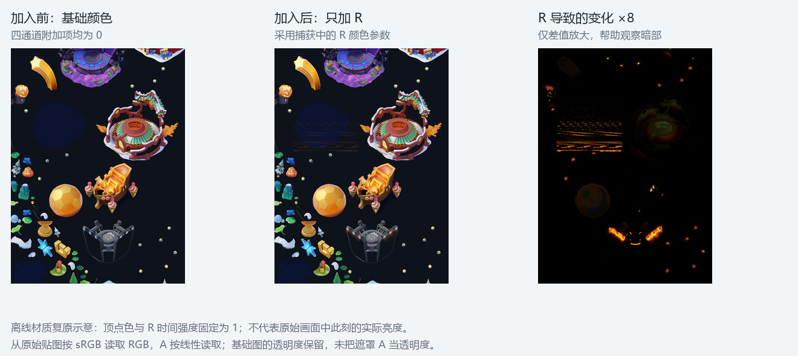

图注：基础颜色 → 加入 R 项 → RGB 差值 ×8。R 颜色使用捕获值；顶点色、基础颜色乘数和 R 时间强度固定为 1，因此亮度不等于夜景原帧。

![四行分别只开启一个通道；全部使用相同测试颜色 \[0.65, 0.20, 0.045\] 与强度 1。G/B/A 在此是人为开启，不能当作原帧已启用。](images/567750-逐通道材质示意.png)

图注：四行分别只开启一个通道；全部使用相同测试颜色 \[0.65, 0.20, 0.045\] 与强度 1。G/B/A 在此是人为开启，不能当作原帧已启用。

这是图集平面的材质示意，没有施加真实模型的网格覆盖、遮挡和时间曲线。A 的大片矩形会在示意中整块着色，不能理解为实际建筑会出现同样的矩形光块。它说明 A 数据被放入颜色加法项，而没有参与透明度输出。

<a id="toc-25-5"></a>

### 原始截帧中的使用位置

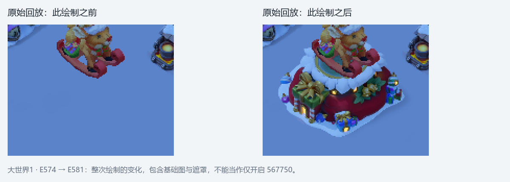

图注：真实原生回放：大世界1 E574 → E581，7019 个 RGB 像素变化。该 draw 画出了礼物／雪景建筑的底座，包含基础图和遮罩的共同结果。

**这张截图展示整次绘制的组成；单独加入 567750 的差异应以上方“关闭遮罩 → 原始效果”对照为准。** 两种对比回答不同问题：整次绘制画了哪个建筑部件，以及遮罩让这个部件的哪些位置变亮。

证据：evidence/shaders/570089\_vertex.txt、570090\_pixel.txt；evidence/mip-lod/mask-constants-\*.json、mask\_verified\_summary.json、mask-replay-variants.json；原始完整 RGBA 读回与独立截帧副本回放。
